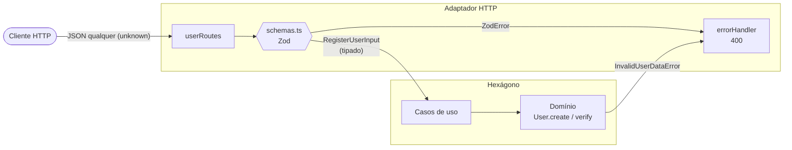

# Aula 09 — Cadastro com Zod e CQRS simples (arquitetura hexagonal)

É o mesmo projeto da [Aula 08](../../Aula08/cadastro/): o usuário se cadastra, recebe um **código de 6 dígitos por e-mail** e confirma a conta enviando esse código de volta.

A novidade é que **tudo o que entra na aplicação vindo de fora passa a ser validado com [Zod](https://zod.dev)**: o corpo das requisições HTTP e as variáveis do `.env`. O objetivo é mostrar **em que lugar do hexágono essa validação mora** e por que ela não substitui as regras do domínio.

Na segunda parte, a listagem ganha filtro e paginação, e os casos de uso se dividem em **commands** (escrita) e **queries** (leitura), num **CQRS simples**.

Material da aula: [`../aula09.md`](../aula09.md) (Zod) e [`../cqrs.md`](../cqrs.md) (CQRS).

---

## Como rodar

```bash
cd Aula09/cadastro
cp .env.example .env
npm install
npm run dev      # http://localhost:3009
npm test         # commands, queries e schemas do Zod, sem HTTP e sem SMTP
```

As requisições de exemplo estão em [`test.http`](test.http) (extensão REST Client do VS Code). No final do arquivo há uma seção **Aula 09** com os erros de formato barrados pelo Zod e as consultas com filtro e paginação.

## A API

| Método | Rota            | Corpo / query     | Respostas                                                          |
| ------ | --------------- | ----------------- | ------------------------------------------------------------------ |
| POST   | `/users`        | `{ name, email }` | 201 · 400 requisição inválida (Zod) ou dados inválidos (domínio) · 409 e-mail já usado |
| POST   | `/users/verify` | `{ email, code }` | 200 · 400 requisição inválida (Zod) ou código errado · 404 · 409 já verificado |
| GET    | `/users`        | `?verified=true\|false&page=1&pageSize=10` (todos opcionais; `pageSize` ≤ 50) | 200 `{ items, total, page, pageSize }` · 400 query inválida (Zod) |

> Na Aula 08, `GET /users` devolvia um array. Agora devolve uma página: `{ "items": [...], "total": 3, "page": 1, "pageSize": 10 }`.

Um erro do Zod devolve **todos** os campos com problema de uma vez:

```json
{
  "error": "Requisição inválida",
  "details": [
    { "field": "name",  "message": "Entrada inválida: esperava um texto, recebeu um número" },
    { "field": "email", "message": "Formato do endereço de e-mail inválido" }
  ]
}
```

## O que mudou em relação à Aula 08

| Arquivo | Mudança |
| ------- | ------- |
| [`src/adapters/http/schemas.ts`](src/adapters/http/schemas.ts) | **Novo.** Schemas Zod dos corpos de `POST /users` e `POST /users/verify` e da query string de `GET /users`. |
| [`src/adapters/http/userRoutes.ts`](src/adapters/http/userRoutes.ts) | O `requireStrings()` feito à mão deu lugar a `schema.parse(req.body)`. |
| [`src/adapters/http/errorHandler.ts`](src/adapters/http/errorHandler.ts) | Traduz `ZodError` → 400 com a lista de campos; JSON malformado → 400 (antes era 500). |
| `src/application/useCases/` → [`commands/`](src/application/commands/) + [`queries/`](src/application/queries/) | **CQRS.** `RegisterUser` e `VerifyUser` viraram commands e exportam o tipo da entrada (`RegisterUserInput`, `VerifyUserInput`). `ListUsers` virou query, com filtro e paginação. **Nenhum importa o Zod.** |
| [`src/application/ports/UserRepository.ts`](src/application/ports/UserRepository.ts) | **CQRS.** Perdeu o `findAll()`: agora só serve à escrita. |
| [`src/application/ports/UserQueries.ts`](src/application/ports/UserQueries.ts) | **Novo (CQRS).** Porta de leitura: devolve `Page<UserSummary>` (DTOs), não entidades. |
| [`src/adapters/memory/`](src/adapters/memory/) | **CQRS.** `InMemoryDatabase` (novo) é compartilhado por `InMemoryUserRepository` e `InMemoryUserQueries` (novo). |
| [`src/config.ts`](src/config.ts) | **Novo.** Valida o `.env` com Zod na inicialização. |
| [`src/index.ts`](src/index.ts) | Usa `loadConfig()`, liga as mensagens do Zod em português e conecta os lados de escrita e de leitura ao mesmo banco. |
| [`test/schemas.test.ts`](test/schemas.test.ts) | **Novo.** Testa os schemas sem subir o servidor. |
| [`test/cadastro.test.ts`](test/cadastro.test.ts) | Ganhou testes da query (filtro, ordem e paginação). |
| `src/domain/` | **Nada.** O domínio não sabe que o Zod existe. |

---

## O mapa do projeto

```
src/
├── domain/                      ← NÚCLEO: não importa nada de fora (nem Zod)
│   ├── User.ts                    entidade + regras de NEGÓCIO
│   └── errors.ts
├── application/
│   ├── ports/
│   │   ├── UserRepository.ts      porta de ESCRITA (entidades)
│   │   ├── UserQueries.ts         porta de LEITURA (DTOs, filtro, paginação)
│   │   ├── EmailSender.ts
│   │   └── CodeGenerator.ts
│   ├── commands/                ← ESCRITA: RegisterUser, VerifyUser (passam pelo domínio)
│   └── queries/                 ← LEITURA: ListUsers (não passa pelo domínio)
├── adapters/
│   ├── http/                      primário (driving): Express
│   │   ├── schemas.ts             ← Zod: valida o FORMATO do request
│   │   ├── userRoutes.ts
│   │   └── errorHandler.ts        ← ZodError → 400
│   ├── memory/                    secundário: InMemoryDatabase compartilhado pelo
│   │                                repositório (escrita) e pelas queries (leitura)
│   ├── email/  code/              secundários (iguais à Aula 08)
├── config.ts                    ← Zod: valida o .env (composition root)
└── index.ts                     ← COMPOSITION ROOT
```



---

## Roteiro de leitura (para a aula)

O diagrama da separação entre escrita e leitura está em [`../cqrs.md`](../cqrs.md#3-como-ficou-o-projeto).

### 1. O contrato — [`src/application/commands/RegisterUser.ts`](src/application/commands/RegisterUser.ts)

- `RegisterUserInput` é uma `interface` TypeScript comum. **É o núcleo que define o formato da entrada**, não o Zod.
- Observe os imports: nenhum `zod`.

### 2. O schema — [`src/adapters/http/schemas.ts`](src/adapters/http/schemas.ts)

- `z.object({...})` descreve o corpo esperado. `trim()`, `max()`, `z.email()` e `regex()` cuidam de **formato**.
- `satisfies z.ZodType<RegisterUserInput>`: se o schema e o contrato divergirem, **o projeto não compila**. Experimente renomear `name` para `nome` e rodar `npx tsc --noEmit`.
- Pergunta para a turma: *por que o schema não exige nome com pelo menos 2 letras, se o domínio exige?*

### 3. A rota — [`src/adapters/http/userRoutes.ts`](src/adapters/http/userRoutes.ts)

- `registerUserSchema.parse(req.body)` devolve um objeto **já tipado** — passe o mouse sobre `input` no VS Code. Não há nenhum `as`.
- Se o corpo for inválido, `parse` lança `ZodError`, e o Express 5 o encaminha ao `errorHandler`.

### 4. O tratamento de erro — [`src/adapters/http/errorHandler.ts`](src/adapters/http/errorHandler.ts)

- Duas origens de 400 com respostas diferentes: `ZodError` (o cliente mandou algo mal formado) e `InvalidUserDataError` (o dado está bem formado, mas viola uma regra de negócio).

### 5. A configuração — [`src/config.ts`](src/config.ts)

- O `.env` é só texto. `z.coerce.number()` e `z.stringbool()` convertem; `z.enum()` restringe `EMAIL_STRATEGY`.
- Se faltar `SMTP_USER` com `EMAIL_STRATEGY=nodemailer`, a API **não sobe** e diz o que está errado.

### 6. CQRS: as duas portas — [`UserRepository`](src/application/ports/UserRepository.ts) × [`UserQueries`](src/application/ports/UserQueries.ts)

- Compare as duas: a de escrita trabalha com a entidade `User`; a de leitura devolve `UserSummary` e sabe paginar.
- Abra [`queries/ListUsers.ts`](src/application/queries/ListUsers.ts): ele **não importa nada de `domain/`**.
- [`InMemoryUserQueries`](src/adapters/memory/InMemoryUserQueries.ts) traz, em comentário, como seria a mesma consulta com Prisma.
- Em [`schemas.ts`](src/adapters/http/schemas.ts), `listUsersQuerySchema` mostra `z.coerce.number()` e `z.stringbool()` convertendo a query string, que sempre chega como texto.

### 7. Os testes — [`test/`](test/)

- Schemas são valores comuns: dá para testá-los com `safeParse` sem Express.
- Um dos testes documenta a divisão de responsabilidades: nome com 1 letra **passa** no Zod.
- Os testes de query mostram que o que os commands gravam a query enxerga, porque é o mesmo armazenamento.

---

## Demonstração sugerida

1. Rode `npm run dev` e dispare, no `test.http`, o `POST /users` com `{}`: a resposta lista **os dois** campos de uma vez (o `requireStrings` da Aula 08 parava no primeiro).
2. Mande `{ "name": "A", "email": "a@ifrs.edu.br" }`: o Zod deixa passar, quem barra é o **domínio**. Compare as duas respostas de 400.
3. Mande `"verified": true` no cadastro: o campo é descartado e o usuário continua não verificado.
4. Pare a API e rode `EMAIL_STRATEGY=sms npm run dev`: a aplicação se recusa a subir.
5. Cadastre três usuários, verifique um e chame `GET /users?verified=false&pageSize=1&page=2`. Depois mande `?page=0&pageSize=999`: o Zod devolve os dois erros.
6. `git diff --no-index ../../Aula08/cadastro/src/domain src/domain`: **nenhuma diferença**, nem com Zod nem com CQRS.

## Exercícios

1. **Middleware genérico:** escreva `validateBody(schema)` (um middleware Express que faz o `parse` e substitui `req.body`) e use-o nas rotas. O que se ganha e o que se perde em relação ao `parse` dentro do handler? (Dica: o tipo de `req.body`.)
2. **Ordenação:** aceite `?sort=name` ou `?sort=-name` com `z.enum([...])`. Em que camada o texto `-name` vira algo como `{ field: 'name', direction: 'desc' }`?
3. **Modo estrito:** troque `z.object` por `z.strictObject` em `registerUserSchema`. O que acontece com o request que manda `verified: true`? Qual comportamento você prefere numa API pública?
4. **Resposta:** crie um schema para a **saída** de `ListUsers` e use-o num teste para garantir que `verificationCode` nunca aparece na resposta.
5. **Mais CQRS:** veja os exercícios no fim de [`../cqrs.md`](../cqrs.md#exercícios).
6. **Senha (continuação da Aula 08):** adicione `password` ao cadastro. Que regras vão no schema (ex.: tamanho máximo) e quais vão no domínio (ex.: força mínima da senha)? Justifique.
