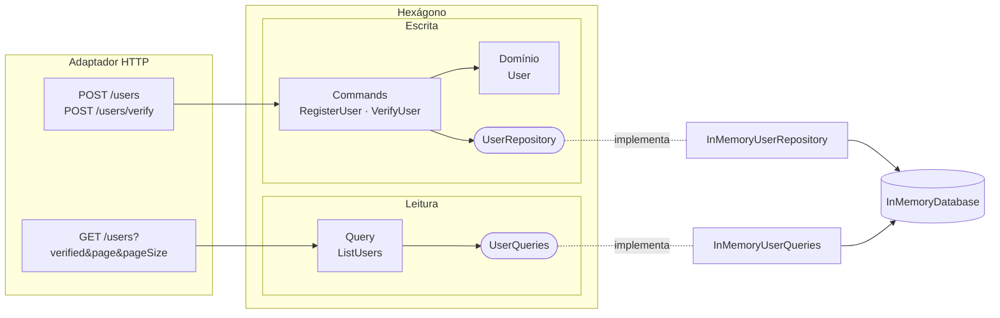

# CQRS simples na arquitetura hexagonal

Material complementar da [Aula 09](aula09.md). O código está em [`cadastro/`](cadastro/); este arquivo explica o **porquê** da separação entre comandos e consultas e mostra como ela se encaixa no hexágono que já vem sendo construído desde a [Aula 06](../Aula06/arquitetura-hexagonal.md).

---

## 1. O problema: ler e escrever têm necessidades diferentes

Na Aula 08 a listagem de usuários era assim:

```ts
// ListUsers (Aula 08)
const users = await this.users.findAll();   // carrega TODAS as entidades User
return users.map((u) => ({ name: u.name, email: u.email, verified: u.verified }));
```

E o mesmo `UserRepository` servia aos dois lados:

```ts
interface UserRepository {
  findByEmail(email: string): Promise<User | undefined>;  // usado para ESCREVER
  findAll(): Promise<User[]>;                             // usado só para LER
  save(user: User): Promise<void>;                        // usado para ESCREVER
}
```

Funciona com três usuários. Agora imagine o requisito "listar usuários verificados, 10 por página, em ordem alfabética":

- Com `findAll()`, o banco devolve **todos** os usuários, com **todas** as colunas (inclusive o código de verificação), e o filtro e a paginação acontecem em memória, no Node.
- A alternativa ingênua é ir adicionando métodos no repositório: `findAllVerified()`, `findAllPaginated(page, size)`, `findAllVerifiedPaginatedOrderedByName(...)`. A porta que deveria proteger as invariantes do domínio vira um catálogo de consultas de tela.

Essa é a observação por trás do CQRS: **escrever e ler são problemas diferentes**.

| | Escrita (alterar o estado) | Leitura (consultar o estado) |
| --- | --- | --- |
| Precisa do domínio? | **Sim.** É ali que as regras moram (`user.verify(code)`). | **Não.** Nenhuma regra roda para mostrar uma lista. |
| Formato ideal | A entidade completa, para aplicar a regra | Só os campos que a tela/cliente vai mostrar |
| Quantidade | Normalmente **um** agregado por vez | Muitos registros, com filtro, ordenação e paginação |
| Muda quando | Muda a regra de negócio | Muda a tela, o relatório, o filtro |

## 2. O que é CQRS

**CQRS** (*Command Query Responsibility Segregation*) é separar, no código, o caminho das operações que **alteram** o estado (*commands*) do caminho das operações que **consultam** o estado (*queries*).

A ideia vem de um princípio mais antigo, o **CQS** (*Command Query Separation*, de Bertrand Meyer), que vale para um método: *um método ou altera o estado, ou devolve um dado; nunca os dois*. O CQRS leva isso para a escala da arquitetura: **objetos e portas diferentes** para cada lado.

- **Command:** expressa uma intenção ("cadastre este usuário", "verifique este código"). Passa pelo domínio, pode falhar por regra de negócio, altera o estado. Devolve no máximo uma confirmação.
- **Query:** faz uma pergunta ("quais usuários estão verificados?"). Não altera nada, não passa pelo domínio e devolve dados prontos para exibir.

### "Simples" em que sentido?

CQRS tem um espectro grande. Este projeto fica no começo dele, de propósito:

| Nível | O que se separa | Neste projeto? |
| ----- | --------------- | -------------- |
| 1. Separar no código | Pastas `commands/` e `queries/`; portas de escrita e de leitura diferentes; **o mesmo banco** | ✅ **Sim** |
| 2. Modelos de leitura próprios | Tabelas ou *views* desnormalizadas só para leitura, atualizadas junto com a escrita | ❌ Não |
| 3. Bancos separados | Escrita num banco, leitura em outro (ex.: PostgreSQL + Elasticsearch), sincronizados por **eventos** | ❌ Não |
| 4. Com *bus* | Controller despacha um objeto `Command`/`Query` num barramento, que encontra o *handler* | ❌ Não (citado no material da Aula 06) |

Os níveis 2 e 3 trazem **consistência eventual**: logo depois de uma escrita, a leitura pode ainda não enxergar o dado novo. Isso é um custo real, e é o principal motivo para **não** começar por eles. No nível 1 esse problema não existe, porque os dois lados leem o mesmo armazenamento.

---

## 3. Como ficou o projeto

```
src/application/
├── commands/                ← ESCRITA: passam pelo domínio
│   ├── RegisterUser.ts
│   └── VerifyUser.ts
├── queries/                 ← LEITURA: não passam pelo domínio
│   └── ListUsers.ts
└── ports/
    ├── UserRepository.ts    ← porta de escrita: findByEmail + save (perdeu o findAll)
    ├── UserQueries.ts       ← porta de leitura: list(filtro) → Page<UserSummary>
    ├── EmailSender.ts
    └── CodeGenerator.ts

src/adapters/memory/
├── InMemoryDatabase.ts      ← o "banco" compartilhado
├── InMemoryUserRepository.ts   implementa UserRepository
└── InMemoryUserQueries.ts      implementa UserQueries
```



Repare em três coisas no diagrama:

1. **A query não toca o domínio.** Não existe seta de `ListUsers` para `User`.
2. **Cada lado tem a sua porta**, desenhada para o que ele precisa.
3. **Os dois adaptadores apontam para o mesmo banco.** CQRS separou os *caminhos*, não os *dados*.

### A porta de escrita encolheu

```ts
export interface UserRepository {
  findByEmail(email: string): Promise<User | undefined>;
  save(user: User): Promise<void>;
}
```

O `findAll()` saiu porque **nenhum command precisava dele**. Esse é um efeito colateral bom do CQRS: a porta de escrita fica pequena, estável e focada nas invariantes. Telas novas não mexem mais nela.

### A porta de leitura fala a língua da consulta (mas ainda do negócio)

```ts
export interface UserQueries {
  list(filter: { verified?: boolean; page: number; pageSize: number }): Promise<Page<UserSummary>>;
}
```

- Devolve `UserSummary` (um DTO), **não** `User`. O código de verificação nem chega a sair do armazenamento.
- Sabe filtrar e paginar.
- **Não** é um disfarce para SQL: não tem `where`, `skip`, `take` nem `runQuery(sql)`. Isso respeita o "erro comum nº 2" do [material da Aula 06](../Aula06/arquitetura-hexagonal.md#erros-comuns): a porta não pode imitar a API da ferramenta.

### Com Prisma, cada lado usaria o banco do jeito que precisa

```ts
// Escrita: PrismaUserRepository — carrega a linha e reconstrói a ENTIDADE
const row = await prisma.user.findUnique({ where: { email } });
return row ? User.restore(row) : undefined;

// Leitura: PrismaUserQueries — só as colunas da resposta, paginado no banco
const where = filter.verified === undefined ? {} : { verified: filter.verified };
const [items, total] = await Promise.all([
  prisma.user.findMany({
    where,
    select: { name: true, email: true, verified: true },
    orderBy: { name: 'asc' },
    skip: (filter.page - 1) * filter.pageSize,
    take: filter.pageSize,
  }),
  prisma.user.count({ where }),
]);
```

O lado da leitura pode usar à vontade tudo o que o banco oferece (`select`, índices, *joins*, até SQL puro para um relatório pesado). Isso é seguro porque **nenhuma regra de negócio depende dele**.

### O HTTP e o Zod (ligação com a primeira parte da aula)

A query string é outra entrada externa, e toda ela chega como **texto**. O schema converte e limita:

```ts
export const listUsersQuerySchema = z.object({
  verified: z.stringbool().optional(),                         // "true" → true
  page: z.coerce.number().int().min(1).default(1),             // "2"    → 2
  pageSize: z.coerce.number().int().min(1).max(50).default(10) // protege contra pageSize=1000000
}) satisfies z.ZodType<ListUsersInput>;
```

```
GET /users?verified=true&page=1&pageSize=10

{ "items": [{ "name": "Bruno", "email": "bruno@ifrs.edu.br", "verified": true }],
  "total": 1, "page": 1, "pageSize": 10 }
```

> **Atenção:** o formato da resposta de `GET /users` mudou em relação à Aula 08: era um array e agora é um objeto `{ items, total, page, pageSize }`. Numa API pública isso **quebraria clientes**. Seria preciso versionar (`/v2/users`) ou manter o formato antigo enquanto os clientes migram.

---

## 4. Perguntas que aparecem em aula

### "A query é só um repasse. Isso não é a indireção sem decisão que a Aula 06 critica?"

É uma boa crítica. Hoje `ListUsers.execute()` só chama `this.queries.list(input)`. Há duas posições defensáveis:

- **Manter a classe de query** (escolha deste projeto): a porta de entrada fica simétrica (o HTTP sempre chama um objeto da camada de aplicação) e há um lugar óbvio para o que vier: autorização ("só admin vê a lista"), log de auditoria, limites por perfil de usuário.
- **O adaptador HTTP chama `UserQueries` direto:** menos uma classe. Muitos projetos fazem isso para leituras simples.

O importante é a turma saber **justificar** a escolha.

### "Uma query pode chamar o domínio?"

Pode, mas, se precisar, desconfie. Se uma leitura precisa de uma regra de negócio (ex.: "usuário está ativo se verificou e logou nos últimos 30 dias"), talvez essa regra devesse estar **gravada** no estado (calculada na escrita) ou ser um conceito explícito do domínio. Leituras que reconstroem entidades só para chamar um *getter* perdem a vantagem do CQRS.

### "Um command pode devolver dados?"

Pelo CQS puro, não. Na prática, devolver o **identificador** ou um resumo do que foi criado (como o `RegisterUser` faz, para o `201`) é aceito quase universalmente. O que se evita é o command virar uma consulta disfarçada, devolvendo listas ou dados de outras entidades.

### "E se a leitura e a escrita precisarem de bancos diferentes?"

Aí entram os níveis 2 e 3 da tabela. A escrita publica um **evento** (`UserVerified`), e um *projetor* atualiza o modelo de leitura. Essa é exatamente a ponte para **eventos de domínio** e **mensageria** (ideias 5 e 7 em [`IdeiasHexagonal`](../IdeiasHexagonal/README.md)). Graças à porta `UserQueries`, essa mudança seria **só de adaptador**: a query e o HTTP não mudariam.

---

## 5. Quando vale a pena

**Vale (pelo menos o nível 1):**
- Telas com filtros, ordenação, paginação, relatórios e agregações.
- O repositório de escrita está crescendo com métodos `findAllBy...` que só servem a telas.
- Leitura e escrita têm volumes ou requisitos de desempenho muito diferentes.

**Não vale (ou ainda não):**
- CRUD sem regra de negócio, em que a escrita é "salvar o que veio".
- Começar direto pelos níveis 2 e 3 "porque escala". A consistência eventual é complexidade que precisa de um motivo concreto.

## 6. Resumo

- **Command** altera o estado e passa pelo domínio; **query** consulta e não passa.
- Cada lado tem a sua **porta**: `UserRepository` (entidades, pequena e estável) e `UserQueries` (DTOs, filtro, paginação).
- No **CQRS simples** os dois lados compartilham o **mesmo banco**: não há consistência eventual.
- A regra de dependência continua igual: commands, queries e portas não importam Express, Zod nem Prisma.
- A separação prepara o terreno para modelos de leitura próprios e eventos, sem obrigar ninguém a usá-los hoje.

## Exercícios

1. **Detalhe de um usuário:** crie a query `GetUserByEmail` e a rota `GET /users/:email`, devolvendo 404 se não existir. Ela usa `UserQueries` ou `UserRepository`? Por quê?
2. **Busca por nome:** acrescente `search` ao filtro (`?search=an` encontra "Ana" e "Fernando"). O que muda em cada camada? Algo muda no domínio?
3. **Estatística:** crie a query `GetUsersStats` → `{ total, verified, pending }`. Implemente-a sem carregar a lista inteira, como você faria com `prisma.user.count`?
4. **Prisma:** implemente `PrismaUserRepository` e `PrismaUserQueries` compartilhando o mesmo `PrismaClient`. Quais tipos do Prisma você precisou impedir de vazar?
5. **Discussão:** remova a classe `ListUsers` e faça a rota chamar `UserQueries` direto. Compare os dois lados: o que se ganhou e o que se perdeu?

## Referências

- FOWLER, Martin. **CQRS.** 2011. Disponível em: <https://martinfowler.com/bliki/CQRS.html>.
- FOWLER, Martin. **CommandQuerySeparation.** 2005. Disponível em: <https://martinfowler.com/bliki/CommandQuerySeparation.html>.
- GRAÇA, Herberto. **Explicit Architecture #1.** 2017. Seção sobre *Command/Query Bus*. Disponível em: <https://herbertograca.com/2017/11/16/explicit-architecture-01-ddd-hexagonal-onion-clean-cqrs-how-i-put-it-all-together/>.
- MICROSOFT. **CQRS pattern.** Azure Architecture Center. Disponível em: <https://learn.microsoft.com/azure/architecture/patterns/cqrs>.
