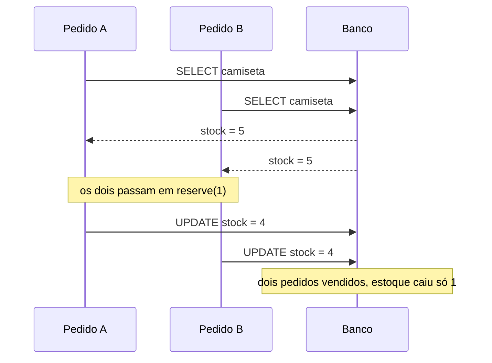
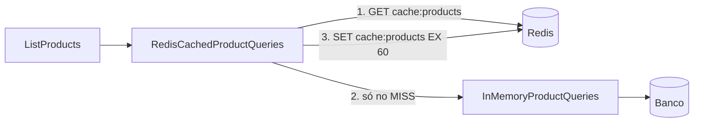
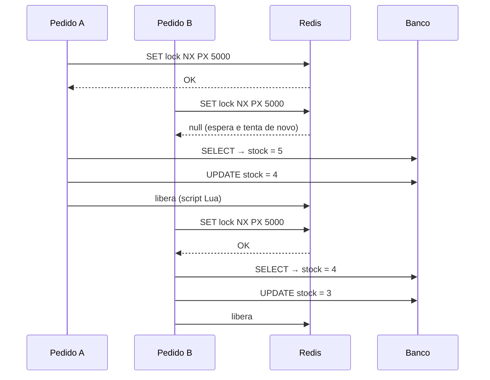
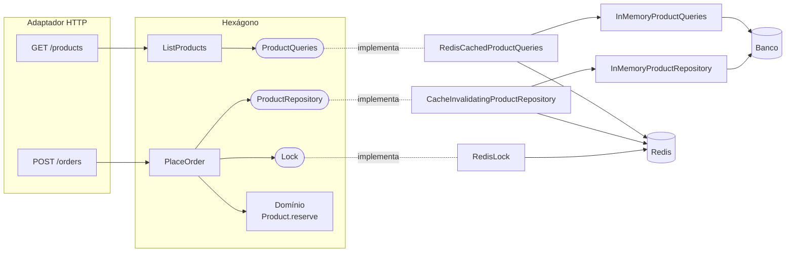

# Aula 10 — Redis: cache de leitura e lock distribuído

## Objetivo

Partir de uma API de pedidos bem simples, com dois problemas que aparecem em qualquer sistema que começa a ter usuários, e resolver os dois com o **Redis**:

1. **Bater menos no banco** nas listagens → **cache**.
2. **Chavear uma operação complexa**, para que duas requisições não a executem ao mesmo tempo sobre o mesmo recurso → **lock distribuído**.

Tudo continua na organização hexagonal + CQRS das aulas [06](../Aula06/arquitetura-hexagonal.md) e [09](../Aula09/cqrs.md). Um dos objetivos é mostrar que o Redis entra **só nos adaptadores e no composition root**: o domínio não muda.

## Material desta pasta

- [`pedidos-sem-redis/`](pedidos-sem-redis/): versão 1. Funciona, mas a listagem sempre vai ao banco e pedidos simultâneos vendem mais do que o estoque.
- [`pedidos-com-redis/`](pedidos-com-redis/): versão 2. O mesmo projeto, com cache na listagem e lock no pedido. Traz o `docker-compose.yml` do Redis.

```bash
# Versão 1
cd pedidos-sem-redis
npm install
npm test               # o teste de concorrência FALHA de propósito
npm run dev            # http://localhost:3010

# Versão 2 (pare a versão 1 antes: as duas usam a porta 3010)
cd ../pedidos-com-redis
docker compose up -d   # sobe o Redis em localhost:6379
npm install
npm test               # agora o mesmo teste passa
npm run dev
```

Para comparar as duas versões arquivo por arquivo:

```bash
git diff --no-index pedidos-sem-redis/src pedidos-com-redis/src
```

---

## 1. A API de pedidos

| Método | Rota        | O que faz |
| ------ | ----------- | --------- |
| GET    | `/products` | Vitrine: lista os produtos com preço e estoque. A rota **mais chamada** da loja. |
| POST   | `/orders`   | Compra `{ productId, quantity }`. |
| GET    | `/orders`   | Lista os pedidos gravados. |

Há também `GET /debug/stats` (quantas consultas chegaram ao banco) e `POST /debug/reset` (volta ao estoque inicial), que existem só para a aula.

O banco é um [`SlowDatabase`](pedidos-sem-redis/src/adapters/memory/SlowDatabase.ts) em memória que imita um banco de verdade em três pontos:

- **cada consulta demora**: 300 ms para listar a tabela, 20 ms para ler ou gravar uma linha;
- **cada leitura devolve uma cópia** da linha, como acontece quando um banco manda o resultado pela rede;
- **ele conta as consultas**, para medirmos o ganho do cache.

Fazer um pedido ([`PlaceOrder`](pedidos-sem-redis/src/application/commands/PlaceOrder.ts)) é uma operação com cinco passos e duas dependências externas (o banco e o meio de pagamento):

```ts
const product = await this.products.findById(input.productId);   // 1. ler o produto
product.reserve(input.quantity);                                   // 2. regra: tem estoque?
const order = Order.place(product, input.quantity);
await this.payments.charge(order.totalCents, ...);                 // 3. cobrar (100 ms)
await this.products.save(product);                                 // 4. gravar o novo estoque
await this.orders.save(order);                                     // 5. gravar o pedido
```

A regra do domínio ([`Product.reserve`](pedidos-sem-redis/src/domain/Product.ts)) está **certa**: não deixa reservar mais do que existe. Mesmo assim, a versão 1 vende mais do que tem.

---

## 2. Problema 1: a condição de corrida

> "Mas o Node não é *single-thread*? Como duas requisições rodam ao mesmo tempo?"

O Node executa **um trecho de JavaScript por vez**, mas a cada `await` a função pausa e o Node vai atender **outra requisição**. Com 20 pedidos da camiseta chegando juntos (estoque 5):



Os 20 executam o passo 1 antes de qualquer um chegar ao passo 4. Todos leem `stock = 5`, todos passam na regra e todos gravam `stock = 4`. Esse padrão (ler, decidir com base no que leu, gravar) se chama **read-modify-write**, e o defeito tem nome: **atualização perdida** (*lost update*).

O teste [`concorrencia.test.ts`](pedidos-sem-redis/test/concorrencia.test.ts) dispara as 20 requisições com `Promise.all` e descreve o resultado **correto**. Na versão 1 ele falha:

```
  + actual - expected
    {
  +   estoqueFinal: 4,
  +   pedidosAceitos: 20,
  +   pedidosGravadosNoBanco: 20,
  +   pedidosRecusados: 0
  -   estoqueFinal: 0,
  -   pedidosAceitos: 5,
  -   pedidosGravadosNoBanco: 5,
  -   pedidosRecusados: 15
    }
```

Vinte camisetas vendidas e cobradas, cinco no estoque, e o sistema ainda acha que sobraram quatro.

### "Por que não um mutex em memória?"

Funcionaria **enquanto houver um único processo**. Em produção quase nunca é assim: a API roda em várias instâncias (PM2 em modo *cluster*, várias réplicas atrás de um *load balancer*, vários *pods* no Kubernetes). Cada instância tem a **sua** memória, e um mutex em memória só segura as requisições que caíram na mesma instância.

O lock precisa morar num lugar que **todas as instâncias enxergam**. O Redis é esse lugar.

### "E uma transação do banco?"

Para **só** decrementar o estoque, o banco resolve, e é a melhor solução: um `UPDATE products SET stock = stock - 1 WHERE id = ? AND stock >= 1` é atômico, ou então `SELECT ... FOR UPDATE` dentro de uma transação.

O problema é quando a operação **sai do banco**: aqui, entre ler e gravar existe uma cobrança num meio de pagamento externo. Uma transação do banco não cobre uma chamada HTTP para outro serviço, nem um e-mail, nem uma fila. O lock no Redis cobre a operação inteira, com quantos passos e sistemas ela tiver. É isso que significa **chavear uma operação complexa**.

---

## 3. Problema 2: a listagem sempre vai ao banco

`GET /products` é a vitrine: é chamada por todo mundo que abre a loja e muda pouco (só quando alguém compra). Mesmo assim, cada chamada é um `SELECT` de 300 ms:

```
[db #1] SELECT * FROM products ORDER BY name
[db #2] SELECT * FROM products ORDER BY name
[db #3] SELECT * FROM products ORDER BY name
...
```

O teste [`listagem.test.ts`](pedidos-sem-redis/test/listagem.test.ts) confirma: **20 listagens = 20 consultas**. Com mil usuários abrindo a loja, o banco responde mil vezes a mesma pergunta, com a mesma resposta.

---

## 4. O Redis

O **Redis** é um banco **chave-valor em memória**. Para esta aula, três características importam:

| Característica | Por que importa |
| -------------- | --------------- |
| Os dados ficam em memória | Um `GET` responde em menos de 1 ms. Ótimo para cache. |
| Executa **um comando por vez** | Não existe "dois `SET` ao mesmo tempo": é isso que torna o lock possível. |
| Chaves podem ter **validade (TTL)** | A chave some sozinha depois de N segundos. Serve ao cache (dado velho expira) e ao lock (lock esquecido expira). |

E ele é um **serviço separado**: todas as instâncias da API falam com o mesmo Redis.

Ele sobe pelo [`docker-compose.yml`](pedidos-com-redis/docker-compose.yml) da versão 2:

```bash
docker compose up -d                          # sobe
docker compose exec redis redis-cli           # console: KEYS *, GET cache:products, TTL cache:products
docker compose exec redis redis-cli monitor   # mostra AO VIVO cada comando que a API manda
```

> **Dica para a aula:** deixe o `monitor` aberto num terminal ao lado da API durante as demonstrações.

---

## 5. Ganho 1: cache da listagem (*cache-aside*)



A estratégia se chama **cache-aside**:

1. Procura a resposta no Redis.
2. Achou (**HIT**)? Devolve, sem tocar no banco.
3. Não achou (**MISS**)? Vai ao banco, guarda a resposta no Redis com validade de 60 s e devolve.

Em [`RedisCachedProductQueries.ts`](pedidos-com-redis/src/adapters/redis/RedisCachedProductQueries.ts):

```ts
async list(): Promise<ProductSummary[]> {
  const cached = await this.redis.get('cache:products');
  if (cached) return JSON.parse(cached);                    // HIT

  const fresh = await this.inner.list();                    // MISS: vai ao banco
  await this.redis.set('cache:products', JSON.stringify(fresh), {
    expiration: { type: 'EX', value: 60 },
  });
  return fresh;
}
```

Repare que a classe **implementa a mesma porta** (`ProductQueries`) e **envolve** o adaptador do banco. É o padrão **Decorator**: nem o caso de uso `ListProducts` nem a porta mudaram. O cache foi ligado só no [`app.ts`](pedidos-com-redis/src/app.ts).

### O problema que o cache cria: dado velho

Se alguém compra uma caneca, o estoque no banco muda, mas o Redis continua com a listagem antiga. Duas defesas, que trabalham juntas:

- **Invalidação:** ao gravar um produto, apagar a chave. Feito por outro decorator, [`CacheInvalidatingProductRepository`](pedidos-com-redis/src/adapters/redis/CacheInvalidatingProductRepository.ts), que envolve o repositório de escrita.
- **TTL:** mesmo que alguma invalidação se perca, em no máximo 60 s a chave expira.

> Há só duas coisas difíceis em Ciência da Computação: invalidação de cache e dar nomes às coisas. — Phil Karlton

### O resultado

| | Sem Redis | Com Redis |
| --- | --- | --- |
| 20 listagens seguidas | 20 consultas ao banco | **1** consulta (1 MISS + 19 HITs) |
| Tempo de cada listagem | ~300 ms | ~300 ms na 1ª, ~1 ms nas demais |
| Tempo total (`npm run listagem`) | ~6 s | ~0,3 s |

Os testes [`listagem.test.ts`](pedidos-com-redis/test/listagem.test.ts) da versão 2 verificam as duas coisas: 20 listagens = 1 consulta, e depois de um pedido a listagem mostra o estoque novo.

### O que (não) colocar em cache

Bons candidatos: leituras **frequentes**, que **mudam pouco** e que podem estar **alguns segundos atrasadas** sem causar dano (vitrine, catálogo, configurações, rankings).

Maus candidatos: o dado usado para **decidir** algo. Repare que o `PlaceOrder` lê o estoque pelo `ProductRepository`, direto do banco, e **nunca** pelo cache. Reservar estoque com base numa listagem de 30 segundos atrás traria o problema da seção 2 de volta.

---

## 6. Ganho 2: lock distribuído

### O comando

Tudo se apoia num único comando do Redis:

```
SET lock:product:camiseta 7f3c...e1 NX PX 5000
```

| Parte | Significado |
| ----- | ----------- |
| `lock:product:camiseta` | A chave do lock. **Um lock por produto**: pedidos da caneca não esperam pelos da camiseta. |
| `7f3c...e1` | Um *token* aleatório (UUID) de quem pegou o lock. |
| `NX` | Só grava se a chave **não existir**. Como o Redis executa um comando por vez, entre 20 pedidos simultâneos **exatamente um** recebe `OK`; os outros recebem `null`. |
| `PX 5000` | A chave expira em 5 s. Se a instância que pegou o lock travar ou cair, o produto não fica bloqueado para sempre. |

Quem recebeu `null` espera 25 ms e tenta de novo, até conseguir ou até desistir (10 s → `503`).

### Liberar só o que é seu

Para liberar, não basta `DEL`. Imagine: o pedido A demora mais de 5 s, o lock expira, o pedido B pega o lock... e A termina e apaga o lock **de B**. Por isso cada um guarda o seu token e só apaga se a chave ainda tiver esse token. Comparar e apagar precisa ser **uma operação só**, e o Redis garante isso para um script Lua:

```lua
if redis.call("GET", KEYS[1]) == ARGV[1] then
  return redis.call("DEL", KEYS[1])
end
return 0
```

Tudo isso está em [`RedisLock.ts`](pedidos-com-redis/src/adapters/redis/RedisLock.ts), atrás da porta [`Lock`](pedidos-com-redis/src/application/ports/Lock.ts):

```ts
export interface Lock {
  withLock<T>(key: string, fn: () => Promise<T>): Promise<T>;
}
```

### O caso de uso

[`PlaceOrder`](pedidos-com-redis/src/application/commands/PlaceOrder.ts) só passou a envolver os mesmos cinco passos num `withLock`:

```ts
execute(input: PlaceOrderInput): Promise<PlaceOrderOutput> {
  return this.lock.withLock(`lock:product:${input.productId}`, () => this.place(input));
}
```

Agora, quando o pedido B consegue o lock, o pedido A já gravou o estoque, e o passo 1 de B lê o valor atualizado.



O mesmo [`concorrencia.test.ts`](pedidos-com-redis/test/concorrencia.test.ts), **sem mudar uma linha de código**, agora passa: 5 aceitos, 15 recusados com `409`, estoque final 0.

### Por que o lock é uma porta e o cache não?

O cache é **transparente**: o caso de uso não precisa saber que ele existe, então ele entra como decorator de um adaptador.

O lock é uma **decisão do caso de uso**: é o `PlaceOrder` que sabe que *estes* passos, *para este* produto, não podem ser intercalados. Por isso ele aparece como dependência explícita (`Lock`), e o Redis continua escondido atrás da porta.

### Cuidados com o lock

- **O TTL precisa ser maior que a operação.** Se o pagamento demorar mais de 5 s, o lock expira no meio e outro pedido entra. Escolha o TTL com folga e meça a operação.
- **Lock serializa.** Pedidos do mesmo produto passam a ser atendidos um por vez: no `npm run ataque`, os 20 pedidos levam ~0,2 s sem lock (errado) e ~1,4 s com lock (certo). É o preço da consistência; por isso a chave é por produto, e não um lock global da loja.
- **Qualquer um que apague a chave quebra o lock.** Um `DEL` ou `FLUSHDB` vindo de outro lugar libera o produto no meio de um pedido. Isso aconteceu de verdade ao escrever esta aula: o `node --test` roda os arquivos de teste em paralelo, o `flushDb()` de um teste apagou o lock do outro e um 6º pedido passou. Por isso o `npm test` da versão 2 usa `--test-concurrency=1`.
- **Um único Redis é um ponto único de falha.** Se ele cair, ninguém compra. Para ambientes mais exigentes existem o algoritmo *Redlock* (vários Redis) e os *fencing tokens*. Ficam fora do escopo desta aula.

---

## 7. Onde o Redis entrou no hexágono



| Arquivo | Mudou? |
| ------- | ------ |
| `src/domain/` | **Não** |
| `ListProducts`, `ListOrders`, portas antigas, rotas HTTP | **Não** |
| `src/application/ports/Lock.ts` | **Novo** (porta) |
| `src/application/commands/PlaceOrder.ts` | Envolve os passos em `lock.withLock(...)` |
| `src/adapters/redis/` | **Novo**: `RedisCachedProductQueries`, `CacheInvalidatingProductRepository`, `RedisLock`, `redisClient` |
| `src/app.ts` | Liga os decorators e o lock (composition root) |
| `errorHandler.ts` | `LockTimeoutError` → 503 |

---

## 8. Roteiro de demonstração

Deixe três terminais lado a lado: a API, o `redis-cli monitor` e um terminal para os comandos.

**Versão 1 (sem Redis)**

1. `npm test`: mostre o diff do teste de concorrência (20 aceitos, estoque 4).
2. `npm run dev` e, no outro terminal, `npm run ataque`. No terminal da API, os 20 `SELECT` aparecem **antes** de qualquer `UPDATE`.
3. `npm run listagem`: 20 listagens, 20 consultas, ~300 ms cada.

**Versão 2 (com Redis)**

4. `docker compose up -d` e `docker compose exec redis redis-cli monitor`.
5. `npm test`: o mesmo teste de concorrência passa.
6. `npm run dev` e `npm run listagem`: 1 consulta ao banco e 19 HITs. No `monitor`, um `SET cache:products ... EX 60` seguido de vários `GET`.
7. No `redis-cli`: `GET cache:products` e `TTL cache:products` (os segundos diminuindo).
8. Faça um `POST /orders` pelo [`test.http`](pedidos-com-redis/test.http): o `monitor` mostra o `DEL cache:products`, e a próxima listagem é um MISS com o estoque novo.
9. `npm run ataque`: 5 aceitos e 15 recusados. No terminal da API, cada pedido aparece inteiro entre `[lock] adquirido` e `[lock] liberado`. No `monitor`, os `SET ... NX PX 5000` repetidos de quem está esperando.
10. Pare o Redis (`docker compose stop`) e chame `GET /products`. Discuta: o que a API deveria fazer quando o cache cai? E quando o lock cai?

---

## Exercícios

1. **Cache stampede:** apague a chave do cache e dispare 20 `GET /products` **ao mesmo tempo** (`Promise.all`). Quantas consultas chegaram ao banco? Por quê? Proponha uma solução (dica: o lock desta aula pode ajudar).
2. **Cache que não derruba a API:** hoje, se o Redis cair, a listagem dá erro 500. Altere `RedisCachedProductQueries` para, em caso de erro do Redis, ir direto ao banco. Faria o mesmo no `RedisLock`? Justifique.
3. **Cache por produto:** crie `GET /products/:id` com cache na chave `cache:product:<id>`. O que precisa ser invalidado quando um pedido é feito?
4. **Sem esperar:** crie uma variação do `RedisLock` que, em vez de esperar, responda `409 Pedido em processamento` na hora. Em que situação isso seria melhor do que esperar?
5. **Lock que expira no meio:** mude o atraso do pagamento para 6 s (`paymentDelayMs`) e rode o teste de concorrência. O que acontece? Por quê?
6. **Sem lock, só com o banco:** se o banco fosse PostgreSQL, como garantir o estoque sem Redis? Escreva o `UPDATE` atômico. Ele resolveria o problema da cobrança no meio de pagamento?
7. **Várias instâncias:** suba duas instâncias da API (`PORT=3010` e `PORT=3011`) com o mesmo Redis. O lock vale entre elas? E o banco em memória? O que precisaria mudar para essa demonstração ser realista?
