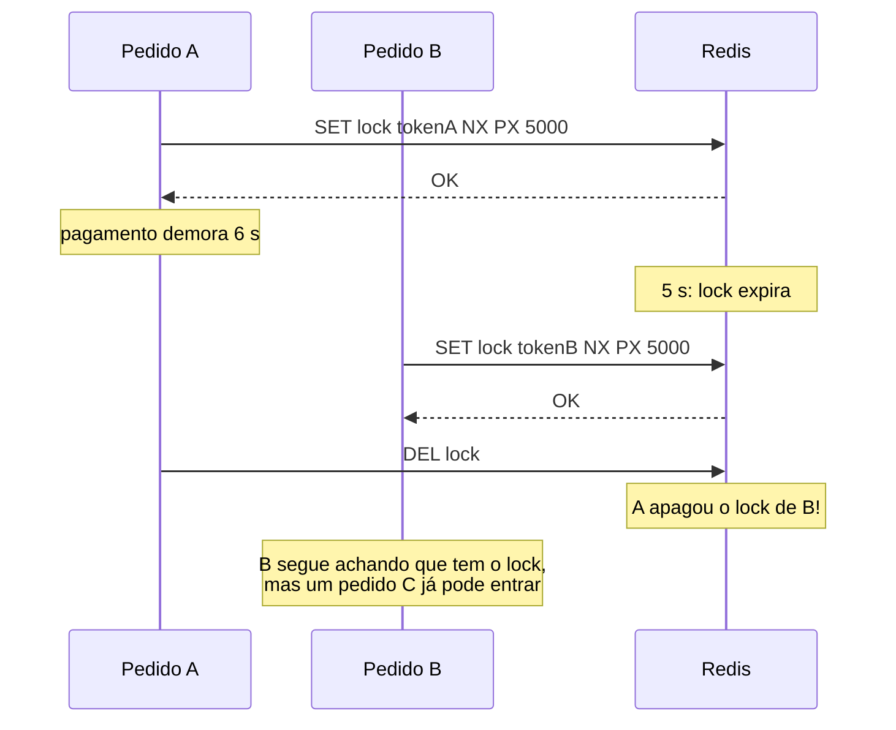
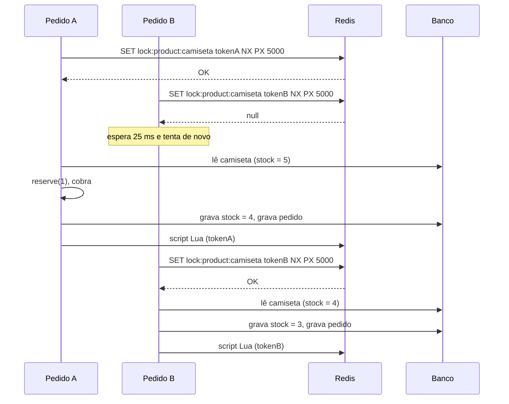

# A estratégia de lock

Este documento explica como o `POST /orders` garante que **dois pedidos do mesmo produto não se intercalam**, mesmo com várias instâncias da API rodando ao mesmo tempo.

Arquivos envolvidos:

| Arquivo | Papel |
| ------- | ----- |
| [`src/application/ports/Lock.ts`](src/application/ports/Lock.ts) | Porta `Lock` e o erro `LockTimeoutError` |
| [`src/adapters/redis/RedisLock.ts`](src/adapters/redis/RedisLock.ts) | Adaptador: implementa o lock com Redis |
| [`src/application/commands/PlaceOrder.ts`](src/application/commands/PlaceOrder.ts) | Caso de uso que usa o lock |
| [`src/app.ts`](src/app.ts) | Composition root: entrega o `RedisLock` ao `PlaceOrder` |
| [`src/adapters/http/errorHandler.ts`](src/adapters/http/errorHandler.ts) | Converte `LockTimeoutError` em `503` |

## 1. O problema que o lock resolve

O `PlaceOrder` faz um *read-modify-write* em 5 passos:

1. ler o produto
2. reservar o estoque (regra do domínio)
3. cobrar no meio de pagamento
4. gravar o novo estoque
5. gravar o pedido

Cada `await` deixa o Node atender outra requisição. Sem coordenação, 20 pedidos da camiseta (estoque 5) leem `stock = 5` antes de qualquer um gravar, e os 20 são aceitos. O nome disso é **atualização perdida** (*lost update*).

A solução é garantir que, **para um mesmo produto**, só um pedido esteja entre o passo 1 e o passo 5 por vez. Isso é **exclusão mútua**.

## 2. O que um lock distribuído precisa garantir

| Requisito | Como o `RedisLock` atende |
| --------- | ------------------------- |
| **Exclusão mútua**: só um dono por vez | `SET ... NX`: o Redis executa um comando por vez, então só um recebe `OK` |
| **Visível para todas as instâncias** | O lock mora no Redis, um serviço separado que todas as instâncias acessam |
| **Não travar para sempre** se o dono morrer | `PX 5000`: a chave expira sozinha em 5 s |
| **Só o dono libera** | Token aleatório + script Lua que compara e apaga |
| **Liberar mesmo com erro** | `try/finally` no `withLock` |
| **Não esperar para sempre** | Tempo máximo de espera de 10 s, depois `LockTimeoutError` → `503` |

Um mutex em memória atenderia só o primeiro requisito, e só dentro de um processo. Uma transação do banco também não resolve sozinha: veja ["Por que uma transação do banco não basta?"](README.md#por-que-uma-transação-do-banco-não-basta).

## 3. A porta: o caso de uso não conhece o Redis

```ts
export interface Lock {
  withLock<T>(key: string, fn: () => Promise<T>): Promise<T>;
}
```

O caso de uso só declara a intenção: "execute `fn` sozinho para a chave `key`".

```ts
execute(input: PlaceOrderInput): Promise<PlaceOrderOutput> {
  return this.lock.withLock(`lock:product:${input.productId}`, () => this.place(input));
}
```

O formato `withLock(key, fn)`, em vez de `acquire()` e `release()` separados, impede o erro mais comum com locks: esquecer de liberar. Quem usa a porta não tem como pegar o lock sem devolvê-lo.

Quem decide **como** o lock é feito é o composition root ([`app.ts`](src/app.ts)). Trocar o Redis por outra implementação (um mutex em memória nos testes, um lock no PostgreSQL, o etcd) não muda uma linha do `PlaceOrder`.

## 4. A chave: um lock por produto

```
lock:product:camiseta
lock:product:caneca
```

A granularidade da chave define **quem espera por quem**:

| Chave | Efeito |
| ----- | ------ |
| `lock:loja` (global) | Correto, mas a loja inteira vende um pedido por vez |
| `lock:product:<id>` (usada aqui) | Pedidos da caneca não esperam pelos da camiseta |
| `lock:user:<id>` | Errado para este caso: dois clientes diferentes ainda disputam o mesmo estoque |

A regra: a chave deve corresponder **ao recurso que está sendo disputado**. Aqui, o recurso é o estoque de um produto.

> Um pedido com vários produtos precisaria de vários locks. Nesse caso, pegue-os sempre **na mesma ordem** (por exemplo, ordenando os ids), senão o pedido A segura a camiseta esperando a caneca enquanto o pedido B segura a caneca esperando a camiseta: um *deadlock*.

## 5. Adquirir: `SET NX PX`

```
SET lock:product:camiseta 7f3c9a...e1 NX PX 5000
```

| Parte | Significado |
| ----- | ----------- |
| `7f3c9a...e1` | Token aleatório (`randomUUID()`), único para cada chamada de `withLock` |
| `NX` | Só grava se a chave **não existir** |
| `PX 5000` | A chave expira em 5000 ms |

O Redis responde `OK` (lock é seu) ou `null` (alguém já tem). Gravar e definir a expiração acontecem **no mesmo comando**. Se fossem dois comandos (`SETNX` e depois `PEXPIRE`), uma instância que caísse entre os dois deixaria um lock sem expiração, e o produto ficaria bloqueado para sempre.

### Esperar a vez

Quem recebe `null` não desiste na hora:

```ts
while (true) {
  const result = await this.redis.set(key, token, { condition: 'NX', expiration: { type: 'PX', value: ttlMs } });
  if (result === 'OK') return;
  if (Date.now() >= deadline) throw new LockTimeoutError(key);
  await sleep(retryDelayMs);
}
```

| Opção | Padrão | Significado |
| ----- | ------ | ----------- |
| `ttlMs` | `5000` | Validade do lock |
| `waitTimeoutMs` | `10000` | Tempo máximo esperando pelo lock |
| `retryDelayMs` | `25` | Intervalo entre tentativas |

Essa estratégia se chama *polling* (ou *spin lock* com pausa). É simples, mas tem dois efeitos:

- **Não há fila.** Quem pega o lock quando ele é liberado é quem tentar primeiro depois disso, não quem chegou primeiro. Para pedidos isso não importa; para algo que exige ordem, não serve.
- **Gera tráfego no Redis.** Com 19 pedidos esperando e uma tentativa a cada 25 ms, são centenas de `SET` por segundo para um produto. Dá para ver no `redis-cli monitor`. Alternativas (Pub/Sub para avisar quando o lock é liberado, filas) ficam fora do escopo da aula.

## 6. Liberar: só o que é seu

O jeito ingênuo de liberar é `DEL lock:product:camiseta`. O problema:



Por isso cada chamada guarda o seu token e só apaga a chave se ela ainda tiver esse token. Comparar e apagar com `GET` e depois `DEL` reabre o problema (a chave pode expirar e ser pega por outro entre os dois comandos). Então a operação vai num **script Lua**, que o Redis executa inteiro sem intercalar nenhum outro comando:

```lua
if redis.call("GET", KEYS[1]) == ARGV[1] then
  return redis.call("DEL", KEYS[1])
end
return 0
```

No `RedisLock`, a liberação fica num `finally`, então acontece tanto quando o pedido dá certo quanto quando ele lança erro (estoque insuficiente, pagamento recusado).

## 7. O fluxo completo



## 8. O que acontece quando algo dá errado

| Situação | Resultado |
| -------- | --------- |
| O pedido lança erro (estoque, pagamento) | `finally` libera o lock; o erro segue para o `errorHandler` |
| A instância da API cai segurando o lock | Ninguém libera, mas a chave expira em 5 s e o próximo pedido entra |
| Muitos pedidos na fila, espera passa de 10 s | `LockTimeoutError` → `503`; o cliente pode tentar de novo |
| A operação demora mais que o TTL (5 s) | **O lock expira no meio** e outro pedido entra. A exclusão mútua é perdida. Ver seção 9 |
| Alguém roda `DEL`/`FLUSHDB` no Redis | O lock some no meio de um pedido e outro entra. Por isso os testes rodam com `--test-concurrency=1` |
| O Redis está fora do ar | Ninguém consegue pegar o lock: nenhum pedido é aceito |

## 9. Limitações e cuidados

**O TTL é uma aposta.** Ele precisa ser maior que a operação mais lenta, com folga. Se for curto demais, o lock expira no meio do pedido; se for longo demais, um processo que caiu bloqueia o produto por mais tempo. Meça a operação real (principalmente o pagamento) antes de escolher. Implementações mais robustas renovam o TTL periodicamente enquanto a operação roda (*watchdog*, como faz o Redisson no Java).

**O lock serializa.** Pedidos do mesmo produto passam a ser atendidos um por vez. No `npm run ataque`, os 20 pedidos levam ~0,2 s sem lock (resultado errado) e ~1,4 s com lock (resultado certo). É o custo da consistência, e o motivo de a chave ser por produto.

**Um Redis só é um ponto único de falha.** Se ele cair, ninguém compra. Com réplicas, um *failover* pode perder um lock recém-criado. O algoritmo *Redlock* (maioria entre vários Redis independentes) e os *fencing tokens* (um número crescente que o banco confere antes de aceitar a gravação, para rejeitar quem perdeu o lock sem saber) tratam esses casos.

**O lock não substitui as garantias do banco.** Ele coordena quem executa o fluxo. Se só a gravação importa, um `UPDATE ... WHERE stock >= ?` atômico é mais simples e mais seguro. E para gravar estoque e pedido juntos, uma transação continua sendo a ferramenta certa. Num sistema real, os três convivem.

## 10. Vendo o lock funcionar

Com a API rodando (`npm run dev`), em dois terminais:

```bash
docker compose exec redis redis-cli monitor   # terminal 1: cada comando enviado ao Redis
npm run ataque                                # terminal 2: 20 pedidos simultâneos da camiseta
```

No `monitor` aparecem os `SET ... NX PX 5000` repetidos dos pedidos esperando e os `EVAL` de liberação. No log da API aparecem os pares `[lock] adquirido` / `[lock] liberado`, sempre alternados para a mesma chave. Nunca há dois `adquirido` seguidos.

Para inspecionar um lock enquanto ele existe:

```bash
docker compose exec redis redis-cli GET  lock:product:camiseta   # o token do dono
docker compose exec redis redis-cli PTTL lock:product:camiseta   # ms até expirar
```
