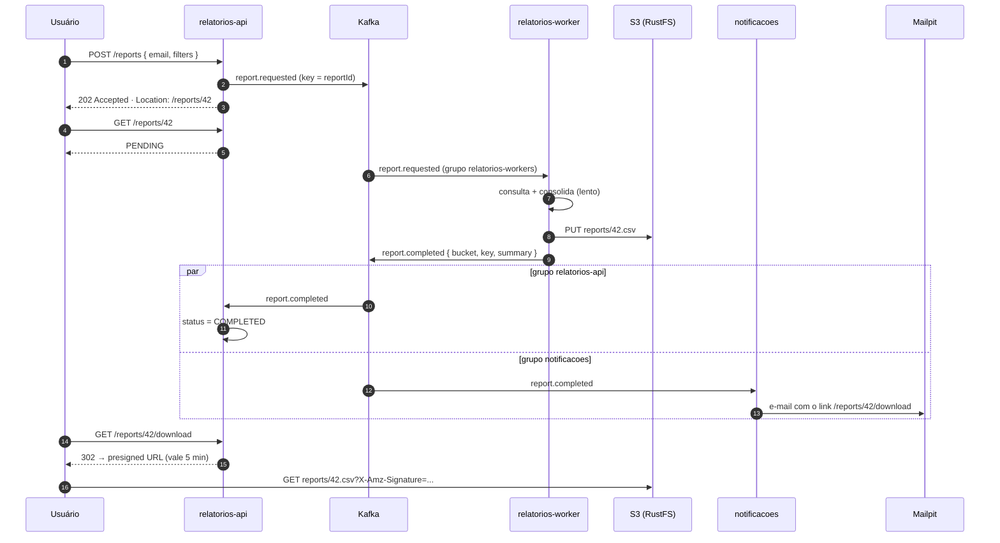
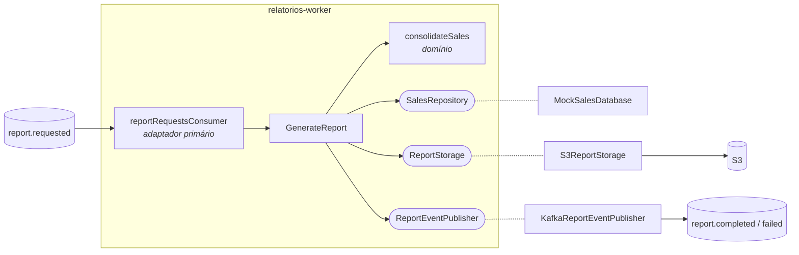

# Aula 11 — Kafka: mensageria e processamento assíncrono

## Objetivo

Tirar de dentro da requisição HTTP um trabalho que demora demais (um relatório de vendas consolidado) e distribuí-lo entre serviços que conversam **só por mensagens**, usando o **Kafka**.

Ao final, você deve saber explicar:

1. Por que uma tarefa longa não deve rodar dentro da requisição, e o que significa responder `202 Accepted`.
2. Tópico, partição, chave, offset, produtor, consumidor e **grupo de consumidores**.
3. Por que o número de partições limita o paralelismo, e o que acontece com workers "a mais".
4. Por que o Kafka entrega **pelo menos uma vez** e como deixar cada serviço **idempotente**.
5. Onde o Kafka entra na arquitetura hexagonal das aulas [06](../Aula06/arquitetura-hexagonal.md) e [09](../Aula09/cqrs.md): nos adaptadores, sem tocar no domínio.

## Material desta pasta

| Arquivo | Para quê |
| ------- | -------- |
| [`kafka-leitura.md`](kafka-leitura.md) | **Leitura**: o básico de Kafka, com exemplos do projeto. |
| [`kafka-apresentacao.md`](kafka-apresentacao.md) | **Apresentação**: os mesmos conceitos em slides ([Marp](https://marp.app): extensão "Marp for VS Code", exporta para PDF/PPTX). |
| [`modelagem.md`](modelagem.md) | A modelagem do projeto: por que faz sentido, o que foi ajustado e as **20 dúvidas** mais comuns. |
| [`relatorios/`](relatorios/) | O projeto: `docker-compose.yml`, 3 microsserviços, testes unitários, e2e e de carga. |

```bash
cd relatorios
docker compose up -d --build                       # tudo: Kafka, Kafka UI, S3, Mailpit e os 3 serviços
cd e2e && npm install && npm test                  # o fluxo inteiro, de ponta a ponta
```

O [`README.md`](relatorios/README.md) do projeto tem a API, o contrato das mensagens, todos os comandos, as variáveis de ambiente e as medições.

---

## 1. O problema

O pedido: "o relatório de vendas consolidado do ano, só da região Sul, só Eletrônicos". Gerar esse relatório leva minutos. Feito dentro da rota `POST /reports`, ele estoura o timeout do proxy, prende uma conexão por minutos, compete com as outras requisições e se perde se a API reiniciar.

A solução tem nome, ***Asynchronous Request-Reply***: a API só **anota o pedido** e responde na hora; outro serviço faz o trabalho; o usuário é avisado quando terminar.

## 2. O desenho



Três serviços, nenhuma chamada HTTP entre eles:

| Serviço | Produz | Consome (grupo) | Faz |
| ------- | ------ | --------------- | --- |
| `relatorios-api` | `report.requested` | `report.completed`, `report.failed` (`relatorios-api`) | Recebe o pedido, guarda o status, gera o link de download |
| `relatorios-worker` | `report.completed`, `report.failed` | `report.requested` (`relatorios-workers`) | Gera o relatório e grava no S3. **Escala** com `--scale` |
| `notificacoes` | — | `report.completed`, `report.failed` (`notificacoes`) | Manda o e-mail |

Por que três e não dois, por que a mensagem leva só a **referência** ao arquivo e por que o link do e-mail aponta para a API e não direto para o S3: [`modelagem.md`](modelagem.md#3-o-que-foi-ajustado-na-implementação).

## 3. Os conceitos, no projeto

| Conceito | Onde ver |
| -------- | -------- |
| Tópico com 3 partições | `kafka-init` no [`docker-compose.yml`](relatorios/docker-compose.yml); Kafka UI → *Topics* |
| Chave → partição | [`KafkaReportRequestPublisher.ts`](relatorios/relatorios-api/src/adapters/kafka/KafkaReportRequestPublisher.ts) (`key: reportId`); o log da API mostra `partição 2 offset 0` |
| Grupo dividindo partições | [`reportRequestsConsumer.ts`](relatorios/relatorios-worker/src/adapters/kafka/reportRequestsConsumer.ts): cada réplica imprime as partições que recebeu |
| Dois grupos no mesmo tópico (*fan-out*) | `report.completed` lido pela API e por `notificacoes` |
| Commit e lag | `kafka-consumer-groups.sh --describe`; Kafka UI → *Consumers* |
| Heartbeat em tarefa longa | `heartbeat()` no `reportRequestsConsumer.ts` |
| Idempotência | `Report.complete()` (API), upload na mesma chave (worker), `NotificationLog` (notificações) |
| Contrato validado com Zod | `adapters/kafka/events.ts` de cada serviço |
| Desligamento limpo | `shutdown()` nos três `index.ts` |

### Onde o Kafka entrou no hexágono



O **consumidor** é um adaptador **primário**: faz para o Kafka o que a rota faz para o HTTP (recebe, valida o formato, chama o caso de uso). O **publicador** é um adaptador **secundário**, atrás de uma porta. O caso de uso `GenerateReport` não sabe o que é tópico, partição ou heartbeat; ele recebe um callback de progresso, e é o adaptador que transforma esse progresso em `heartbeat()`. Por isso os testes unitários dos três serviços rodam sem Kafka.

## 4. Roteiro de demonstração

Deixe abertos: um terminal com `docker compose logs -f relatorios-worker notificacoes`, o **Kafka UI** (http://localhost:8080) e o **Mailpit** (http://localhost:8025).

**Parte 1: o fluxo**

1. `docker compose up -d --build`. No Kafka UI, mostre os 3 tópicos com 3 partições e os grupos.
2. Pelo [`test.http`](relatorios/test.http), peça um relatório de 3 meses. Mostre o `202` e o `Location`, e consulte o status: `PENDING`.
3. No log do worker: `← report.requested partição X offset Y`, `consultando vendas...`, `50%`, `100%`, `→ report.completed`.
4. Consulte de novo: `COMPLETED`, com `processedBy`, `processingMs` e `totalMs`.
5. No Mailpit, abra o e-mail e clique no link: o navegador baixa o CSV. No RustFS (http://localhost:9001/rustfs/console/), mostre o arquivo no bucket `relatorios`.
6. No Kafka UI, abra `report.completed` → *Messages*: a mensagem tem o JSON do contrato e a chave `reportId`.

**Parte 2: escala e partições**

7. `docker compose up -d --scale relatorios-worker=3`. No log, cada worker diz qual partição recebeu (houve um *rebalance*).
8. `cd e2e && npm run carga` com 1 e com 3 workers: 28,9 s → 12,2 s.
9. `--scale relatorios-worker=5` e `npm run carga` de novo: **12,2 s**, e dois workers dizem `NENHUMA partição (ocioso)`. Pergunte à turma por quê antes de explicar.

**Parte 3: a fila absorve o pico**

10. `docker compose --profile carga run --rm k6`: 200 pedidos em 20 s, p95 do POST em poucos milissegundos.
11. Durante e depois do k6, Kafka UI → *Consumers* → `relatorios-workers`: o **lag** sobe e depois desce no ritmo dos workers.

**Parte 4: falhas**

12. Peça um relatório de um ano (6,5 s) e, no meio, `docker kill` no worker que o pegou. Quanto tempo até ficar pronto, e quem terminou? (~30 s depois, outro worker.) Repita com `docker stop`.
13. `docker compose stop notificacoes`, peça 3 relatórios, espere ficarem `COMPLETED`, `docker compose start notificacoes`: os 3 e-mails chegam de uma vez.
14. `REPORT_FAILURE_RATE=1 docker compose up -d relatorios-worker`: 3 tentativas, `report.failed`, status `FAILED` e e-mail de falha. Volte com `docker compose up -d relatorios-worker`.

## Exercícios para aprofundar os estudos

1. **Mais partições.** Recrie `report.requested` com 6 partições (`docker compose down`, mude o `kafka-init`) e rode `npm run carga -- 24` com 3 e com 6 workers. O que mudou?
2. **Chave por usuário.** Troque a chave de `report.requested` para o e-mail. Rode `npm run carga` (todos os pedidos têm e-mails diferentes) e depois uma variação em que todos usam o **mesmo** e-mail. Explique o resultado.
3. **Status persistente.** Implemente `RedisReportRepository` (Aula 10) e suba duas instâncias da API. Por que, com o repositório em memória, duas instâncias não funcionam? (Veja a dúvida 14 da [`modelagem.md`](modelagem.md).)
4. **DLQ.** Quando o worker recebe uma mensagem fora do contrato, publique-a em `report.requested.dlq` com um header `error`, em vez de só registrar no log. Teste publicando uma mensagem inválida com o `kafka-console-producer.sh`.
5. **Status intermediário.** Adicione o status `PROCESSING`: o worker publica `report.started` ao começar, e a API passa a mostrar quem está processando. Precisa de um tópico novo? Quais serviços mudam?
6. **Pedido repetido.** Se o mesmo usuário pedir o mesmo relatório (mesmos filtros) enquanto o anterior está `PENDING`, devolva o existente em vez de criar outro. Em que camada fica essa regra?
7. **Aviso em tempo real.** Crie um quarto serviço (ou uma rota SSE na API) que avise o navegador quando o relatório ficar pronto, sem *polling*. Qual grupo de consumidores ele deve usar? (Inspire-se em [`AulaWebSocket/`](../AulaWebSocket/).)
8. **Outbox.** Simule o Kafka fora do ar (`docker compose stop kafka`) e faça um pedido. O que a API responde? Desenhe (ou implemente) o *Transactional Outbox* para que o pedido não se perca.
9. **Relatório gigante.** Com 1 worker, peça um relatório de um ano e logo depois três de um dia. Em que ordem terminam? Proponha duas soluções para os relatórios pequenos não esperarem o grande.
