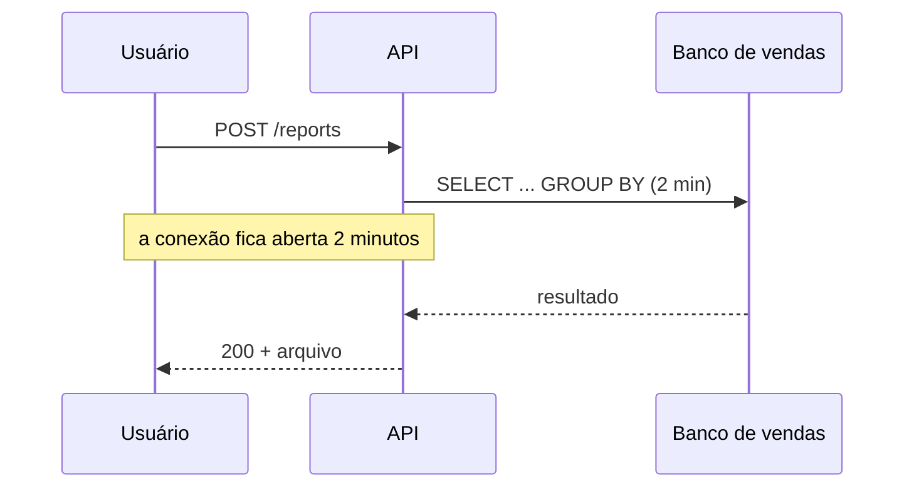
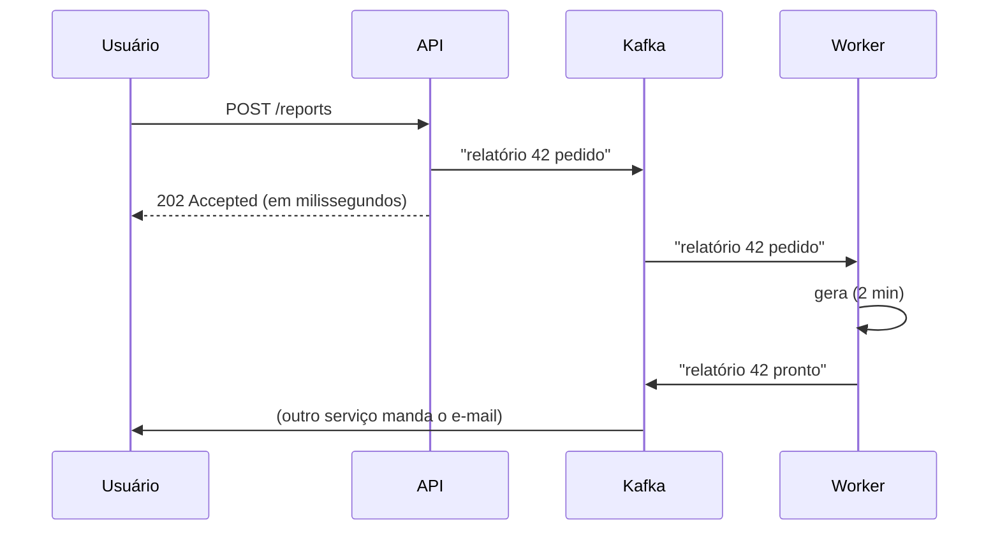
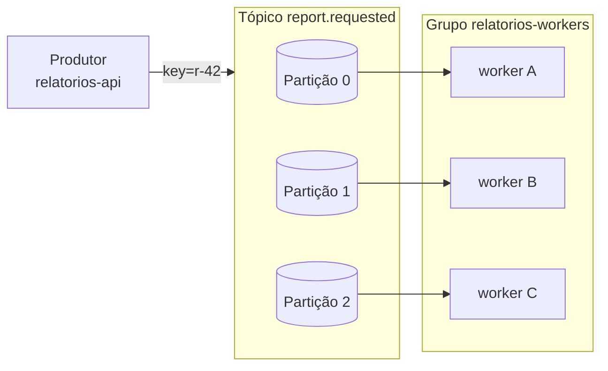
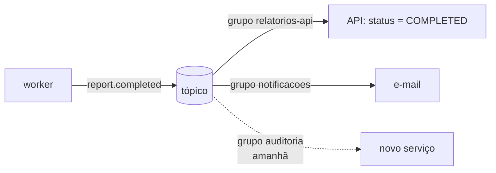

# Kafka: o básico (material de leitura)

> Versão para apresentar em sala: [`kafka-apresentacao.md`](kafka-apresentacao.md). Projeto da aula: [`relatorios/`](relatorios/).

## Sumário

1. [O problema: trabalho que não cabe numa requisição](#1-o-problema-trabalho-que-não-cabe-numa-requisição)
2. [Mensageria](#2-mensageria)
3. [Fila × log: o que torna o Kafka diferente](#3-fila--log-o-que-torna-o-kafka-diferente)
4. [Os conceitos, um por um](#4-os-conceitos-um-por-um)
5. [Grupos de consumidores: dividir e repetir](#5-grupos-de-consumidores-dividir-e-repetir)
6. [Offset e commit: como o Kafka sabe onde você parou](#6-offset-e-commit-como-o-kafka-sabe-onde-você-parou)
7. [Garantias de entrega e idempotência](#7-garantias-de-entrega-e-idempotência)
8. [Ordem](#8-ordem)
9. [Durabilidade: retenção e replicação](#9-durabilidade-retenção-e-replicação)
10. [O Kafka no código (kafkajs)](#10-o-kafka-no-código-kafkajs)
11. [Quando usar e quando não usar](#11-quando-usar-e-quando-não-usar)
12. [Kafka × RabbitMQ × Redis](#12-kafka--rabbitmq--redis)
13. [Comandos úteis](#13-comandos-úteis)
14. [Glossário](#14-glossário)

---

## 1. O problema: trabalho que não cabe numa requisição

Um relatório de vendas consolidado de um ano leva, digamos, 2 minutos para ser gerado. Se a rota HTTP fizer o trabalho:



O que dá errado:

- **Timeout.** Navegador, *load balancer* e *proxy* costumam desistir entre 30 e 60 s. O usuário recebe erro, mas o servidor continua trabalhando para ninguém.
- **Recurso preso.** Cada relatório em andamento segura uma conexão HTTP, memória e uma conexão com o banco. Vinte usuários pedindo ao mesmo tempo derrubam a API, inclusive para quem só queria listar produtos.
- **Sem segunda chance.** Se o processo cair no minuto 1:59, o trabalho se perde e o usuário precisa pedir de novo.
- **Escala amarrada.** Para gerar mais relatórios ao mesmo tempo, é preciso escalar a API inteira.

A saída é **separar o pedido do trabalho**:



A API só **anota o pedido** e responde `202 Accepted` ("recebi, ainda não terminei"). Outro processo, o **worker**, faz o trabalho no seu ritmo. Entre os dois fica um intermediário que guarda os pedidos: um **sistema de mensageria**.

## 2. Mensageria

Mensageria é comunicação **assíncrona** entre sistemas por meio de um intermediário (o *broker*):

| | Chamada direta (HTTP) | Mensageria |
| --- | --- | --- |
| Quem chama espera a resposta? | Sim | Não: publica e segue |
| O outro lado precisa estar no ar agora? | Sim | Não: a mensagem espera no broker |
| Quem chama conhece quem responde? | Sim (URL) | Não: conhece só o **tópico** |
| Picos de tráfego | Chegam direto ao serviço | O broker **absorve**; o consumidor processa no seu ritmo |
| Vários interessados no mesmo fato | Uma chamada para cada | Uma mensagem; cada um lê |

Três ganhos aparecem sempre:

1. **Desacoplamento no tempo.** Produtor e consumidor não precisam estar no ar ao mesmo tempo.
2. **Desacoplamento de conhecimento.** O worker publica "relatório pronto" sem saber que existe um serviço de notificações. Amanhã pode surgir um serviço de auditoria lendo o mesmo tópico, sem mudar o worker.
3. **Amortecimento de carga.** 500 pedidos num segundo viram 500 mensagens esperando; os workers consomem a 10 por segundo, sem cair.

O preço: o sistema fica **eventualmente consistente** (durante um tempo, o relatório está "pedido" mas não "pronto"), mais difícil de depurar (o fluxo atravessa processos) e aparecem problemas novos (mensagens duplicadas, fora de ordem, contrato entre serviços). As seções 7 e 8 tratam disso.

## 3. Fila × log: o que torna o Kafka diferente

Numa **fila** tradicional (RabbitMQ, SQS), a mensagem é **entregue e apagada**. Cada mensagem vai para um consumidor só.

O Kafka não é uma fila: é um **log distribuído**. Pense num arquivo em que só se pode **acrescentar no final**:

```
report.requested, partição 0
offset:   0      1      2      3      4      5      6
        ┌──────┬──────┬──────┬──────┬──────┬──────┬──────┐
        │ r-17 │ r-21 │ r-22 │ r-30 │ r-31 │ r-35 │ r-40 │ ← o produtor acrescenta aqui
        └──────┴──────┴──────┴──────┴──────┴──────┴──────┘
                         ▲                    ▲
          grupo "notificações" está aqui      grupo "workers" está aqui
```

- Ler **não apaga**. A mensagem fica guardada pelo tempo de **retenção** (padrão: 7 dias), tenha sido lida ou não.
- Cada leitor guarda **a sua posição** (o *offset*). Dois leitores diferentes leem o mesmo log, cada um no seu ritmo.
- Dá para **voltar no tempo**: reposicionar o offset e reprocessar mensagens antigas (útil depois de corrigir um bug).

Essa diferença explica quase tudo o que vem a seguir.

## 4. Os conceitos, um por um



| Conceito | O que é | No projeto |
| -------- | ------- | ---------- |
| **Broker** | Um servidor Kafka. Um **cluster** tem vários (3 é o mínimo comum em produção). | Um só, no Docker (`kafka`). |
| **Tópico** | Um "assunto", com nome. É onde se publica e de onde se lê. | `report.requested`, `report.completed`, `report.failed` |
| **Partição** | Cada tópico é dividido em N logs independentes. É a **unidade de paralelismo** e de **ordem**. | 3 partições por tópico |
| **Mensagem** (*record*) | Chave + valor + headers + timestamp. Para o Kafka, o valor é só bytes. | Valor: JSON do contrato. Chave: `reportId` |
| **Chave** (*key*) | Decide a partição: `hash(chave) % nº de partições`. Mesma chave → mesma partição → mesma ordem. Sem chave, as mensagens se espalham. | `reportId` |
| **Offset** | A posição de uma mensagem dentro da partição (0, 1, 2...). Só cresce. | Aparece nos logs: `partição 2 offset 0` |
| **Produtor** | Quem publica. | A API (pedidos) e o worker (resultados) |
| **Consumidor** | Quem lê. Sempre faz parte de um **grupo**. | Os três serviços |
| **Grupo de consumidores** | Um conjunto de consumidores que **divide** o trabalho de ler um tópico. Cada grupo tem os seus offsets. | `relatorios-workers`, `relatorios-api`, `notificacoes` |
| **Controller / KRaft** | O nó que guarda os metadados do cluster (quais tópicos existem, quem lidera cada partição). Desde o Kafka 3.3 isso é feito pelo próprio Kafka (modo **KRaft**); antes era o ZooKeeper. | O mesmo contêiner é broker e controller |

## 5. Grupos de consumidores: dividir e repetir

A regra mais importante do Kafka:

> **Dentro de um grupo**, cada partição é lida por **um** consumidor só.
> **Entre grupos**, cada grupo recebe **todas** as mensagens.

### Dentro do grupo: dividir o trabalho

O Kafka distribui as partições entre os membros do grupo. Quando alguém entra ou sai, ele **redistribui** (*rebalance*):

| Partições | Workers no grupo | Resultado |
| --------- | ---------------- | --------- |
| 3 | 1 | O worker lê as 3 partições |
| 3 | 2 | Um lê 2 partições, o outro 1 |
| 3 | 3 | Cada um lê 1: **3 relatórios em paralelo** |
| 3 | 5 | 3 trabalham, **2 ficam ociosos** |

O número de partições é o **teto de paralelismo** de um grupo. Medido no projeto, com 12 relatórios de ~2,4 s:

| Workers | Tempo até o último ficar pronto |
| ------- | ------------------------------- |
| 1 | 28,9 s |
| 3 | 12,2 s |
| 5 | 12,2 s (igual: 2 ociosos) |

Por isso se escolhe o número de partições pensando no **paralelismo máximo** que se espera. Aumentar depois é possível, mas muda o destino das chaves (`hash % N` muda) e quebra a ordem por chave durante a transição. Diminuir não é possível.

### Entre grupos: repetir para cada interessado

`report.completed` é lido por **dois** grupos: `relatorios-api` (atualiza o status) e `notificacoes` (manda o e-mail). Cada grupo tem os seus offsets e recebe **todas** as mensagens. É o padrão *publish/subscribe* (ou *fan-out*).



Se o serviço de notificações ficar uma hora fora do ar, nada se perde: ao voltar, o grupo `notificacoes` continua do offset em que parou e manda os e-mails atrasados. A API não percebe nada.

> **Resumo:** quer **dividir** o trabalho? Mesmo grupo. Quer que **todos** recebam? Grupos diferentes.

## 6. Offset e commit: como o Kafka sabe onde você parou

Cada grupo grava, por partição, **até onde já processou**. Esse registro se chama **commit do offset** e fica num tópico interno do Kafka (`__consumer_offsets`).

```
partição 0:  [0][1][2][3][4][5][6][7]
                       ▲           ▲
              commit = 3           último offset = 7     → LAG = 4
```

- **Lag** = quantas mensagens o grupo ainda não processou. É **a** métrica de saúde de um consumidor: lag crescendo sem parar = consumidores de menos (ou travados).
- O `kafkajs` faz o commit **depois** que a função `eachMessage` termina sem erro. Se ela lançar erro, o offset não avança e a mensagem é entregue de novo.
- Quando um grupo **novo** começa a ler um tópico, não há commit. O que ele faz depende de `fromBeginning`: `true` lê desde a mensagem mais antiga retida; `false` só as que chegarem a partir de agora. No projeto usamos `true`: se a API publicar um pedido antes do primeiro worker subir, ele não se perde.

### Heartbeat e session timeout

Como o Kafka sabe que um consumidor morreu? Pelo **heartbeat**: cada membro do grupo avisa periodicamente "estou vivo". Se o Kafka ficar `sessionTimeout` (30 s no projeto) sem notícia, ele tira o membro do grupo e entrega as suas partições a outro.

Isso cria uma armadilha para **tarefas longas**: se o processamento de uma mensagem demora mais que o session timeout e o consumidor não manda heartbeat no meio, o Kafka acha que ele morreu, redistribui a partição, e **outro worker começa a processar a mesma mensagem**. Por isso o worker do projeto chama `heartbeat()` a cada etapa do relatório ([`reportRequestsConsumer.ts`](relatorios/relatorios-worker/src/adapters/kafka/reportRequestsConsumer.ts)).

Medido no projeto, com 2 workers e um relatório de 6,5 s:

| O que aconteceu com o worker | Resultado |
| ---------------------------- | --------- |
| `docker stop` (SIGTERM: desligamento limpo) | Termina o relatório, faz o commit, sai do grupo. Pronto em **7 s**, sem reprocessar. |
| `docker kill` (SIGKILL: queda) | O Kafka espera os 30 s do session timeout, passa a partição para o outro worker, que **refaz** o relatório. Pronto em **39 s**. |

## 7. Garantias de entrega e idempotência

Existem três "contratos" possíveis entre o broker e quem consome:

| Garantia | O que significa | Como acontece |
| -------- | --------------- | ------------- |
| *At-most-once* (no máximo uma vez) | Pode **perder**, nunca duplica | Commit **antes** de processar. Se cair no meio, a mensagem já foi dada como lida. |
| *At-least-once* (pelo menos uma vez) | Nunca perde, pode **duplicar** | Commit **depois** de processar. Se cair entre processar e commitar, processa de novo. **É o padrão.** |
| *Exactly-once* (exatamente uma vez) | Nem perde nem duplica | O Kafka oferece com produtores idempotentes + transações, mas **só vale dentro do Kafka**. Um e-mail enviado ou um arquivo gravado no S3 não entram na transação. |

Na prática: **conte com mensagens duplicadas** e torne o processamento **idempotente**, isto é, processar duas vezes tem o mesmo efeito que processar uma. No projeto:

| Onde | Duplicata possível | Defesa |
| ---- | ------------------ | ------ |
| Worker | O mesmo `report.requested` duas vezes | O arquivo vai sempre para `reports/<reportId>.csv`: o segundo upload só sobrescreve. |
| API | O mesmo `report.completed` duas vezes | `Report.complete()` só muda de `PENDING` para `COMPLETED`; a segunda vez devolve `false` e é ignorada. |
| Notificações | Dois `report.completed` do mesmo relatório (até com `eventId` diferentes, se o worker reprocessou) | Registra `completed:<reportId>` antes de enviar; se já existe, não manda de novo. |

Repare na última linha: a chave de idempotência é **de negócio** (o relatório), não o id da mensagem.

## 8. Ordem

O Kafka garante ordem **só dentro de uma partição**. Entre partições, não há ordem nenhuma.

Por isso a **chave** importa. Mensagens com a mesma chave caem na mesma partição e são lidas na ordem em que foram escritas. No projeto, todos os eventos de um relatório usam a chave `reportId`, então `report.completed` de um relatório nunca é processado "antes" de outro evento do mesmo relatório no mesmo tópico.

Escolhas possíveis para a chave de `report.requested`:

| Chave | Efeito |
| ----- | ------ |
| `reportId` (o projeto) | Relatórios se espalham pelas partições: bom para paralelismo. |
| `email` do usuário | Todos os relatórios de um usuário vão para a mesma partição, em ordem. Um usuário que pede 50 relatórios ocupa um worker sozinho e atrasa quem está na mesma partição. |
| nenhuma | Distribuição uniforme, sem garantia de ordem nenhuma. |

## 9. Durabilidade: retenção e replicação

- **Retenção.** Mensagens ficam no disco por tempo (`retention.ms`, padrão 7 dias) ou tamanho (`retention.bytes`), lidas ou não. Existe também a **compactação** (`cleanup.policy=compact`), que guarda só a última mensagem de cada chave, útil para "estado atual" (ex.: o último preço de cada produto).
- **Replicação.** Em produção, cada partição tem cópias em vários brokers (`replication-factor=3`). Uma é a **líder** (recebe escritas e leituras), as outras são **seguidoras**. Se o broker da líder cai, uma seguidora assume.
- **`acks`.** O produtor escolhe quando considerar a mensagem gravada: `0` (não espera), `1` (a líder gravou), `all`/`-1` (todas as réplicas em sincronia gravaram). O `kafkajs` usa `-1` por padrão.

No Docker da aula há **um** broker, então o fator de replicação é 1: se o contêiner cai, o Kafka para. Serve para estudar, não para produção.

## 10. O Kafka no código (kafkajs)

### Produzir

```ts
const kafka = new Kafka({ clientId: 'relatorios-api', brokers: ['localhost:9094'] });
const producer = kafka.producer();
await producer.connect();

await producer.send({
  topic: 'report.requested',
  messages: [{ key: report.id, value: JSON.stringify(event) }],
});
```

Código completo: [`KafkaReportRequestPublisher.ts`](relatorios/relatorios-api/src/adapters/kafka/KafkaReportRequestPublisher.ts).

### Consumir

```ts
const consumer = kafka.consumer({ groupId: 'relatorios-workers' });
await consumer.connect();
await consumer.subscribe({ topic: 'report.requested', fromBeginning: true });

await consumer.run({
  eachMessage: async ({ topic, partition, message, heartbeat }) => {
    const event = JSON.parse(message.value!.toString());
    await gerarRelatorio(event, () => heartbeat());
    // terminou sem erro → o kafkajs faz o commit do offset
  },
});
```

Código completo: [`reportRequestsConsumer.ts`](relatorios/relatorios-worker/src/adapters/kafka/reportRequestsConsumer.ts).

### Cuidados que aparecem no código do projeto

- **Valide o que chega.** Para o Kafka, a mensagem é só bytes. Os consumidores validam com Zod (como na Aula 09) e **ignoram** o que não segue o contrato. Se lançassem erro, a mensagem seria entregue de novo para sempre e travaria a partição: a chamada *poison pill*. Em produção, ela iria para um tópico de mensagens mortas (*dead letter queue*, DLQ).
- **Desligue com calma.** No `SIGTERM`, chame `consumer.disconnect()`: ele espera a mensagem atual, faz o commit e sai do grupo, e o Kafka redistribui as partições na hora, sem esperar o session timeout.
- **O consumidor é um adaptador primário.** Na arquitetura hexagonal, ele tem o mesmo papel de uma rota HTTP: traduz a entrada e chama um caso de uso. O caso de uso não sabe que veio do Kafka.

Sobre a biblioteca: o `kafkajs` é escrito em JavaScript puro e tem a API mais didática, mas **não recebe novas versões desde 2023**. Para projetos novos em produção, a alternativa mantida é o `@confluentinc/kafka-javascript` (baseado no `librdkafka`), que oferece uma API compatível com a do `kafkajs`.

## 11. Quando usar e quando não usar

**Bons usos:**

- Tarefas **demoradas** ou **pesadas** fora da requisição (relatórios, vídeos, importação de planilhas).
- **Eventos de domínio** que vários serviços precisam saber ("pedido pago", "usuário cadastrado").
- **Absorver picos** (Black Friday, abertura de inscrições).
- **Integração** entre sistemas que não estão sempre no ar.
- **Fluxos de dados** contínuos: logs, cliques, telemetria, *change data capture*.

**Quando não vale a pena:**

- O usuário **precisa** da resposta para continuar (validar login, calcular o frete na tela do carrinho). Use uma chamada direta.
- Volume pequeno e um único serviço: uma tabela `jobs` no banco ou uma fila simples (BullMQ sobre Redis) resolvem com bem menos infraestrutura.
- A equipe não tem como operar um cluster: Kafka exige monitoramento (lag, disco, réplicas). Existem versões gerenciadas (Confluent Cloud, Amazon MSK, Aiven).

## 12. Kafka × RabbitMQ × Redis

| | Kafka | RabbitMQ | Redis (listas/streams, BullMQ) |
| --- | --- | --- | --- |
| Modelo | **Log** particionado | **Fila** com roteamento (exchanges) | Estruturas em memória |
| Depois de lida | A mensagem **fica** (retenção) | É **apagada** (ack) | Lista: apagada. Stream: fica. |
| Reprocessar o passado | Sim (mover o offset) | Não | Só com Streams |
| Vários grupos lendo tudo | Natural (grupos de consumidores) | Uma fila por interessado (fanout exchange) | Streams + consumer groups |
| Ordem | Por partição | Por fila (com 1 consumidor) | Por lista/stream |
| Vazão | Altíssima (milhões/s num cluster) | Alta | Alta, limitada pela memória |
| Recursos por mensagem (atraso, prioridade, retry) | Você implementa | Nativos | Nativos no BullMQ |
| Operação | Mais pesada | Média | Leve (você já tem um Redis da Aula 10) |

Uma regra prática: **RabbitMQ/BullMQ para "faça esta tarefa"**, **Kafka para "isto aconteceu"** (eventos que vários serviços leem e que vale a pena guardar). O relatório da aula fica no meio: é uma tarefa (`report.requested`) e também gera eventos (`report.completed`). O Kafka foi escolhido para estudar o modelo de log, partições e grupos.

## 13. Comandos úteis

Rodando dentro do contêiner do Kafka (`docker compose exec kafka ...`):

```bash
B="--bootstrap-server localhost:9092"
K=/opt/kafka/bin

$K/kafka-topics.sh $B --list                                   # tópicos
$K/kafka-topics.sh $B --describe --topic report.requested      # partições, líder, réplicas
$K/kafka-topics.sh $B --create --topic teste --partitions 3 --replication-factor 1

$K/kafka-console-producer.sh $B --topic teste --property parse.key=true --property key.separator=:
#   > chave1:olá       (cada linha é uma mensagem)

$K/kafka-console-consumer.sh $B --topic teste --from-beginning \
   --property print.key=true --property print.partition=true --property print.offset=true

$K/kafka-consumer-groups.sh $B --list                                       # grupos
$K/kafka-consumer-groups.sh $B --describe --group relatorios-workers        # offsets e LAG
$K/kafka-consumer-groups.sh $B --group relatorios-workers --topic report.requested \
   --reset-offsets --to-earliest --execute                                  # reprocessar tudo (grupo parado)
```

Ou, sem terminal: **Kafka UI** em http://localhost:8080.

## 14. Glossário

| Termo | Significado |
| ----- | ----------- |
| *Broker* | Servidor Kafka. |
| *Cluster* | Conjunto de brokers. |
| *Tópico* | Categoria nomeada de mensagens. |
| *Partição* | Um dos logs em que um tópico é dividido; unidade de ordem e paralelismo. |
| *Offset* | Posição de uma mensagem na partição. |
| *Produtor* / *consumidor* | Quem escreve / quem lê. |
| *Grupo de consumidores* | Consumidores que dividem as partições de um tópico; cada grupo tem os seus offsets. |
| *Rebalance* | Redistribuição das partições quando um membro entra ou sai do grupo. |
| *Commit* | Gravar até onde o grupo já processou. |
| *Lag* | Mensagens que o grupo ainda não processou. |
| *Heartbeat* | Sinal periódico do consumidor: "estou vivo". |
| *Session timeout* | Tempo sem heartbeat depois do qual o consumidor é tirado do grupo. |
| *Retenção* | Por quanto tempo (ou espaço) as mensagens ficam guardadas. |
| *Replicação* / *líder* / *ISR* | Cópias de uma partição em brokers diferentes / a cópia que atende / as cópias em sincronia. |
| *acks* | Quantas réplicas precisam confirmar uma escrita. |
| *At-least-once* | Garantia de entrega em que nada se perde, mas pode duplicar. |
| *Idempotência* | Processar duas vezes tem o mesmo efeito que processar uma. |
| *Poison pill* | Mensagem que sempre falha e trava o consumo. |
| *DLQ* | *Dead letter queue*: tópico para onde vão as mensagens que não puderam ser processadas. |
| *KRaft* | Modo do Kafka que dispensa o ZooKeeper. |
| *Fan-out* | Um evento entregue a vários interessados. |
