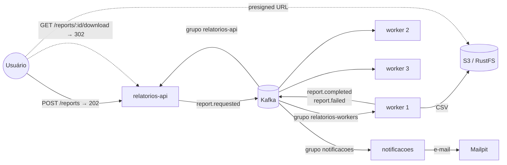

# Aula 11 — Relatórios assíncronos com Kafka

Três microsserviços que conversam **só pelo Kafka** para gerar um relatório de vendas pesado sem prender a requisição HTTP.

Material da aula: [`../aula11.md`](../aula11.md) · Conceitos de Kafka: [`../kafka-leitura.md`](../kafka-leitura.md) · Decisões e dúvidas: [`../modelagem.md`](../modelagem.md)



## Como rodar

Pré-requisitos: Docker (com Compose) e Node 22+ (só para os testes e scripts).

```bash
cd Aula11/relatorios
docker compose up -d --build       # Kafka, Kafka UI, RustFS (S3), Mailpit e os 3 serviços
docker compose ps                  # espere kafka-init "Exited (0)" e a API "healthy"
docker compose logs -f relatorios-worker notificacoes
```

| Endereço | O que é |
| -------- | ------- |
| http://localhost:3011/reports | API de relatórios |
| http://localhost:8080 | **Kafka UI**: tópicos, partições, mensagens, grupos de consumidores e *lag* |
| http://localhost:8025 | **Mailpit**: a caixa de entrada com os e-mails enviados |
| http://localhost:9001/rustfs/console/ | **RustFS**: o "S3" (usuário `aula11`, senha `aula11-secret`), bucket `relatorios` |
| `localhost:9094` | Kafka para clientes **fora** do Docker (`npm run dev`) |

Faça um pedido pelo [`test.http`](test.http) (extensão REST Client do VS Code) ou:

```bash
curl -i -X POST localhost:3011/reports -H 'Content-Type: application/json' \
  -d '{"email":"ana@exemplo.com","filters":{"from":"2026-01-01","to":"2026-03-31","region":"Sul"}}'
# HTTP/1.1 202 Accepted
# Location: /reports/6d8e...

curl -s localhost:3011/reports/<id>          # PENDING → (2,4 s depois) COMPLETED
curl -L localhost:3011/reports/<id>/download # o CSV
```

Para derrubar e **apagar tudo** (mensagens, offsets, arquivos, e-mails): `docker compose down`.

## Os serviços

| Serviço | Papel no Kafka | O que faz |
| ------- | -------------- | --------- |
| [`relatorios-api/`](relatorios-api/) | produz `report.requested`; consome `report.completed` e `report.failed` (grupo `relatorios-api`) | Recebe o pedido, responde `202`, guarda o status, gera o link de download. |
| [`relatorios-worker/`](relatorios-worker/) | consome `report.requested` (grupo `relatorios-workers`); produz `report.completed` / `report.failed` | Consulta as vendas (lento, de propósito), consolida, grava o CSV no S3. **Escalável.** |
| [`notificacoes/`](notificacoes/) | consome `report.completed` e `report.failed` (grupo `notificacoes`) | Manda o e-mail com o link (Mailpit). |

Os três seguem a organização hexagonal + CQRS das aulas [06](../../Aula06/arquitetura-hexagonal.md) e [09](../../Aula09/cqrs.md): o Kafka fica **só** em `adapters/kafka/`, e os consumidores são adaptadores **primários** (como as rotas HTTP).

```
relatorios-api/src/
├── domain/                 Report (PENDING → COMPLETED | FAILED), ReportFilters (regra: ≤ 366 dias)
├── application/
│   ├── commands/           RequestReport, MarkReportCompleted, MarkReportFailed
│   ├── queries/            GetReport, ListReports, GetReportDownloadUrl
│   └── ports/              ReportRepository, ReportRequestPublisher, ReportFileStorage
├── adapters/
│   ├── http/               rotas (202 + Location), Zod, errorHandler
│   ├── kafka/              events.ts (contrato), KafkaReportRequestPublisher, reportResultsConsumer
│   ├── s3/                 S3ReportFileStorage (presigned URL)
│   └── memory/             InMemoryReportRepository
├── app.ts / index.ts       composition root (sem rede / com rede)

relatorios-worker/src/
├── domain/                 consolidateSales (função pura), ReportFilters (cópia do contrato)
├── application/commands/   GenerateReport (consulta → consolida → CSV → S3 → evento, com novas tentativas)
├── adapters/
│   ├── kafka/              reportRequestsConsumer (heartbeat!), KafkaReportEventPublisher, events.ts
│   ├── mock/               MockSalesDatabase (o "peso": 1 s + 15 ms por dia do período)
│   └── s3/                 S3ReportStorage

notificacoes/src/
├── application/commands/   NotifyUser (idempotente: um e-mail por relatório)
└── adapters/               kafka/, email/ (SMTP e console), memory/ (registro do que já foi enviado)
```

## API

| Método | Rota | Resposta |
| ------ | ---- | -------- |
| POST | `/reports` | `202` + `Location`. Corpo: `{ email, filters: { from, to, region?, category? } }` |
| GET | `/reports/:id` | O status: `PENDING`, `COMPLETED` (com `summary`, `processedBy`, `processingMs`, `totalMs`) ou `FAILED` (com `failureReason`) |
| GET | `/reports/:id/download` | `302` para uma presigned URL do S3 (válida por 5 min). `409` se ainda não está pronto. |
| GET | `/reports?limit=50` | Os últimos relatórios |
| GET | `/health` | `{ status: "ok" }` |

Filtros: `from`/`to` no formato `AAAA-MM-DD` (período de 1 a 366 dias); `region` ∈ Norte, Nordeste, Centro-Oeste, Sudeste, Sul; `category` ∈ Eletrônicos, Livros, Moda, Casa, Esportes. Os dados simulados vão de 2025-01-01 a 2026-12-31.

Erros: `400` (formato ou regra), `404` (não existe), `409` (download antes da hora), `503` (não conseguiu publicar no Kafka).

## Os tópicos e o contrato das mensagens

Todos com **3 partições**, criados pelo serviço `kafka-init` do Compose. A **chave** de todas as mensagens é o `reportId`.

| Tópico | Quem produz | Quem consome (grupo) |
| ------ | ----------- | -------------------- |
| `report.requested` | API | worker (`relatorios-workers`) |
| `report.completed` | worker | API (`relatorios-api`), notificações (`notificacoes`) |
| `report.failed` | worker | API (`relatorios-api`), notificações (`notificacoes`) |

```jsonc
// report.requested
{ "eventId": "uuid", "occurredAt": "2026-11-04T20:13:31.098Z",
  "reportId": "uuid", "email": "ana@exemplo.com",
  "filters": { "from": "2026-01-01", "to": "2026-03-31", "region": "Sul" } }

// report.completed
{ "eventId": "uuid", "occurredAt": "...", "reportId": "uuid", "email": "ana@exemplo.com",
  "file": { "bucket": "relatorios", "key": "reports/<reportId>.csv", "sizeBytes": 3712 },
  "summary": { "salesCount": 2148, "totalCents": 107420895 },
  "processedBy": "202f6e23e668", "durationMs": 2376 }

// report.failed
{ "eventId": "uuid", "occurredAt": "...", "reportId": "uuid", "email": "ana@exemplo.com",
  "reason": "timeout no banco de vendas (simulado)", "attempts": 3, "processedBy": "..." }
```

O contrato está em `src/adapters/kafka/events.ts` de cada serviço, validado com Zod por quem consome.

## Testes

### Unitários (sem Docker)

Cada serviço testa domínio, casos de uso e HTTP com adaptadores falsos (sem Kafka, sem S3):

```bash
cd relatorios-api    && npm install && npm test   # 16 testes
cd relatorios-worker && npm install && npm test   # 11 testes
cd notificacoes      && npm install && npm test   #  5 testes
```

### Ponta a ponta (com o Docker rodando)

```bash
cd e2e && npm install && npm test
```

Passa pelos 3 serviços, pelo Kafka, pelo S3 e pelo Mailpit: pede um relatório, espera o `COMPLETED`, baixa o CSV pela presigned URL e confere o e-mail. Também pede 6 relatórios ao mesmo tempo e confere que cada usuário recebeu **exatamente um** e-mail.

### Carga 1: o sistema inteiro escalando (`npm run carga`)

Pede N relatórios de uma vez e espera todos ficarem prontos. Rode com 1, 3 e 5 workers:

```bash
docker compose up -d --scale relatorios-worker=1
cd e2e && npm run carga            # 12 relatórios de 90 dias (~2,4 s cada)
docker compose up -d --scale relatorios-worker=3 && npm run carga
docker compose up -d --scale relatorios-worker=5 && npm run carga
npm run carga -- 30 7              # 30 relatórios de 7 dias
```

Resultado medido ao preparar a aula (12 relatórios de 90 dias):

| Workers | POST p95 | Até o último ficar pronto | Relatórios por réplica |
| ------- | -------- | ------------------------- | ---------------------- |
| 1 | 61 ms | 28,9 s | 12 |
| 3 | 69 ms | 12,2 s | 5 / 4 / 3 |
| 5 | 45 ms | **12,2 s** | 5 / 4 / 3 (2 réplicas **ociosas**) |

Três lições: a API responde em milissegundos **independentemente** de quantos workers existem; com 3 partições, o 4º e o 5º worker não recebem nada; e 3 workers não deram 3x porque as chaves se distribuíram desigualmente entre as partições (5/4/3: a partição com 5 relatórios define o tempo total).

### Carga 2: a API sob pressão (k6)

```bash
docker compose --profile carga run --rm k6                                   # 10 pedidos/s por 20 s
docker compose --profile carga run --rm -e RATE=10 -e DURATION=10s k6        # 100 pedidos
```

O [`k6/solicitar-relatorios.js`](e2e/k6/solicitar-relatorios.js) dispara pedidos a uma **taxa constante** e exige `p95 < 200 ms` e 99% de `202`. Medido: **p95 = 6,6 ms** a 10 pedidos/s, enquanto os workers levam ~1 s por relatório. Durante o teste, abra o Kafka UI → *Consumers* → `relatorios-workers` e veja o **lag** subir e depois descer.

Cuidado: cada pedido vira um relatório de verdade. Para jogar fora o que sobrou na fila:

```bash
docker compose stop relatorios-worker
docker compose exec kafka /opt/kafka/bin/kafka-consumer-groups.sh --bootstrap-server localhost:9092 \
  --group relatorios-workers --topic report.requested --reset-offsets --to-latest --execute
docker compose up -d relatorios-worker
```

## Demonstrações

**Partições e grupo de consumidores.** `docker compose up -d --scale relatorios-worker=3` e olhe o log: cada réplica imprime as partições que recebeu (`partições [1] de report.requested`). Com `=5`, duas imprimem `NENHUMA partição (ocioso)`.

**Lag pela linha de comando:**

```bash
docker compose exec kafka /opt/kafka/bin/kafka-consumer-groups.sh --bootstrap-server localhost:9092 \
  --describe --group relatorios-workers
# TOPIC             PARTITION  CURRENT-OFFSET  LOG-END-OFFSET  LAG
# report.requested  0          27              46              19
```

**Desligamento limpo × queda.** Com 2 workers, peça um relatório de um ano (6,5 s) e, no meio:

- `docker stop <contêiner>`: o worker **termina** o relatório atual, confirma o offset e sai do grupo. Nada é reprocessado (medido: pronto em 7 s).
- `docker kill <contêiner>`: o processo morre sem avisar. O Kafka espera o *session timeout* (30 s), passa a partição para o outro worker, que **refaz** o relatório (medido: pronto em 39 s). É o *at-least-once* na prática.

**Falhas.** `REPORT_FAILURE_RATE=1 docker compose up -d relatorios-worker`: cada consulta falha, o worker tenta 3 vezes, publica `report.failed`, a API marca `FAILED` e o usuário recebe o e-mail "Não conseguimos gerar o seu relatório". Com `0.3`, alguns relatórios passam na 2ª ou 3ª tentativa. Volte com `docker compose up -d relatorios-worker`.

**Serviço fora do ar não perde nada.** `docker compose stop notificacoes`, peça 3 relatórios, espere ficarem prontos (a API mostra `COMPLETED`), depois `docker compose start notificacoes`: os 3 e-mails saem na hora. O grupo `notificacoes` continuou do offset em que parou.

**Ler um tópico do começo pelo terminal:**

```bash
docker compose exec kafka /opt/kafka/bin/kafka-console-consumer.sh --bootstrap-server localhost:9092 \
  --topic report.completed --from-beginning --property print.key=true --property print.partition=true
```

## Rodando um serviço fora do Docker

Útil para depurar com breakpoints. Suba só a infraestrutura e o que não for depurar:

```bash
docker compose up -d kafka kafka-init kafka-ui rustfs mailpit relatorios-worker notificacoes
cd relatorios-api && npm install && npm run dev     # fala com o Kafka em localhost:9094
```

Um worker rodando com `npm run dev` entra no **mesmo grupo** que os do Docker e divide as partições com eles.

| Variável | Padrão (fora do Docker) | Serviço |
| -------- | ----------------------- | ------- |
| `KAFKA_BROKERS` | `localhost:9094` | todos |
| `PORT` | `3011` | api |
| `S3_PUBLIC_ENDPOINT` / `S3_ENDPOINT` | `http://localhost:9000` | api / worker |
| `S3_ACCESS_KEY` / `S3_SECRET_KEY` | `aula11` / `aula11-secret` | api, worker |
| `REPORT_BASE_MS` / `REPORT_MS_PER_DAY` | `1000` / `15` | worker (o "peso" do relatório) |
| `REPORT_FAILURE_RATE` | `0` | worker (0 a 1) |
| `REPORT_MAX_ATTEMPTS` | `3` | worker |
| `PUBLIC_API_URL` | `http://localhost:3011` | notificações (link do e-mail) |
| `EMAIL_STRATEGY` | `smtp` (`console` imprime no terminal) | notificações |

## Problemas comuns

- **Porta ocupada** (3011, 8080, 9000...): pare o que está usando a porta ou mude o mapeamento no `docker-compose.yml`.
- **Relatório fica `PENDING` para sempre**: veja se há worker rodando (`docker compose ps`) e o lag do grupo `relatorios-workers`. Lembre que a API guarda o status em memória: se ela reiniciou, perdeu os relatórios antigos.
- **`TimeoutNegativeWarning`**: aviso inofensivo do `kafkajs` no Node 23+. Os scripts e as imagens já o desligam com `--disable-warning`.
- **`WARNING: Due to limitations in metric names, topics with a period ('.')...`** no `kafka-init`: aviso do Kafka sobre misturar `.` e `_` em nomes de tópicos. Usamos só `.`; pode ignorar.
- **Por que RustFS e não MinIO?** As imagens oficiais do MinIO deixaram de ser publicadas no Docker Hub. O RustFS fala a mesma API S3; o código usa o SDK oficial da AWS e funcionaria igual com MinIO, LocalStack ou o S3 de verdade.
