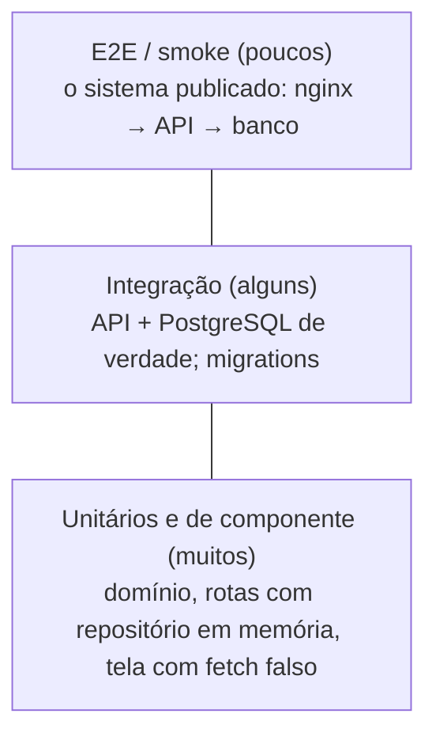

# Aula 12 — Testes, empacotamento e deploy

## Objetivo

Fechar o caminho entre "funciona na minha máquina" e "funciona publicado": testar em camadas, empacotar com Docker, configurar por ambiente, versionar o banco (migrations), automatizar com CI, publicar e saber **voltar atrás**.

O critério da aula **não é "subiu"**. É: *depois da publicação, conseguimos validar o fluxo principal?* Na demonstração você vai ver um deploy quebrado em que **todos os contêineres ficam saudáveis** e mesmo assim o sistema está fora do ar, e só o smoke test percebe.

Ao final, você deve saber explicar:

1. Para que serve cada camada de teste (unitário, integração, ponta a ponta) e quando cada uma roda.
2. Imagem × contêiner, e por que o Dockerfile é escrito em **estágios**.
3. Como o `docker-compose.yml` descreve o sistema e como `healthcheck` + `depends_on` ordenam a subida.
4. Por que configuração vem de **variáveis de ambiente** e segredo nunca vai para o git.
5. O que é uma migration, por que ela é aplicada por um passo separado e por que o rollback do código **não** desfaz o banco.
6. O que um pipeline de CI faz e por que o deploy deve ser *build uma vez, rodar em qualquer lugar*.
7. A diferença entre **rollback** (voltar a versão) e **restore** (voltar os dados), e por que backup só vale se já foi restaurado.

## Material desta pasta

| Arquivo | Para quê |
| ------- | -------- |
| [`tarefas/`](tarefas/) | O projeto: banco + API + front React estático, com testes, Dockerfiles, compose, scripts e CI. O [`README.md`](tarefas/README.md) tem todos os comandos. |

```bash
cd tarefas
cp .env.example .env
docker compose up -d --build --wait                 # banco, migrations, API e front
docker compose --profile smoke run --rm smoke       # o fluxo principal funciona?
# http://localhost:8090
```

---

## 1. A pirâmide de testes e onde cada camada roda



| Camada | Exemplo no projeto | Velocidade | Quando roda |
| ------ | ------------------ | ---------- | ----------- |
| Unitário | [`domain.test.ts`](tarefas/api/test/unit/domain.test.ts), [`api.test.ts`](tarefas/api/test/unit/api.test.ts) (adaptador em memória) | ms | a cada save, no `docker build`, no CI |
| Componente | [`App.test.tsx`](tarefas/web/test/App.test.tsx) | ~1 s | no `docker build` do web, no CI |
| Integração | [`postgres.test.ts`](tarefas/api/test/integration/postgres.test.ts): migrations, SQL, constraints | segundos | `docker-compose.test.yml`, no CI |
| E2E / smoke | [`smoke.test.mjs`](tarefas/e2e/smoke.test.mjs) | segundos | **depois** de cada deploy, e no CI contra o sistema recém-subido |

Pontos para observar:

- A arquitetura hexagonal (aulas 06 e 09) é o que torna a camada de baixo barata: a API roda no teste unitário com `InMemoryTaskRepository`, sem banco.
- O teste de integração **só roda em banco cujo nome termina em `_test`**: ele apaga dados, e ninguém deve apontá-lo para o banco real por engano.
- O smoke test deixa o banco como encontrou (remove o que criou), então pode rodar em produção.

## 2. Docker: imagem, contêiner e o Dockerfile em estágios

- **Imagem** é a receita congelada (sistema + dependências + código). **Contêiner** é uma execução dela. Imagens são imutáveis; contêineres são descartáveis. Por isso o estado (banco) vai num **volume**.
- O [`api/Dockerfile`](tarefas/api/Dockerfile) tem cinco estágios: `deps` → `build` → `test` → `prod-deps` → `runtime`. Cada `FROM` começa do zero; só vai adiante o que um `COPY --from` copia.

| Decisão | Por quê |
| ------- | ------- |
| Copiar `package*.json` **antes** do código | Camadas são cacheadas. Mudou só o código? O `npm ci` vem do cache. |
| `npm ci`, não `npm install` | Instala exatamente o `package-lock.json`: build reproduzível. |
| Estágio `runtime` sem compilador, devDependencies nem testes | Imagem menor (API ~181 MB) e menos superfície de ataque. |
| `USER node` | Contêiner nunca roda como root. |
| `CMD ["node", ...]` em vez de `npm start` | O processo recebe o `SIGTERM` do `docker stop` e desliga limpo (ver `shutdown` em [`index.ts`](tarefas/api/src/index.ts)). |
| `HEALTHCHECK` | É como o Docker (e o `--wait`) sabe que a API está *pronta*, não só *iniciada*. |
| `.dockerignore` | `node_modules` do seu computador não entra na imagem (nem o `.env`). |
| Testes no build | `RUN npm run test:unit` no estágio `test`: teste vermelho = imagem não existe. |

O front ([`web/Dockerfile`](tarefas/web/Dockerfile)) tem dois estágios: Node compila o React; **nginx** serve os arquivos estáticos. A imagem final (~60 MB) não tem Node. O [`nginx.conf`](tarefas/web/nginx.conf) faz três coisas: serve com **cache imutável** os arquivos com hash (`/assets/`), serve o `index.html` **sem cache** (é ele que aponta para os assets novos) e repassa `/api/` para a API.

> **Mesma origem = sem CORS e sem URL embutida no JavaScript.** O front chama `/api`; o nginx (produção) ou o Vite (dev) decide o destino. O mesmo build roda em qualquer ambiente.

## 3. Docker Compose: o sistema como código

O [`docker-compose.yml`](tarefas/docker-compose.yml) descreve os quatro serviços e a **ordem** entre eles:


- `depends_on` + `condition: service_healthy` / `service_completed_successfully`: sem isso, a API tenta conectar num Postgres que ainda está iniciando.
- `docker compose up --wait` só retorna quando tudo ficou saudável (ou falha). É o que o script de deploy usa.
- O banco **não publica porta** (`ports:` ausente). Só a API o alcança, pela rede interna. Para acessá-lo em desenvolvimento há o override [`docker-compose.dev.yml`](tarefas/docker-compose.dev.yml) (`-f` duas vezes mescla os arquivos).
- Três arquivos, três propósitos: **produção-like** (`docker-compose.yml`), **testes** ([`docker-compose.test.yml`](tarefas/docker-compose.test.yml): Postgres em `tmpfs`, descartável, projeto com nome próprio) e **dev** (override).
- *Profiles*: o serviço `smoke` só roda com `--profile smoke`.

## 4. Configuração por ambiente

- Tudo vem de **variáveis de ambiente** ([12-factor, fator III](https://12factor.net/pt_br/config)). O código é o mesmo em dev, teste e produção; muda só o ambiente.
- A [`config.ts`](tarefas/api/src/config.ts) valida com Zod **na partida**: faltou `DATABASE_URL` ou `NODE_ENV=prodution`? O processo morre na hora, com mensagem clara (há [teste](tarefas/api/test/unit/config.test.ts) para isso).
- **Segredo não vai para o git.** `.env.example` (versionado) mostra *quais* variáveis existem; `.env` (no `.gitignore`) tem os valores. No compose, `${POSTGRES_PASSWORD:?mensagem}` faz o comando falhar se a senha não estiver definida.
- Só o *composition root* lê `process.env` (mesma regra do Trabalho III).

## 5. Migrations

Migration é o **histórico versionado do esquema do banco**, em arquivos aplicados em ordem: [`001_create_tasks.sql`](tarefas/api/migrations/001_create_tasks.sql), [`002_add_task_done_at.sql`](tarefas/api/migrations/002_add_task_done_at.sql). O [`migrate.ts`](tarefas/api/src/migrate.ts) é um *runner* de ~40 linhas (Prisma, Flyway etc. fazem o mesmo, com mais recursos):

| Propriedade | Como |
| ----------- | ---- |
| Aplica só o que falta | tabela `schema_migrations` |
| Tudo ou nada | cada migration numa transação (há teste de rollback) |
| Sem corrida entre instâncias | `pg_advisory_lock` |
| Imutável depois de aplicada | checksum; editar uma migration antiga é erro: crie outra |
| Idempotente | rodar duas vezes não faz nada |

**Quem roda?** Um serviço **separado e único** (`migrate`), antes da API, e não o `index.ts` da API. Com três réplicas da API, ninguém quer três processos migrando ao mesmo tempo, nem uma API com permissão de `ALTER TABLE` em runtime.

**Migrations e rollback.** A migration 002 só **adiciona** uma coluna opcional. A versão anterior da API continua funcionando com o banco já migrado, então dá para voltar o código sem desfazer o banco. Isso é o padrão *expand/contract*: expandir (adicionar) → migrar o código → só depois contrair (remover). Migration destrutiva (`DROP COLUMN`, renomear) junto com o deploy da versão nova é o que transforma rollback em desastre.

## 6. CI: build e testes a cada push

O [`ci/github-actions.yml`](tarefas/ci/github-actions.yml) tem quatro jobs, do mais barato ao mais caro: **unit + typecheck** → **web** → **integração** (o mesmo `docker-compose.test.yml` do seu terminal) → **build-and-smoke** (builda as imagens de produção, sobe o sistema inteiro e roda o smoke).

Princípios:

- **Mesmo comando no terminal e no CI.** Se o CI quebra e na sua máquina não, o ambiente é diferente: investigue.
- **Falhe cedo e barato.** Verificações rápidas primeiro.
- **Build uma vez, promova a mesma imagem.** A imagem testada no CI é a que vai para produção (identificada pelo hash do commit), não uma recompilação.
- O job de publicação num registry (GHCR) está comentado, pronto para ativar.

## 7. Deploy, rollback e backup

[`scripts/deploy.sh`](tarefas/scripts/deploy.sh) executa o roteiro inteiro:

```
1 build (testes rodam dentro)  →  2 backup  →  3 up --wait (migrate → api → web)
   →  4 smoke test  →  5 registra a versão   (se 3 ou 4 falhar: rollback automático)
```

- **Versão visível.** A `TAG` (hash do commit) vira `APP_VERSION` na API; o rodapé da tela e o `/api/version` mostram o que está no ar, e o smoke confere (`EXPECTED_VERSION`).
- **Health × Ready.** `/api/health` (liveness: o processo vive?) não toca no banco; `/api/ready` (readiness: pode receber tráfego?) verifica o banco. O healthcheck usa o `ready`.
- **Rollback** ([`rollback.sh`](tarefas/scripts/rollback.sh)): sobe de novo a imagem da tag anterior com `--no-build`. Leva segundos, porque as imagens antigas continuam no servidor. Desfaz o **código**, não os dados.
- **Backup** ([`backup.sh`](tarefas/scripts/backup.sh)): `pg_dump` + validação do arquivo + rotação. **Restore** ([`restore.sh`](tarefas/scripts/restore.sh)): `--verify` restaura num banco temporário e conta as linhas, sem tocar no real. Backup que nunca foi restaurado é esperança, não backup; e backup só na mesma máquina não protege da perda da máquina.

| Problema | Ferramenta | O que volta |
| -------- | ---------- | ----------- |
| Versão nova com bug | **rollback** | o código |
| Migration destrutiva, dado apagado ou corrompido | **restore** | os dados (perdendo o que mudou depois do backup) |

## 8. Roteiro de demonstração

**Parte 1: testes**
1. `cd api && npm run test:unit`: milissegundos, sem Docker. Mostre que a API é testada com o repositório em memória.
2. `docker compose -f docker-compose.test.yml up --build --abort-on-container-exit --exit-code-from api-test; echo $?`: Postgres real, migrations aplicadas, saída `0`.
3. Edite uma migration já aplicada no teste (ou troque `SELECT 1;` por `SELECT 2;`): o checksum recusa.

**Parte 2: empacotar e subir**
4. `docker build --target test -t x ./api` e depois `docker compose build`. Mostre `docker images | grep tarefas` (181 MB e 60 MB). Edite só um arquivo de `src` e rebuild: o `npm ci` vem do cache.
5. `docker compose up -d --build --wait`; `docker compose ps` (migrate `Exited (0)`, resto `healthy`); `docker compose logs migrate`.
6. Abra http://localhost:8090, crie e conclua tarefas. DevTools → *Network*: a chamada vai para `/api/tasks` (mesma origem). Veja os cabeçalhos de `index.html` (`no-cache`) e de `/assets/*.js` (`immutable`).
7. `docker compose exec db psql -U tarefas -c "select * from tasks"`: o dado está no banco. `docker compose down` e `up` de novo: a tarefa continua (volume). `down -v`: some.

**Parte 3: o deploy que "sobe" mas não funciona**
8. `scripts/deploy.sh v1` e depois `scripts/deploy.sh v2` (rodapé: *versão v2*).
9. Em `web/nginx.conf`, troque `api:3000` por `api:3999` e rode `scripts/deploy.sh v3`. Todos os contêineres ficam **healthy**, mas o smoke falha e o script volta sozinho para a v2. Pergunte à turma: o que um `docker ps` verde teria dito?
10. Desfaça a edição do nginx.

**Parte 4: dados**
11. Crie uma tarefa, `scripts/backup.sh`, `scripts/restore.sh --verify <arquivo>`.
12. `docker compose exec db psql -U tarefas -c "truncate tasks"` (o "acidente"), depois `scripts/restore.sh <arquivo>` e confira a tela.

## Exercícios para aprofundar os estudos

1. **Nova migration segura.** Adicione `priority` às tarefas (coluna com `DEFAULT`) e uma rota que a use. Faça deploy e rollback: a versão antiga continua funcionando?
2. **Migration perigosa.** Renomeie `title` para `name` numa só migration e faça `deploy` seguido de `rollback`. O que quebra? Refaça em três deploys (expand/contract).
3. **Teste que pega o bug.** Remova a checagem de `ready` do smoke e repita a Parte 3, item 9. Que parte do sistema você deixou de validar?
4. **Variável faltando.** Apague `POSTGRES_PASSWORD` do `.env` e rode `docker compose up`. Depois defina `NODE_ENV=prodution` na API. Onde cada erro aparece, e quão claro é?
5. **Tamanho e cache.** Troque `node:24-alpine` por `node:24` no runtime. Compare tamanhos. Depois mova o `COPY src` para antes do `npm ci` e meça o rebuild.
6. **Zero downtime.** `docker compose up -d --scale api=2` com o `web` na frente: o que acontece com o `proxy_pass http://api:3000`? O que um balanceador faria de diferente?
7. **E2E de navegador.** Adicione um teste Playwright ao pipeline que abre a página, cria uma tarefa e a conclui. O que ele cobre que o smoke HTTP não cobre? E a que custo?
8. **Publicar de verdade.** Ative o job `publish` do CI (GHCR) e altere o `deploy.sh` para fazer `docker pull` da tag em vez de `build`. Quais riscos novos aparecem (imagem não encontrada, tag mutável)?
9. **Agendar o backup** com cron (ou `docker compose` + um serviço `backup`) e enviar o arquivo a um bucket S3 (RustFS da aula 11). Quem testa o restore, e com que frequência?
