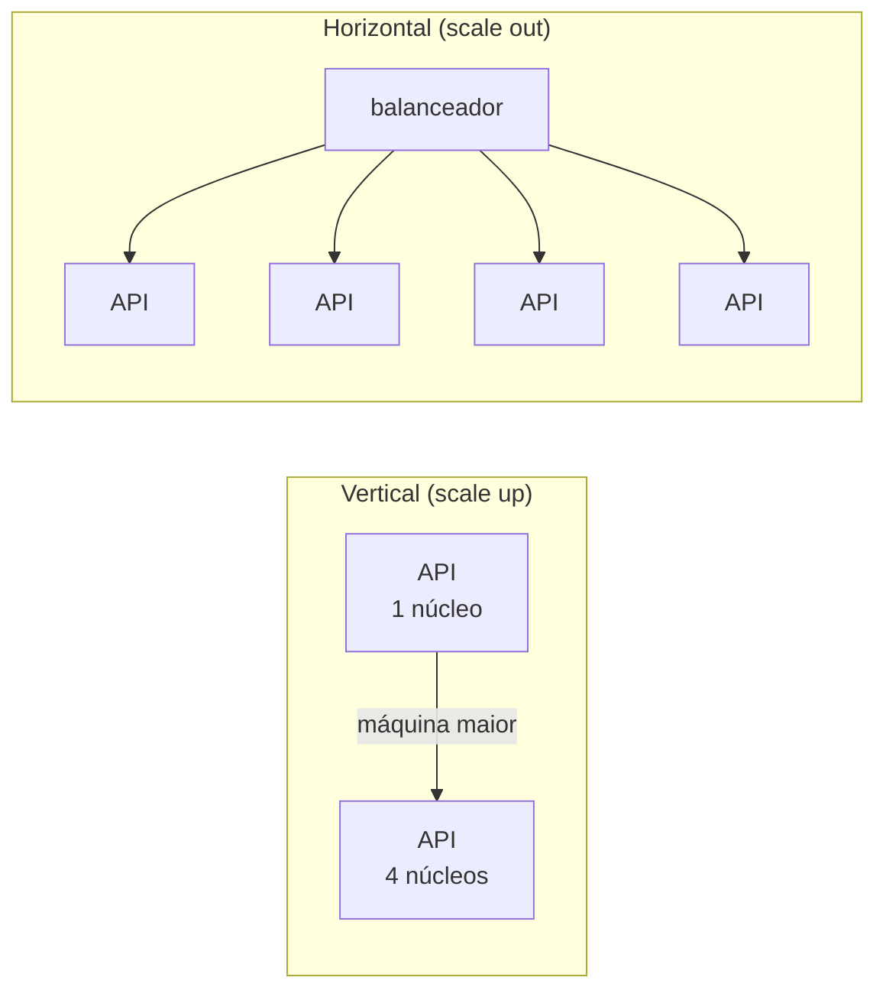
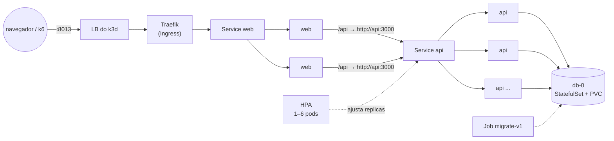
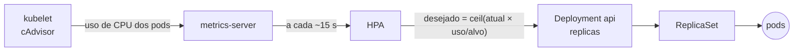
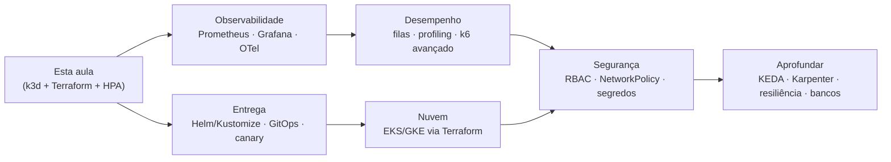

# Aula 13 — Escalabilidade horizontal: Kubernetes, Terraform e teste de carga

## Objetivo

Pegar **o mesmo sistema da [Aula 12](../Aula12/aula12.md)** (PostgreSQL + API Node + front React/nginx) e fazê-lo **aguentar mais carga adicionando cópias da API**, não uma máquina maior. As cópias são criadas **sozinhas** quando a carga sobe e removidas quando ela cai.

Nada é configurado à mão: o cluster é descrito num arquivo YAML, e tudo o que roda dentro dele é descrito em **Terraform**, com os parâmetros de escala (mínimo, máximo, alvo de CPU, recursos) em variáveis. Um **teste de carga** (k6) prova o efeito com números.

O critério da aula: *com a mesma carga, o sistema sem autoscaling falha e o sistema com autoscaling passa, e dá para explicar o porquê de cada número.*

Ao final, você deve saber explicar:

1. Escala **vertical × horizontal**, e por que a horizontal exige uma API **sem estado**.
2. Como cada peça do `docker-compose.yml` da Aula 12 vira um objeto do **Kubernetes**.
3. O que é **Infraestrutura como Código**, e o ciclo `plan` → `apply` do Terraform, com *state* e *drift*.
4. Como o **HPA** decide quantos pods criar, e por que ele depende de **requests** de CPU.
5. Como ler um **teste de carga**: taxa de chegada, p95, thresholds, e por que medir de fora.
6. Por que remover pods sob carga não gera erros (*readiness*, *preStop*, *graceful shutdown*).
7. Onde a escala horizontal **para de ajudar**.

## Material desta pasta

| Arquivo | Para quê |
| ------- | -------- |
| [`aula13-apresentacao.md`](aula13-apresentacao.md) | **Apresentação**: os conceitos e os resultados medidos em slides ([Marp](https://marp.app): extensão "Marp for VS Code", exporta para PDF/PPTX). |
| [`kubernetes.md`](kubernetes.md) | **Texto-base** de Kubernetes: arquitetura, objetos, probes, recursos, `kubectl`. |
| [`infra-como-codigo.md`](infra-como-codigo.md) | **Texto-base** de IaC com Terraform/OpenTofu: conceitos, linguagem, state, drift, boas práticas. |
| [`tarefas/`](tarefas/) | O projeto: a aplicação da Aula 12 + `cluster/` (k3d) + `infra/` (Terraform) + `carga/` (k6) + `scripts/`. O [`README.md`](tarefas/README.md) tem todos os comandos. |

```bash
brew install k3d opentofu k9s       # (Windows/Linux: veja o README)
cd tarefas && cp .env.example .env
scripts/cluster-up.sh               # cria o Kubernetes local (≈ 45 s)
scripts/deploy.sh v1                # build → imagens no cluster → tofu apply → smoke (≈ 50 s)
# http://localhost:8013
scripts/observar.sh                 # (outro terminal) painel: HPA, pods, CPU
scripts/carga.sh                    # teste de carga (3,5 min)
```

---

## 1. Escalar: para cima ou para os lados?



| | Vertical | Horizontal |
| - | -------- | ---------- |
| Como | Máquina com mais CPU e memória | Mais cópias idênticas atrás de um balanceador |
| Limite | O maior servidor que existe (e o preço sobe mais que linear) | Os recursos compartilhados (banco, rede) |
| Falha | Um processo: caiu, caiu tudo | Uma cópia cai, as outras atendem |
| Exige da aplicação | Nada | Ser **sem estado** |
| Ajustar com o sistema no ar | Normalmente requer reiniciar | Adicionar e remover cópias a qualquer momento |

**Node.js tem um agravante:** o JavaScript roda numa **única thread**. Uma instância da API usa no máximo ~1 núcleo, por maior que seja a máquina. Escalar Node é, quase sempre, rodar **mais processos**.

### O pré-requisito: API sem estado

Se a API guarda algo **em memória** (sessão de usuário, carrinho, um lock, um cache), cada cópia tem a **sua** versão, e o usuário "perde" o estado quando o balanceador o manda para outra cópia. Isso já foi visto na [Aula 10](../Aula10/aula10.md) (lock no Redis) e no texto [*Sessões em memória × Redis*](../SESSAO-REDIS-VS-MEMORIA.md). A API de tarefas é sem estado: tudo está no PostgreSQL. Por isso ela pode ter 1 ou 6 cópias sem mudar uma linha.

## 2. Do Compose ao Kubernetes

O Docker Compose da Aula 12 descreve contêineres **numa máquina**. O Kubernetes descreve o sistema **num cluster** e mantém o estado real igual ao desejado. Leia o [texto-base](kubernetes.md) para os conceitos. Esta é a tradução peça por peça:

| Aula 12 (`docker-compose.yml`) | Aula 13 (Kubernetes, via [`infra/`](tarefas/infra/)) |
| ------------------------------ | --------------------------------------------- |
| `.env` com `POSTGRES_PASSWORD` | **Secret** `db` (a senha chega ao Terraform por `TF_VAR_db_password`) |
| serviço `db` + volume `pgdata` | **StatefulSet** `db` + **PersistentVolumeClaim** + Service *headless* `db` |
| `migrate` *one-shot* + `service_completed_successfully` | **Job** `migrate-<versão>` + `wait_for_completion` |
| `api` + `HEALTHCHECK` | **Deployment** `api` + *readiness* `/api/ready` + *liveness* `/api/health` |
| `docker compose up --scale api=3` | `replicas`, ou o **HorizontalPodAutoscaler** |
| nome `api` na rede do Compose | **Service** `api`: DNS + IP virtual, balanceando entre os pods prontos |
| `web` + `ports: "8090:8080"` | Deployment `web` + Service + **Ingress** (Traefik) ← LB do k3d em `localhost:8013` |
| `docker compose up --wait` | `tofu apply` (com `wait_for_rollout`) |



**A resposta ao exercício 6 da Aula 12.** Lá, com `--scale api=2`, o nginx resolvia o nome `api` **uma vez**, na partida, e mandava tudo para um contêiner só. Aqui o **mesmo `nginx.conf`** funciona: `api` resolve para o IP **virtual** do Service, que nunca muda, e o kube-proxy distribui cada conexão entre os pods prontos. A aplicação não sabe quantas cópias existem.

### O que mudou na aplicação

Quase nada (a arquitetura hexagonal ajuda de novo):

| Mudança | Para quê |
| ------- | -------- |
| `GET /api/tasks/report` ([`tasks.ts`](tarefas/api/src/application/tasks.ts)) | Um relatório que **gasta CPU de verdade**: a "assinatura" com PBKDF2 (≈ 19 ms de CPU) representa gerar PDF, comprimir ou assinar. É síncrono, então ocupa a única thread do Node. |
| Cabeçalho `X-Instance` em toda resposta, e `instance` em `/api/version` | Ver **qual pod** atendeu (curl, rodapé da tela, `scripts/quem-responde.sh`). |
| `DB_POOL_MAX` e `REPORT_CPU_COST` na [`config.ts`](tarefas/api/src/config.ts) | Parâmetros que vêm do Terraform. |

## 3. O cluster como código: k3d

O [k3d](https://k3d.io) roda o **k3s** (um Kubernetes certificado e leve) dentro de contêineres Docker. O cluster inteiro está em [`cluster/k3d.yaml`](tarefas/cluster/k3d.yaml): 1 *server* (control plane) + 2 *agents* (nós de trabalho), a porta 8013 e a versão do Kubernetes fixada.

```bash
scripts/cluster-up.sh
kubectl get nodes          # 3 nós...
docker ps | grep k3d       # ...que são contêineres na sua máquina
```

Ele já traz o **metrics-server** (sem ele, não há HPA), o **Traefik** (Ingress) e o **local-path** (volumes persistentes).

> Por que o cluster não está no Terraform? Porque o Terraform de `infra/` **conecta-se** ao cluster: ele precisa existir antes. Na nuvem, o cluster também seria Terraform (`aws_eks_cluster`, `google_container_cluster`), normalmente num projeto separado. São duas camadas: **plataforma** e **aplicação**.

## 4. Infraestrutura como código: Terraform

Leia o [texto-base de IaC](infra-como-codigo.md). No projeto, [`infra/`](tarefas/infra/) tem um arquivo por peça (`postgres.tf`, `migrate.tf`, `api.tf`, `hpa.tf`, `web.tf`, `ingress.tf`) e **todos os parâmetros** em [`variables.tf`](tarefas/infra/variables.tf), com descrição e validação.

### Os cenários

O mesmo código, com valores diferentes ([`infra/cenarios/`](tarefas/infra/cenarios/)):

| Cenário | Parâmetros | Para quê |
| ------- | ---------- | -------- |
| `sem-hpa` | `hpa_enabled = false`, `api_replicas = 1` | O "antes" |
| `hpa` | 1–6 pods, alvo 60 %, scale-down após **300 s** (padrão do K8s) | O realista |
| `hpa-agressivo` | igual, scale-down após **30 s** | Caber na aula |

```bash
scripts/cenario.sh sem-hpa        # copia para infra/cenario.auto.tfvars e roda tofu apply
scripts/tf.sh plan                # o que mudaria? (o .env já é carregado)
scripts/tf.sh plan -var hpa_max=10   # "e se...?", sem aplicar
```

### Pontos para observar

- **`tofu plan` é a revisão.** Antes de qualquer mudança, leia o plano com a turma: `+`, `~`, `-/+` (substituir). Trocar a versão **substitui** o Job de migration (nome novo) e **altera** os Deployments.
- **O state guarda a senha em texto puro** (`grep troque infra/terraform.tfstate`). Por isso ele está no `.gitignore` e, em equipe, mora num backend remoto com lock.
- **Quem manda no número de pods?** Com o HPA ligado, `replicas = null` no [`api.tf`](tarefas/infra/api.tf): o Terraform "solta" o campo. Sem isso, cada `apply` desfaria o autoscaler. Com 5 pods criados pelo HPA, o `plan` diz **No changes**.
- **Validação antes de tocar no cluster.** `hpa_cpu_target = 150` falha na `validation`. `hpa_max = 10` com `db_pool_max = 10` falha na `precondition` (10 × 10 > 100 − 5 conexões do Postgres), e nenhum recurso é alterado.

## 5. HPA: o autoscaler horizontal



**A fórmula**: `réplicas desejadas = ceil( réplicas atuais × uso médio / alvo )`

**O "uso" é em % do *request*.** A API pede `250m` (¼ de núcleo) e tem limite de `500m`. Com alvo de 60 %, o HPA quer cada pod usando ~150m. Um pod no limite marca 200 % (500/250). Sem *request* de CPU, o HPA não tem base de cálculo e fica com `<unknown>`.

Exemplo real, medido na aula (60 req/s, cenário `hpa-agressivo`):

| t | Uso médio | Réplicas | Conta do HPA |
| - | --------- | -------- | ------------ |
| 40 s | 82 % | 1 → 2 | ceil(1 × 82/60) = 2 |
| 55 s | 114 % | 2 → 4 | ceil(2 × 114/60) = 4 |
| 70 s | 129 % | 4 → 5 | (média no momento da decisão) |
| 100 s+ | 55–60 % | 5 | estável: ceil(5 × 57/60) = 5 |

**Por que demora?** São várias esperas somadas: o metrics-server coleta a cada ~15 s, o HPA decide a cada 15 s, o pod novo precisa iniciar e passar na *readiness*, e o `behavior` limita o ritmo. Escalar **reage** à carga, não a **antecipa**. Picos instantâneos precisam de folga (`hpa_min` maior) ou de escala agendada.

**`behavior`** ([`hpa.tf`](tarefas/infra/hpa.tf)): sobe rápido (dobra, ou +4 pods, a cada 15 s) e desce devagar (no máximo metade a cada 15 s, depois da janela de estabilização). A janela de **300 s** para descer evita o *flapping*: subir, descer e subir de novo quando a carga oscila.

## 6. Teste de carga com k6

O [`carga/escala.js`](tarefas/carga/escala.js) usa o executor `ramping-arrival-rate`, um **modelo aberto**: as requisições chegam numa **taxa** (req/s), estejam as respostas rápidas ou lentas, como usuários reais. No modelo **fechado** (N usuários em loop), um sistema lento recebe *menos* carga, o que esconde o problema.

```
taxa
 60 ┤        ┌──────── platô (2 min) ────────┐
 15 ┤ ┌──────┘                               └──┐
    └─┴────────────────────────────────────────┴──▶
      30 s   30 s                            30 s
```

Mistura: 60 % relatório (CPU), 30 % listagem (banco), 10 % criar + apagar.

**Como ler o resultado:**

- **p95 / p99**: 95 % (99 %) das requisições levaram até X. A média esconde a cauda, e o usuário que espera 10 s não é consolado pela média.
- **`http_req_failed`**: erros e *timeouts* (10 s no script).
- **`dropped_iterations`**: o k6 não teve usuários virtuais livres para manter a taxa, porque o sistema estava lento demais.
- **Thresholds** são critérios de aceite: `p(95) < 500 ms` no relatório e menos de 1 % de erros. Se falharem, o k6 sai com código ≠ 0, o que serve para CI.
- **Rodamos de fora do cluster** (um contêiner na rede do k3d → LB → Traefik → nginx → API) para medir o caminho do usuário, sem roubar CPU dos pods medidos. Mesmo assim, k6 e cluster dividem a mesma máquina.

## 7. Resultados medidos (nesta máquina: Apple Silicon, 8 núcleos para o Docker)

| Cenário | Carga | p95 relatório | p95 listagem | Erros | Pods |
| ------- | ----- | ------------- | ------------ | ----- | ---- |
| `sem-hpa` | pico 40 req/s | 162 ms | 126 ms | 0 % | 1 (CPU 450–474m de 500m) |
| `sem-hpa` | **pico 60 req/s** | **10 s** (timeout) | **10 s** | **9,2 %** (+638 descartadas) | 1 |
| `hpa-agressivo` | **pico 60 req/s** | **43 ms** | **6 ms** | **0 %** | 1 → 5 em ~75 s |
| `hpa-agressivo` + deploy v2 no meio | pico 60 req/s | 42 ms | 6 ms | **0 %** (12.433 req) | ~5, trocados um a um |
| scale-down 5 → 1 | 6 req/s contínuos | 43 ms | 8 ms | **0 %** (637 req) | 5 → 4 → 2 → 1 em ~50 s |

O que discutir:

- **A listagem também quebra** sem HPA, embora quase não use CPU: o event loop está ocupado assinando relatórios, e todas as requisições esperam na mesma fila. Uma rota lenta derruba as rápidas.
- **Fila sem fim:** a 60 req/s chegam ~36 relatórios/s × 19 ms ≈ 690m de CPU, e o pod só tem 500m. O excesso não é "um pouco mais lento": ele **acumula**, até o timeout. Capacidade abaixo da demanda é colapso, não degradação.
- **Zero erros ao remover pods.** Resultado de três peças juntas: a *readiness* tira o pod do Service, o `preStop: sleep 5` dá tempo para os balanceadores perceberem, e o `shutdown()` do [`index.ts`](tarefas/api/src/index.ts) termina as requisições em andamento.

## 8. Onde a escala horizontal para

| Gargalo | Por quê | O que se faz |
| ------- | ------- | ------------ |
| **Banco único** | Todas as cópias da API usam o mesmo PostgreSQL, que não escala com `replicas`. | Índices e consultas melhores; **cache** (Redis, Aula 10); réplicas de **leitura**; tirar trabalho da requisição com **filas** (Kafka, Aula 11); particionamento. |
| **Conexões** | 6 pods × 10 conexões = 60; o Postgres aceita 100. A 11ª cópia derrubaria o banco. | `precondition` no Terraform; pool menor por pod; um *pooler* (PgBouncer). |
| **Limite de CPU** | Acima do *limit*, o pod é estrangulado (*throttling*): ele não morre, mas fica lento. | Medir e ajustar *requests/limits*; o HPA deve agir **antes** do teto (alvo < 100 %). |
| **Capacidade dos nós** | Se os *requests* somados não cabem nos nós, os pods ficam `Pending`. | **Cluster Autoscaler** / Karpenter: adiciona **nós** (máquinas). Na nuvem; aqui é só conceitual. |
| **Tempo de reação** | ~1 min do pico até os pods novos atenderem. | `hpa_min` maior nos horários de pico; escala agendada; imagens pequenas para iniciar rápido. |
| **Estado em memória** | Sessão ou cache local quebram com várias cópias. | Estado em serviço externo (Redis, banco). |

> **Os nós do k3d são de mentira.** Os três "nós" são contêineres na mesma máquina e dividem as mesmas CPUs. Os mecanismos são idênticos aos de um cluster real, mas o ganho de **hardware** só existe com máquinas de verdade.

## 9. Roteiro de demonstração

Deixe **dois terminais** lado a lado: um com `scripts/observar.sh` (ou `k9s`), outro para os comandos.

**Parte 1: o cluster**
1. `scripts/cluster-up.sh`. Depois `kubectl get nodes` e `docker ps | grep k3d`: os nós são contêineres. Mostre o [`k3d.yaml`](tarefas/cluster/k3d.yaml).

**Parte 2: Terraform**
2. Mostre [`variables.tf`](tarefas/infra/variables.tf) e [`api.tf`](tarefas/infra/api.tf). Rode `scripts/deploy.sh v1` e leia a saída do `apply` (ordem: namespace → Secret → StatefulSet → Job → Deployment → HPA).
3. Abra http://localhost:8013 e crie tarefas. O rodapé mostra *versão v1 · atendido por api-…*.
4. `scripts/tf.sh plan` → *No changes*. `scripts/tf.sh state list`. `grep troque infra/terraform.tfstate`: o segredo está no state.

**Parte 3: sem autoscaling**
5. `scripts/cenario.sh sem-hpa` e depois `scripts/carga.sh`. No painel: 1 pod com CPU colada em ~500m. No k6: p95 sobe até 10 s, os erros aparecem e os thresholds falham (✗). Pergunte: por que a **listagem** também ficou lenta?

**Parte 4: com autoscaling**
6. `scripts/cenario.sh hpa-agressivo` e depois `scripts/carga.sh`. No painel, acompanhe `TARGETS` subindo (82 %, 114 %...), os pods passando por `Pending → Running → PRONTO true` e os nós escolhidos. Faça a conta da fórmula em voz alta. No k6: thresholds ✓.
7. Durante o platô, `scripts/quem-responde.sh`: as respostas vêm de vários pods. Dê F5 na página e veja o rodapé mudar.

**Parte 5: scale-down sem erros**
8. Logo depois, `PICO=6 PLATO=90s RAMPA=5s scripts/carga.sh`. Os pods vão para `Terminating` (5 → 4 → 2 → 1), e o k6 termina com 0 % de erros. Explique o *preStop* e o `shutdown()`. Experimente comentar o `pre_stop` no `api.tf`, aplicar e repetir.

**Parte 6: quem é o dono do `replicas`?**
9. Com o HPA ligado: `kubectl -n tarefas scale deploy/api --replicas=4`. Em ~1 min, o HPA traz de volta para 1.
10. `scripts/cenario.sh sem-hpa`, depois `kubectl -n tarefas scale deploy/api --replicas=3` e `scripts/tf.sh plan`: aparece `~ replicas = "3" -> "1"`. É **drift**: o próximo `apply` desfaz a mudança manual.

**Parte 7: deploy e rollback sob carga**
11. `scripts/cenario.sh hpa-agressivo`, `scripts/carga.sh` em um terminal e, no meio do platô, `scripts/deploy.sh v2` no outro. O *rolling update* troca os pods um a um, e o k6 termina sem erros.
12. `scripts/rollback.sh`: volta para a v1 em segundos (as imagens já estão no cluster). Por que não `kubectl rollout undo`? Porque o código diria v2, e o próximo `apply` desfaria o rollback.

**Parte 8: o limite**
13. `scripts/tf.sh plan -var hpa_max=10` → a `precondition` recusa: o banco não teria conexões para todos. Discuta a tabela da seção 8.

**Fim:** `scripts/cluster-down.sh` apaga o cluster e o state.

## 10. Indo além: o que vale a pena estudar depois desta aula

Esta aula tocou em muitos assuntos que, sozinhos, são uma área inteira de estudo. Abaixo estão os caminhos mais valiosos para quem quer trabalhar com sistemas web em produção. Cada um parte de algo que você **já viu funcionando** no projeto.

### 10.1 O que você *deveria* estudar (base de quem coloca sistemas no ar)

#### Observabilidade: medir antes de escalar

Na aula, olhamos CPU no `kubectl top` e latência no resumo do k6. Em produção, você precisa dessas informações **o tempo todo**, com histórico e alertas, e precisa saber **onde** o tempo foi gasto em cada requisição.

- **Métricas**: [Prometheus](https://prometheus.io) + [Grafana](https://grafana.com/oss/grafana/). O `kube-prometheus-stack` (Helm) instala tudo num cluster como o da aula.
- **Traces distribuídos**: [OpenTelemetry](https://opentelemetry.io). Veja uma requisição atravessar nginx → API → PostgreSQL, com o tempo de cada trecho.
- **Logs estruturados** (JSON) e centralizados: Loki, ELK.
- **O que medir**: os *quatro sinais de ouro* (latência, tráfego, erros, saturação), os métodos **RED** (para serviços) e **USE** (para recursos).
- **SLI, SLO e error budget**: transformar "p95 < 500 ms" (o threshold do k6) num **compromisso** com o usuário, e decidir com base nele quando parar de lançar funcionalidades para cuidar da estabilidade.
- 📖 *Site Reliability Engineering* e *The Site Reliability Workbook*, do Google, gratuitos em <https://sre.google/books/>.

#### Desempenho de verdade: entender a fila

Sem HPA, a API não ficou "um pouco mais lenta": ela **colapsou**. Isso tem explicação matemática, e entendê-la muda a forma como você dimensiona sistemas.

- **Lei de Little**: `L = λ × W` (itens no sistema = taxa de chegada × tempo de permanência). Com 36 relatórios/s chegando e capacidade para ~26/s, a fila só cresce.
- **Teoria das filas** básica: por que a latência explode perto de 100 % de utilização, e por que o alvo do HPA é 60 %, não 95 %.
- **Profiling de Node.js**: `node --cpu-prof`, [Clinic.js](https://clinicjs.org), *flame graphs*. Descubra **o que** gasta CPU antes de comprar mais CPU.
- **Trabalho pesado fora do event loop**: `worker_threads`, `crypto.pbkdf2` **assíncrono** (em vez do `pbkdf2Sync` da aula) e filas (Aula 11). Refaça a medição e compare.
- **k6 como disciplina**: testes de *stress*, *soak* (horas de carga constante, para achar vazamentos) e *spike*; thresholds no CI; [documentação do k6](https://grafana.com/docs/k6/latest/).
- **Planejamento de capacidade**: de "quantos usuários teremos?" para "quantos pods, conexões e núcleos?".

#### Entrega contínua no Kubernetes: GitOps

Na aula, o Terraform aplicou tudo a partir do seu computador. Em equipes, o cluster se atualiza **sozinho a partir do git**, e ninguém roda `apply` na mão.

- **GitOps**: [Argo CD](https://argo-cd.readthedocs.io) ou [Flux](https://fluxcd.io). O cluster observa um repositório e reconcilia (é o mesmo laço do Kubernetes, um nível acima).
- **Helm** e **Kustomize**: os formatos mais usados para empacotar manifestos. Saiba ler e escrever os dois.
- **Estratégias de deploy**: *blue-green*, *canary* (1 % → 10 % → 100 %, com rollback automático pelas métricas): Argo Rollouts, Flagger.
- **Feature flags**: separar *deploy* (código no ar) de *release* (funcionalidade ligada).
- **Registry de imagens** e promoção da mesma imagem entre ambientes (o "build uma vez" da Aula 12, agora com `docker push`).

#### Segurança de contêineres e de cluster

O projeto tem `USER node`, Secret e segredo fora do git. Isso é o começo:

- **RBAC**: quem (pessoa ou pod) pode fazer o quê em qual namespace. Princípio do menor privilégio.
- **NetworkPolicy**: hoje, qualquer pod do cluster alcança o `db`. Restrinja para "só a API fala com o banco".
- **Pod Security Standards**: sem root, sistema de arquivos só leitura, sem *capabilities* extras.
- **Segredos de verdade**: External Secrets + um cofre (Vault, AWS Secrets Manager), Sealed Secrets ou SOPS. Lembre que o Secret do Kubernetes é só base64 e que o state do Terraform guarda a senha.
- **Cadeia de suprimentos**: varredura de imagens ([Trivy](https://trivy.dev)), SBOM, assinatura de imagens (cosign).
- 📖 [OWASP Kubernetes Top Ten](https://owasp.org/www-project-kubernetes-top-ten/).

#### Kubernetes numa nuvem de verdade

O k3d simula tudo numa máquina. O passo seguinte é um cluster gerenciado:

- **EKS** (AWS), **GKE** (Google) ou **AKS** (Azure), criados com **Terraform** (módulos oficiais, como `terraform-aws-modules/eks/aws`).
- O que muda: `LoadBalancer` de verdade, volumes de disco de rede, múltiplas zonas de disponibilidade, IAM integrado ao RBAC.
- **Custos (FinOps)**: requests superdimensionados custam dinheiro todo mês. Use instâncias *spot* e escale para baixo à noite.
- As contas gratuitas e os créditos para estudantes (GitHub Student Developer Pack, AWS Educate, Google Cloud for Education) bastam para experimentar. **Destrua tudo ao terminar** (`tofu destroy`).

### 10.2 O que você *poderia* estudar (aprofundamentos)

| Tema | Por que é interessante | Por onde começar |
| ---- | ---------------------- | ---------------- |
| **Autoscaling por eventos** | Escalar os workers da Aula 11 pelo **lag** do Kafka, não por CPU, inclusive até **zero** pods | [KEDA](https://keda.sh) |
| **Autoscaling por métricas de negócio** | Escalar por req/s ou latência em vez de CPU | Prometheus Adapter + HPA `type: Pods/External` |
| **Escalar os nós** | Quando os pods ficam `Pending`, alguém precisa criar máquinas | Cluster Autoscaler, [Karpenter](https://karpenter.sh) |
| **Escala vertical automática** | Descobrir o *request* certo a partir do uso real | Vertical Pod Autoscaler (modo recomendação) |
| **Bancos que escalam** | O gargalo que sobrou na seção 8 | PgBouncer, réplicas de leitura, [CloudNativePG](https://cloudnative-pg.io), *sharding*; 📖 *Designing Data-Intensive Applications* (Kleppmann) |
| **Padrões de resiliência** | Timeouts, retries com *backoff*, *circuit breaker*, *rate limiting*, *bulkhead* | 📖 *Release It!* (Nygard) |
| **Engenharia do caos** | Derrubar pods e nós de propósito para provar que o sistema aguenta | Chaos Mesh, LitmusChaos; comece com `kubectl delete pod` durante o `carga.sh` |
| **Distribuição entre zonas** | Sobreviver à queda de um datacenter | `topologySpreadConstraints`, PodDisruptionBudget, multi-AZ |
| **Rede moderna** | O sucessor do Ingress, e rede com eBPF | [Gateway API](https://gateway-api.sigs.k8s.io), [Cilium](https://cilium.io) |
| **Service mesh** | mTLS entre serviços, retries e métricas sem mudar o código | Linkerd (mais simples), Istio |
| **IaC avançada** | Testar e revisar infraestrutura como se testa código | `tofu test`, Terratest, tflint, Checkov; *plans* comentados no PR (Atlantis) |
| **Plataformas internas** | Times de plataforma oferecem "crie um banco" como API | Crossplane, Backstage |
| **Policy as code** | Regras automáticas ("todo pod precisa de request") | Kyverno, OPA Gatekeeper |
| **Serverless sobre K8s** | Escala até zero e cobra por requisição | Knative, Google Cloud Run |

### 10.3 Uma trilha sugerida



1. **Comece pela observabilidade.** Instale o `kube-prometheus-stack` no cluster da aula, crie um painel com p95, req/s e réplicas, e rode o `carga.sh` olhando para ele. Tudo o que vem depois depende de saber medir.
2. **Volte ao desempenho.** Troque o `pbkdf2Sync` por `pbkdf2` assíncrono ou por `worker_threads`, e compare quantos pods o HPA cria para a mesma carga.
3. **Automatize a entrega.** Converta o `infra/` (ou só a API) para Helm ou Kustomize e entregue com Argo CD a partir de um repositório.
4. **Suba numa nuvem** com Terraform, rode a mesma carga e **destrua** no fim.
5. **Endureça a segurança**: NetworkPolicy para o banco, Pod Security, segredos fora do state.

**Certificações**, se quiser uma meta com prova no fim: KCNA (introdutória, conceitos) → **CKAD** (desenvolvedor: a mais útil para quem programa) → CKA (administração de cluster); e HashiCorp Terraform Associate. Para praticar de graça, use os laboratórios interativos do [Killercoda](https://killercoda.com) e o [tutorial oficial do Kubernetes](https://kubernetes.io/pt-br/docs/tutorials/kubernetes-basics/).

**Livros que valem o tempo:** *Kubernetes Up & Running* (Burns et al.), *Terraform: Up & Running* (Brikman), *Site Reliability Engineering* (Google, gratuito), *Designing Data-Intensive Applications* (Kleppmann) e *Release It!* (Nygard).
