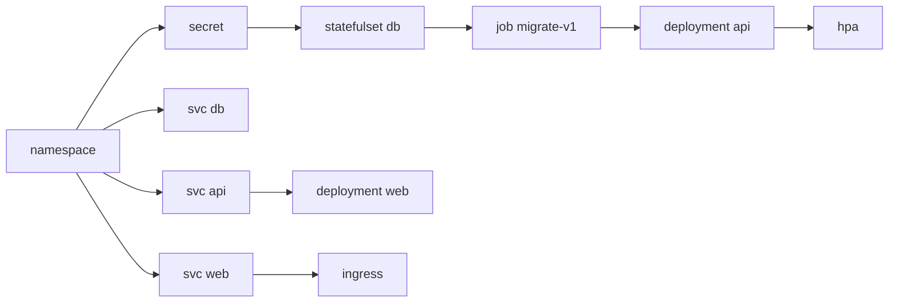
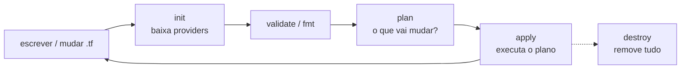
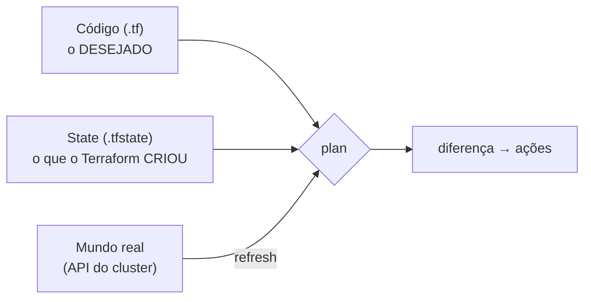

# Infraestrutura como Código com Terraform / OpenTofu

> Leitura de apoio da [Aula 13](aula13.md). Os exemplos vêm de [`tarefas/infra/`](tarefas/infra/), que descreve todo o sistema dentro de um Kubernetes local.

## 1. Objetivo deste texto

Ao terminar a leitura, você deve saber:

1. O que é **Infraestrutura como Código** (*Infrastructure as Code*, IaC) e que problemas ela resolve.
2. A diferença entre o estilo **declarativo** e o **imperativo**.
3. Os elementos do Terraform: *provider*, *resource*, *variable*, *output*, *locals*, *data source*, *module*.
4. O ciclo `init` → `plan` → `apply` → `destroy`, e por que o `plan` é o momento mais importante.
5. O que é o **state**, por que ele guarda segredos e onde ele deve morar.
6. O que é **drift** e como o Terraform o detecta.
7. Como o projeto da aula usa tudo isso para **parametrizar** a escalabilidade da API.

## 2. O problema: infraestrutura "clicada"

Imagine colocar o sistema `tarefas` em produção numa nuvem sem IaC: você entra no console web, cria a rede, o cluster, o banco, os balanceadores, os certificados... dezenas de telas e centenas de campos. Meses depois:

- **Ninguém lembra** por que aquele campo tem aquele valor, nem quem mudou.
- Criar um **ambiente de homologação idêntico** leva dias, e ele nunca sai idêntico.
- Um desastre (conta comprometida, região fora) exige **reconstruir tudo de memória**.
- A mudança não passou por **revisão**. Não há *pull request* para um clique.
- Produção vai ficando diferente do que todos acham que ela é (*configuration drift*).

Em resumo: o mesmo problema do código antes do controle de versão.

## 3. A ideia: infraestrutura descrita em arquivos versionados

**Infraestrutura como Código** é descrever servidores, redes, bancos, clusters, DNS e permissões em **arquivos de texto**, guardados no **git**, e deixar uma **ferramenta** criar e atualizar os recursos reais a partir deles.

| Sem IaC | Com IaC |
| ------- | ------- |
| Console web, cliques, wiki desatualizada | Arquivos `.tf` no repositório |
| "Quem mudou isso?" | `git log`, `git blame`, pull request revisado |
| Ambientes divergem | Mesmo código, parâmetros diferentes (`dev.tfvars`, `prod.tfvars`) |
| Recriar leva dias | `tofu apply` em minutos |
| Mudança arriscada às cegas | `tofu plan` mostra **exatamente** o que vai mudar, antes |
| Documentação separada | O código **é** a documentação, e está sempre atualizada |

### Benefícios, em uma frase cada

- **Reprodutibilidade**: o mesmo código produz a mesma infraestrutura, em qualquer conta ou máquina.
- **Revisão**: mudança de infra passa pelo mesmo *pull request* e pela mesma discussão que o código.
- **Auditoria**: o histórico do git mostra quem, quando e por quê.
- **Velocidade**: ambientes novos (homologação, um ambiente por PR, a turma inteira) saem de um comando.
- **Recuperação de desastres**: reconstruir é executar de novo.
- **Parametrização**: diferenças entre ambientes viram **variáveis**, não cópias.

## 4. Declarativo × imperativo

```bash
# IMPERATIVO: os PASSOS. Rodar duas vezes cria dois; você trata cada caso.
kubectl create deployment api --image=tarefas-api:v1
kubectl scale deployment api --replicas=3
kubectl set image deployment/api api=tarefas-api:v2
```

```hcl
# DECLARATIVO: o RESULTADO. A ferramenta descobre os passos.
resource "kubernetes_deployment_v1" "api" {
  spec {
    replicas = 3
    template { spec { container { image = "tarefas-api:v2" } } }
  }
}
```

No estilo declarativo, a ferramenta compara **o desejado** (o código) com **o que existe** e calcula a diferença: criar, alterar, destruir ou nada. Rodar duas vezes dá o mesmo resultado (**idempotência**). É a mesma filosofia do Kubernetes ([texto-base](kubernetes.md#2-a-ideia-central-declarativo--laço-de-reconciliação)). Aqui temos duas camadas declarativas, uma sobre a outra.

## 5. O panorama de ferramentas

| Ferramenta | Estilo | Linguagem | Foco |
| ---------- | ------ | --------- | ---- |
| **Terraform** (HashiCorp) | declarativo | HCL | Qualquer coisa com API: nuvens, Kubernetes, DNS, GitHub, Cloudflare... (milhares de *providers*) |
| **OpenTofu** (Linux Foundation) | declarativo | HCL | *Fork* aberto do Terraform (veja abaixo). Mesmo código, mesmos providers. |
| **Pulumi** | declarativo | TypeScript, Python, Go... | Como o Terraform, mas em linguagem de programação |
| **AWS CloudFormation / CDK**, **Azure Bicep** | declarativo | YAML/JSON / TS / Bicep | Presos a um provedor |
| **Ansible**, Chef, Puppet | mais imperativo / configuração | YAML / Ruby | **Configurar** máquinas existentes (instalar pacotes, editar arquivos) |
| **Helm**, **Kustomize** | declarativo | YAML (templates/patches) | Só manifestos de Kubernetes |
| **Docker Compose** (Aula 12) | declarativo | YAML | Contêineres numa máquina: também é uma forma de IaC |

> **Terraform × OpenTofu.** Em 2023, a HashiCorp trocou a licença do Terraform de *open source* (MPL) para BUSL, que restringe o uso por concorrentes. A comunidade criou o **OpenTofu**, um *fork* da última versão aberta, mantido pela Linux Foundation. Para quem usa (e para esta aula), os dois são **intercambiáveis**: mesma linguagem e mesmos providers, com `tofu` no lugar de `terraform`. Os scripts do projeto usam `tofu` se existir e `terraform` caso contrário.

## 6. Anatomia de um projeto Terraform

```
infra/
├── versions.tf        # versão da ferramenta e dos providers
├── providers.tf       # como se conectar (aqui: ao cluster do k3d)
├── variables.tf       # os PARÂMETROS, com descrição e validação
├── terraform.tfvars   # valores base (versionado, sem segredo)
├── cenarios/*.tfvars  # conjuntos de valores alternativos
├── namespace.tf  postgres.tf  migrate.tf  api.tf  hpa.tf  web.tf  ingress.tf
├── outputs.tf         # o que mostrar no fim
├── .terraform.lock.hcl  # versões EXATAS dos providers (vai para o git)
└── terraform.tfstate    # o STATE (NÃO vai para o git)
```

O Terraform lê **todos** os `.tf` da pasta como se fossem um arquivo só. A divisão em arquivos é só para organizar, e a **ordem não importa**: o que define a ordem são as dependências (seção 7.8).

## 7. Os principais elementos da linguagem (HCL)

### 7.1 `terraform` e `provider`

O **provider** é o "driver" que traduz cada recurso em chamadas de API. Há providers para AWS, Google, Azure, Kubernetes, GitHub, Cloudflare e milhares de outros (<https://registry.terraform.io>, <https://search.opentofu.org>).

```hcl
terraform {
  required_version = ">= 1.6"
  required_providers {
    kubernetes = { source = "hashicorp/kubernetes", version = "~> 2.36" }  # 2.36 ≤ v < 3.0
  }
}

provider "kubernetes" {
  config_path    = pathexpand(var.kubeconfig_path)   # o mesmo ~/.kube/config do kubectl
  config_context = var.kube_context                  # "k3d-aula13"
}
```

O `tofu init` baixa o provider e grava a versão exata no `.terraform.lock.hcl`. Esse arquivo **vai para o git**, pelo mesmo motivo que o `package-lock.json`.

### 7.2 `resource`: o que existe no mundo real

```hcl
resource "kubernetes_service_v1" "api" {      # tipo + nome LOCAL (só existe no Terraform)
  metadata {
    name      = "api"                          # nome REAL, no cluster
    namespace = local.ns
  }
  spec {
    selector = { app = "api" }
    port { port = 3000, target_port = 3000 }
  }
}
```

Para referenciar o recurso em outro lugar, use `TIPO.NOME.atributo`, como em `kubernetes_service_v1.api.metadata[0].name`.

### 7.3 `variable`: os parâmetros

```hcl
variable "hpa_cpu_target" {
  description = "Uso médio de CPU, em % do REQUEST, que o HPA tenta manter."
  type        = number
  default     = 60
  validation {
    condition     = var.hpa_cpu_target > 0 && var.hpa_cpu_target <= 100
    error_message = "hpa_cpu_target é um percentual entre 1 e 100."
  }
}

variable "db_password" {
  type      = string
  sensitive = true   # escondida no plan e nos outputs (mas NÃO no state!)
}
```

**De onde vêm os valores** (cada linha **vence** as de cima):

1. `default` na declaração
2. variáveis de ambiente `TF_VAR_<nome>` (o projeto passa a senha assim, lida do `.env`)
3. `terraform.tfvars`
4. `*.auto.tfvars`, em ordem alfabética (o projeto gera `cenario.auto.tfvars` e `versao.auto.tfvars`)
5. `-var-file=...` e `-var nome=valor` na linha de comando

### 7.4 `locals`: valores calculados

```hcl
locals {
  ns           = kubernetes_namespace_v1.tarefas.metadata[0].name
  labels       = { "app.kubernetes.io/part-of" = "tarefas", "app.kubernetes.io/managed-by" = "terraform" }
  database_url = "postgres://${var.db_user}:${var.db_password}@db:5432/${var.db_name}"
}
```

`locals` evita repetição. Não é um parâmetro (não pode ser passado de fora); é uma conta feita a partir dos parâmetros.

### 7.5 `output`: o que mostrar (ou passar adiante)

```hcl
output "autoscaling" {
  value = var.hpa_enabled ? "HPA: ${var.hpa_min}–${var.hpa_max} pods" : "réplicas fixas: ${var.api_replicas}"
}
```

`tofu output` mostra os valores a qualquer momento. Em projetos maiores, os outputs de um módulo são as entradas de outro (por exemplo, o endereço do cluster criado por um módulo vira a configuração do provider de outro).

### 7.6 `data`: ler o que já existe

```hcl
data "kubernetes_namespace_v1" "kube_system" {
  metadata { name = "kube-system" }
}
```

Um `data source` **consulta** um recurso que não é gerenciado por este código, como uma rede criada por outra equipe ou a imagem mais recente. Ele não cria nada.

### 7.7 `count` e `for_each`: zero, um ou muitos

```hcl
resource "kubernetes_horizontal_pod_autoscaler_v2" "api" {
  count = var.hpa_enabled ? 1 : 0     # liga/desliga um recurso por parâmetro
  ...
}
```

`for_each` cria um recurso por item de um mapa ou conjunto, por exemplo um namespace por aluno: `for_each = toset(["ana", "bruno", "carla"])`.

### 7.8 Dependências: implícitas e `depends_on`

O Terraform monta um **grafo** com as referências entre recursos e cria em paralelo tudo o que não depende de nada. Na prática:



- **Implícita**: `secret_key_ref { name = kubernetes_secret_v1.db.metadata[0].name }` faz o Secret ser criado antes.
- **Explícita**: `depends_on = [kubernetes_job_v1.migrate]` serve quando não há referência, mas há ordem (a API só sobe depois das migrations).

`tofu graph | dot -Tpng > grafo.png` desenha o grafo real.

### 7.9 `lifecycle`: regras especiais

```hcl
lifecycle {
  precondition {                       # valida ANTES de tocar no mundo real
    condition     = var.hpa_max * var.db_pool_max <= var.db_max_connections - 5
    error_message = "Réplicas máximas × db_pool_max excede db_max_connections - 5"
  }
  # prevent_destroy       = true          # recusa destruir (bancos de produção!)
  # create_before_destroy = true          # cria o substituto antes de remover o antigo
  # ignore_changes        = [spec[0].replicas]  # "este campo é gerenciado por outro"
}
```

### 7.10 `module`: reuso

Um **módulo** é uma pasta de `.tf` com variáveis de entrada e outputs, usada como uma função:

```hcl
module "tarefas_homolog" {
  source       = "./modulos/tarefas"
  namespace    = "tarefas-homolog"
  hpa_max      = 2
}
module "tarefas_prod" {
  source       = "./modulos/tarefas"
  namespace    = "tarefas"
  hpa_max      = 20
}
```

Há módulos prontos e mantidos pela comunidade no Registry (ex.: `terraform-aws-modules/eks/aws` cria um cluster EKS completo).

## 8. O ciclo de trabalho



| Comando | O que faz |
| ------- | --------- |
| `tofu init` | Baixa providers e módulos; prepara o *backend* do state. Uma vez por pasta (ou quando mudam os providers). |
| `tofu fmt` | Formata os arquivos no padrão oficial (o "prettier" do HCL). |
| `tofu validate` | Verifica sintaxe e tipos, sem acessar o cluster. |
| `tofu plan` | Lê o state, consulta o mundo real e mostra a **diferença**: `+` criar, `~` alterar, `-` destruir, `-/+` substituir. |
| `tofu apply` | Mostra o plano, pede confirmação e executa. `-auto-approve` pula a pergunta (os scripts usam). |
| `tofu destroy` | Remove tudo que este código criou. |
| `tofu output` | Mostra os outputs. |
| `tofu state list` / `state show` | Inspeciona o que o Terraform acha que existe. |
| `tofu import` | Passa a gerenciar um recurso que já existia (criado na mão). |

**Ler o `plan` é a habilidade mais importante.** Exemplo real da aula, ao trocar a versão de v1 para v2:

```
  # kubernetes_job_v1.migrate must be replaced
-/+ resource "kubernetes_job_v1" "migrate" {
      ~ metadata {
          ~ name = "migrate-v1" -> "migrate-v2" # forces replacement
  # kubernetes_deployment_v1.api will be updated in-place
  ~ resource "kubernetes_deployment_v1" "api" {
              ~ image = "tarefas-api:v1" -> "tarefas-api:v2"
Plan: 1 to add, 2 to change, 1 to destroy.
```

Procure sempre por `must be replaced` e `destroy`. Num banco de dados, **substituir** significa **apagar e criar vazio**.

## 9. O state

O Terraform precisa lembrar **qual recurso real corresponde a qual bloco do código**. É o `terraform.tfstate`, um JSON com o id e todos os atributos de cada recurso.



Três regras sobre o state:

1. **O state contém segredos em texto puro.** A senha do banco está lá, mesmo com `sensitive = true` (`grep -c troque infra/terraform.tfstate`). Por isso ele está no `.gitignore`.
2. **Em equipe, o state mora num *backend* remoto com *lock***: S3 + DynamoDB/lockfile, Google Cloud Storage, Azure Blob, Terraform Cloud, ou o backend `kubernetes` (um Secret no cluster). O lock impede que duas pessoas apliquem ao mesmo tempo. O OpenTofu também oferece **criptografia do state**.
3. **Nunca edite o state à mão.** Use `tofu state mv`, `state rm` e `import`.

```hcl
# exemplo de backend remoto (não usado na aula, que guarda o state localmente)
terraform {
  backend "s3" {
    bucket       = "minha-empresa-tfstate"
    key          = "tarefas/prod.tfstate"
    region       = "sa-east-1"
    use_lockfile = true
  }
}
```

Na aula, o `scripts/cluster-down.sh` apaga o state junto com o cluster. Sem isso, o próximo `plan` procuraria recursos de um cluster que não existe mais.

## 10. Drift: quando o mundo real muda "por fora"

**Drift** é a diferença entre o código e a realidade, causada por mudanças feitas fora do Terraform (um `kubectl` manual, um clique no console). O `plan` detecta:

```bash
scripts/cenario.sh sem-hpa                      # o código diz: 1 réplica
kubectl -n tarefas scale deploy/api --replicas=3 # alguém mudou na mão
scripts/tf.sh plan
#   ~ replicas = "3" -> "1"
#   Plan: 0 to add, 1 to change, 0 to destroy.
```

O próximo `apply` **desfaz** a mudança manual. Isso é bom (o código é a fonte da verdade), mas pode surpreender quem fez o ajuste de emergência. A regra é: mudou na mão para apagar um incêndio, leve a mudança para o código logo em seguida.

### O caso do HPA: dois "donos" para o mesmo campo

Com o autoscaler ligado, quem decide `replicas` é o HPA, não o Terraform. Se o código fixasse `replicas = 1`, cada `apply` derrubaria os pods que o HPA criou. A solução usada no projeto ([`api.tf`](tarefas/infra/api.tf)):

```hcl
replicas = var.hpa_enabled ? null : var.api_replicas   # null = "não é meu, não mexo"
```

A alternativa clássica é `lifecycle { ignore_changes = [spec[0].replicas] }`, mas aí o Terraform deixa de gerenciar o campo **sempre**, inclusive quando o HPA está desligado. Na aula: com 5 pods criados pelo HPA, `tofu plan` → **No changes**.

## 11. Parametrização na prática: os cenários da aula

O mesmo código gera três infraestruturas diferentes; só mudam os valores:

```hcl
# cenarios/sem-hpa.tfvars          # cenarios/hpa-agressivo.tfvars
hpa_enabled  = false               hpa_enabled           = true
api_replicas = 1                   hpa_min               = 1
                                   hpa_max               = 6
                                   hpa_cpu_target        = 60
                                   hpa_scale_down_window = 30
```

```bash
scripts/cenario.sh sem-hpa          # copia para infra/cenario.auto.tfvars e aplica
scripts/cenario.sh hpa-agressivo
scripts/tf.sh plan -var hpa_max=10  # "e se...?" sem aplicar nada
```

Em empresas, o padrão é o mesmo com nomes diferentes: `dev.tfvars`, `homolog.tfvars`, `prod.tfvars`, ou um módulo chamado uma vez por ambiente.

## 12. Boas práticas (lista de verificação)

- [ ] Versões fixas da ferramenta e dos providers; `.terraform.lock.hcl` no git.
- [ ] State remoto, com lock e criptografia; **nunca** no git.
- [ ] Segredos fora dos `.tf` e `.tfvars` versionados (variáveis de ambiente, cofre de segredos).
- [ ] `description` e `validation` em toda variável; `precondition` para regras entre variáveis.
- [ ] `tofu fmt -check` e `tofu validate` no CI; `tofu plan` comentado no pull request.
- [ ] `apply` só a partir do código revisado (idealmente pelo CI), nunca de alterações locais não commitadas.
- [ ] `prevent_destroy` em recursos com dados.
- [ ] Recursos pequenos e nomeados com clareza; módulos quando houver repetição real.
- [ ] Mudanças manuais de emergência viram código logo depois (ou serão desfeitas pelo próximo `apply`).

## 13. Limites e cuidados

- **IaC não testa a aplicação.** `apply` verde não garante sistema funcionando. Por isso o `deploy.sh` ainda roda o smoke test (lição da Aula 12).
- **Nem tudo é reversível.** Apagar um volume apaga os dados. O `plan` avisa, mas é preciso ler.
- **Terraform não é ferramenta de deploy contínuo de aplicação.** Muitas equipes usam Terraform para a **plataforma** (cluster, rede, banco) e ferramentas *GitOps* (Argo CD, Flux) para os **manifestos da aplicação**. Na aula, o Terraform faz as duas coisas, para manter uma ferramenta só.
- **Recursos que duas ferramentas gerenciam** (como o `replicas` com HPA) precisam de um dono claro.

## 14. Glossário

**Provider**: plugin que conversa com uma API. **Resource**: algo que o Terraform cria e gerencia. **Data source**: algo que o Terraform só lê. **Variable**: parâmetro de entrada. **Output**: valor de saída. **Locals**: valores calculados. **Module**: pasta reutilizável de `.tf`. **State**: o registro do que foi criado. **Backend**: onde o state é guardado. **Plan**: a diferença calculada. **Apply**: a execução do plano. **Drift**: diferença entre o real e o código. **Idempotência**: aplicar de novo não muda nada. **HCL**: HashiCorp Configuration Language. **Registry**: catálogo público de providers e módulos.

## Para ir além

- OpenTofu, documentação: <https://opentofu.org/docs/>
- Terraform, tutoriais oficiais: <https://developer.hashicorp.com/terraform/tutorials>
- Provider Kubernetes: <https://registry.terraform.io/providers/hashicorp/kubernetes/latest/docs>
- Livro: *Terraform: Up & Running*, de Yevgeniy Brikman (O'Reilly).
