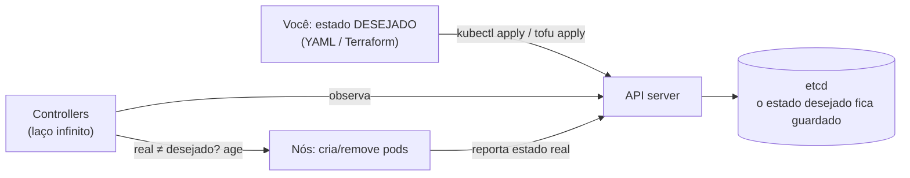
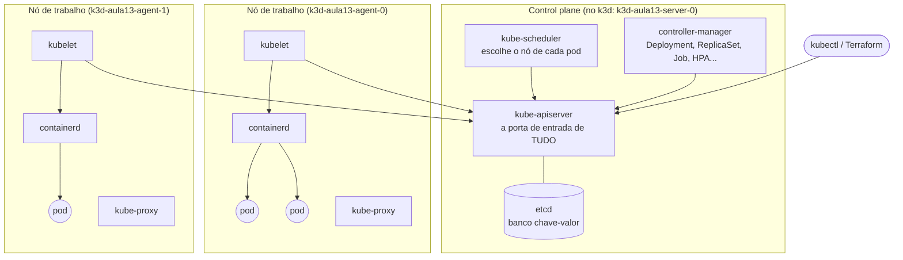
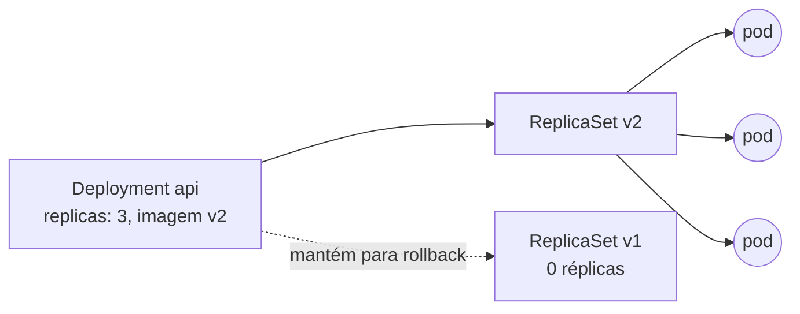
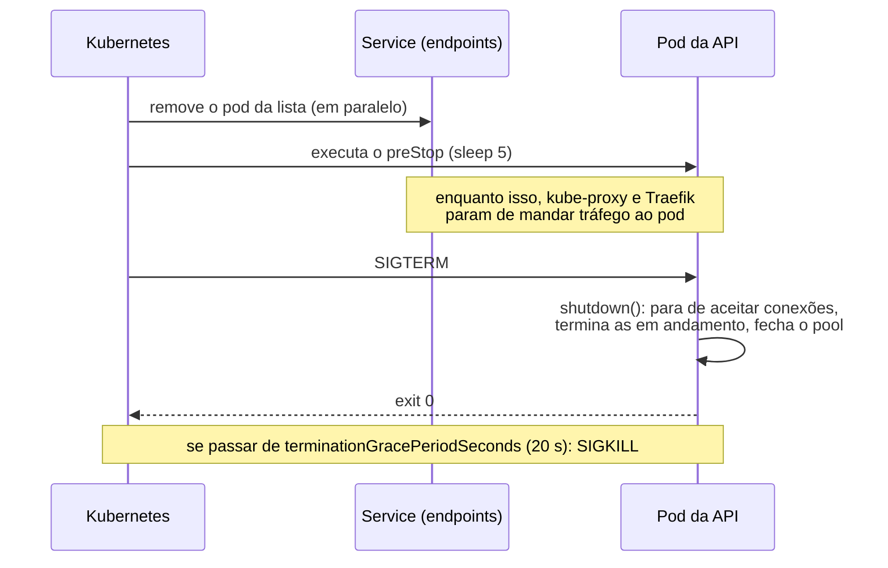

# Kubernetes: texto-base

> Leitura de apoio da [Aula 13](aula13.md). Os exemplos citam o projeto [`tarefas/`](tarefas/), que roda num Kubernetes local (k3d).

## 1. O problema que o Kubernetes resolve

Na Aula 12, o sistema rodou numa máquina só, com Docker Compose. O Compose descreve **quais contêineres** sobem e em que ordem, e para uma máquina ele basta. Os problemas começam quando o sistema precisa de mais de uma máquina, ou de mais de uma cópia da API:

| Pergunta | Docker Compose | Kubernetes |
| -------- | -------------- | ---------- |
| Em **qual máquina** cada contêiner roda? | Na única que existe | O *scheduler* escolhe, conforme CPU e memória livres |
| E se um contêiner **morrer**? | `restart: unless-stopped`, na mesma máquina | Recria o pod, em outra máquina se preciso |
| E se a **máquina** morrer? | Tudo cai | Os pods são recriados nos nós que sobraram |
| Como ter **N cópias** da API e dividir o tráfego? | `--scale api=3`, mas o nginx resolve o nome uma vez e fica preso a um contêiner (exercício 6 da Aula 12) | `Deployment` com `replicas: 3` + `Service`, que balanceia entre os pods **prontos** |
| E aumentar as cópias **sozinho** quando a carga sobe? | Não existe | `HorizontalPodAutoscaler` |
| Como trocar de versão **sem derrubar** nada? | `up -d` recria; há uma janela de indisponibilidade | *Rolling update*: sobe o novo, espera ficar pronto, derruba o antigo |

**Kubernetes** (abreviado *K8s*: K + 8 letras + s) é um **orquestrador de contêineres**. Você descreve o **estado desejado** ("quero 3 cópias desta imagem, cada uma com 250m de CPU, atrás deste endereço"), e ele trabalha sem parar para que o **estado real** fique igual. Nasceu no Google (inspirado no Borg, o sistema interno deles), foi aberto em 2014 e hoje é mantido pela CNCF (Cloud Native Computing Foundation).

## 2. A ideia central: declarativo + laço de reconciliação



Não existe um comando "crie mais um pod". Existe "o desejado agora é 4". Cada *controller* roda um laço que faz o mesmo, para sempre:

1. Lê o estado desejado (ex.: o Deployment diz `replicas: 4`).
2. Observa o estado real (há 3 pods rodando).
3. Age para aproximar os dois (cria 1 pod).

É por isso que, se você apagar um pod na mão (`kubectl delete pod api-xyz`), outro aparece em segundos: o desejado continua sendo 4. E é também por isso que um `kubectl scale` manual "briga" com quem mais declara o desejado, seja o HPA ou o Terraform (ver Aula 13, parte 6).

## 3. Arquitetura de um cluster



| Componente | Onde | Papel |
| ---------- | ---- | ----- |
| **kube-apiserver** | control plane | API REST que recebe e valida todos os pedidos. Nenhum outro componente fala direto com o etcd. |
| **etcd** | control plane | Banco chave-valor distribuído com todo o estado do cluster. Perder o etcd é perder o cluster. |
| **kube-scheduler** | control plane | Para cada pod sem nó, escolhe um nó com **requests** de CPU e memória livres. |
| **controller-manager** | control plane | Os laços de reconciliação (Deployment, ReplicaSet, Job, HPA, Node...). |
| **kubelet** | cada nó | Agente que recebe "rode este pod" e cuida dele: inicia contêineres e executa as *probes*. |
| **container runtime** | cada nó | Quem roda os contêineres de fato (containerd; o Docker não é mais usado dentro dos nós). |
| **kube-proxy** | cada nó | Programa regras de rede (iptables/IPVS) para que o IP de um `Service` chegue a algum pod. |

No **k3s** (a distribuição usada pelo k3d), tudo isso vem num binário só, e o etcd pode ser trocado por SQLite. Ele é leve o suficiente para rodar em contêineres na sua máquina, mas continua sendo um Kubernetes certificado: os mesmos manifestos funcionam num EKS (AWS), GKE (Google) ou AKS (Azure).

## 4. Os objetos principais

Tudo no Kubernetes é um **objeto** com `apiVersion`, `kind`, `metadata` (nome, namespace, *labels*) e `spec` (o desejado). O cluster preenche `status` (o real).

### 4.1 Pod

A menor unidade. É um ou mais contêineres que compartilham IP e volumes, e sempre rodam juntos no mesmo nó.

- **Pods são descartáveis.** Recebem um IP novo a cada recriação. Nunca guarde estado no sistema de arquivos de um pod, nem aponte para o IP dele.
- Você quase nunca cria um pod direto. Quem cria pods são os *controllers* abaixo.

### 4.2 Deployment (→ ReplicaSet → Pods)

O controller para aplicações **sem estado** (como a API e o nginx). Ele declara a imagem, quantas réplicas e como atualizar.



- Mudou a imagem? O Deployment cria um **ReplicaSet novo** e transfere os pods do antigo para o novo, aos poucos (*rolling update*). Os parâmetros `maxSurge` (quantos a mais) e `maxUnavailable` (quantos a menos) controlam o ritmo.
- `kubectl rollout undo deployment/api` volta para o ReplicaSet anterior.
- No projeto: [`infra/api.tf`](tarefas/infra/api.tf) e [`infra/web.tf`](tarefas/infra/web.tf).

### 4.3 Service

Os pods mudam de IP o tempo todo. O **Service** dá a eles um **nome DNS e um IP virtual estáveis**, e distribui as conexões entre os pods que estão **prontos** (*readiness*). Ele encontra os pods por **labels** (`selector: app=api`), não por nome.

| Tipo | Para quê |
| ---- | -------- |
| `ClusterIP` (padrão) | Acesso só de dentro do cluster. O `web` fala com `http://api:3000`. |
| *Headless* (`clusterIP: None`) | Sem IP virtual: o DNS devolve os IPs dos pods. Usado com StatefulSet (o `db`). |
| `NodePort` | Abre a mesma porta em todos os nós. |
| `LoadBalancer` | Pede um balanceador ao provedor de nuvem (no k3d, um contêiner faz esse papel). |

### 4.4 Ingress

A **porta de entrada HTTP** do cluster: regras por host e caminho (`/` → Service `web`). Quem executa as regras é um **Ingress controller** (Traefik no k3s, ingress-nginx, ou o balanceador do provedor de nuvem). No projeto: [`infra/ingress.tf`](tarefas/infra/ingress.tf). (O sucessor do Ingress é a *Gateway API*, mais expressiva; a ideia é a mesma.)

### 4.5 ConfigMap e Secret

Configuração fora da imagem (fator III do 12-factor, Aula 12). O **ConfigMap** guarda texto comum. O **Secret** guarda dados sensíveis.

> ⚠️ Um Secret é só **base64**, não criptografia. Quem tem permissão de leitura no namespace lê a senha. Proteções reais: RBAC restrito, criptografia do etcd em repouso, ou cofres externos (Vault, AWS Secrets Manager + External Secrets).

### 4.6 Namespace

Uma "pasta" lógica dentro do cluster: isola nomes, permissões (RBAC) e cotas. O projeto inteiro fica no namespace `tarefas`.

### 4.7 Job e CronJob

Para trabalho que **termina**: o Job roda até concluir com sucesso, com novas tentativas (`backoffLimit`). O **CronJob** cria Jobs num horário. No projeto, as **migrations** são um Job ([`infra/migrate.tf`](tarefas/infra/migrate.tf)), o equivalente ao serviço `migrate` *one-shot* do Compose.

### 4.8 StatefulSet, PersistentVolumeClaim e StorageClass

Para aplicações **com estado** (bancos, filas):

- Cada pod tem **identidade estável** (`db-0`, `db-1`...) e **o seu próprio volume**, que é religado a ele se o pod for recriado.
- **PersistentVolumeClaim (PVC)**: "preciso de 1 GiB, leitura e escrita por um nó". **StorageClass**: *como* o volume é criado (EBS na AWS, `local-path` no k3s). **PersistentVolume (PV)**: o volume que foi criado.
- No projeto: [`infra/postgres.tf`](tarefas/infra/postgres.tf).

> Rodar banco **em produção** dentro do Kubernetes é possível (com *operators* como CloudNativePG), mas exige cuidado com backup, failover e disco. Muitas equipes usam o banco gerenciado do provedor (RDS, Cloud SQL) e deixam no cluster só o que não tem estado.

### 4.9 DaemonSet

Um pod **em cada nó**: agentes de log, monitoramento, o próprio kube-proxy.

### 4.10 HorizontalPodAutoscaler (HPA)

Ajusta o `replicas` de um Deployment conforme uma métrica (CPU, memória ou métricas customizadas):

```
réplicas desejadas = ceil( réplicas atuais × valor atual / valor alvo )
```

Depende do **metrics-server**, que coleta CPU e memória dos pods. Os detalhes e os números medidos estão na [Aula 13, seção 5](aula13.md#5-hpa-o-autoscaler-horizontal).

## 5. Saúde: as três *probes*

| Probe | Pergunta | Se falhar | No projeto |
| ----- | -------- | --------- | ---------- |
| **liveness** | O processo está vivo? | O kubelet **reinicia** o contêiner | `/api/health` (não toca no banco) |
| **readiness** | Pode receber tráfego? | O pod **sai do Service** (não reinicia) | `/api/ready` (testa o banco) |
| **startup** | Já terminou de iniciar? | Adia as outras duas | (não usada: a API sobe em ~1 s) |

Liveness que depende do banco é um erro clássico: o banco cai, todas as APIs "morrem", o Kubernetes reinicia todas em loop, e a recuperação fica mais lenta. É a mesma distinção *health × ready* da Aula 12, agora com consequências automáticas.

## 6. Recursos: requests, limits e QoS

```yaml
resources:
  requests: { cpu: 250m, memory: 96Mi }   # o que é RESERVADO no nó
  limits:   { cpu: 500m, memory: 192Mi }  # o TETO
```

- **CPU** é medida em *millicores*: `1000m` = 1 núcleo, e `250m` = um quarto de núcleo.
- **requests** servem para o *scheduler* (o pod só vai para um nó com esse tanto livre) e são a **base do HPA** (60 % de 250m = 150m).
- **limits de CPU**: acima do teto o processo é **estrangulado** (*throttling*). Ele fica mais lento, mas não morre.
- **limits de memória**: acima do teto o processo é **morto** (`OOMKilled`) e reiniciado.
- **Classes de QoS**: `Guaranteed` (requests = limits), `Burstable` (requests < limits, o caso da API) e `BestEffort` (sem nada; é o primeiro a ser despejado quando o nó fica sem memória).

## 7. Labels e selectors: a "cola" do Kubernetes

Nada se liga por nome. Tudo se liga por **labels**:

```
Deployment api  --cria pods com-->  labels { app: api, version: v2 }
Service api     --selector-->       app = api          (todas as versões)
HPA api         --scaleTargetRef--> Deployment api
```

Durante um *rolling update*, pods `v1` e `v2` atendem juntos atrás do mesmo Service, porque ambos têm `app: api`.

## 8. O ciclo de vida de um pod que vai embora

O pod sai num scale-down do HPA, num deploy ou quando um nó é drenado:



Sem o `preStop`, o SIGTERM pode chegar **antes** de os balanceadores saberem que o pod saiu, e as requisições ainda roteadas para ele falham. Na Aula 13, um scale-down de 5 para 1 sob carga terminou com **0 erros** em 637 requisições.

## 9. Kubernetes na sua máquina: as distribuições locais

| Ferramenta | Como funciona | Prós | Contras |
| ---------- | ------------- | ---- | ------- |
| **k3d** (usada na aula) | k3s em contêineres Docker | Sobe em ~40 s; já traz metrics-server, Traefik, LB e local-path; cluster descrito em YAML | k3s, não o Kubernetes "upstream" puro |
| **kind** | Kubernetes oficial em contêineres | O mais fiel ao upstream; usado nos testes do próprio K8s | Exige instalar metrics-server (com `--kubelet-insecure-tls`) e um ingress |
| **minikube** | VM ou contêiner, com *addons* | Muitos addons, dashboard | Mais pesado e lento |
| **Docker Desktop** | Liga com um *checkbox* | Zero instalação | Sem metrics-server; configuração fora de arquivo |

> **Cuidado ao interpretar números:** no k3d, os "nós" são contêineres na **mesma** máquina. Os três dividem as mesmas CPUs, e cada um "acha" que tem todas. A escala horizontal entre nós de verdade traz ganhos de hardware que aqui não aparecem. Os mecanismos (scheduler, HPA, Service) são os mesmos.

## 10. Quando **não** usar Kubernetes

Kubernetes tem custo: curva de aprendizado, YAML (ou HCL), upgrades do cluster, rede, observabilidade e segurança. Para um sistema pequeno, com tráfego previsível e uma equipe pequena, as alternativas costumam ser melhores:

- Uma VM com Docker Compose (Aula 12), com deploy, backup e rollback bem feitos.
- PaaS: Render, Fly.io, Railway, Heroku, Google Cloud Run, AWS App Runner. Muitos escalam horizontalmente sem você ver um nó.

Kubernetes compensa quando há **muitos serviços**, **várias equipes**, necessidade de **autoscaling** e **resiliência a falhas de máquina**, ou portabilidade entre nuvens.

## 11. Cola de `kubectl`

```bash
kubectl config get-contexts                     # em qual cluster estou?
kubectl get nodes -o wide
kubectl -n tarefas get all                       # pods, services, deployments, replicasets, hpa
kubectl -n tarefas get pods -o wide -w          # -w = acompanhar mudanças
kubectl -n tarefas describe pod <nome>          # eventos: por que está Pending/CrashLoopBackOff?
kubectl -n tarefas logs -l app=api -f --prefix  # logs de TODOS os pods da API
kubectl -n tarefas exec -it db-0 -- psql -U tarefas
kubectl -n tarefas top pods                     # CPU/memória (metrics-server)
kubectl -n tarefas get hpa -w
kubectl -n tarefas get events --sort-by=.lastTimestamp
kubectl -n tarefas rollout status deploy/api
kubectl -n tarefas rollout history deploy/api
kubectl -n tarefas port-forward svc/api 3000:3000   # acessar um Service do seu computador
kubectl explain deployment.spec.strategy        # documentação de qualquer campo
```

**k9s** (`brew install k9s`) é um painel de terminal: `:pods`, `:hpa`, `:deploy`, `l` para logs e `d` para *describe*. Ótimo para projetar em aula.

## 12. Estados de pod que você vai encontrar

| Estado | Significa | Onde olhar |
| ------ | --------- | ---------- |
| `Pending` | Nenhum nó tem os **requests** livres, ou o volume não foi criado | `describe pod` → *Events* (`Insufficient cpu`) |
| `ContainerCreating` | Baixando a imagem ou montando volumes | `describe pod` |
| `ErrImagePull` / `ImagePullBackOff` | Imagem não encontrada (no k3d: faltou o `k3d image import`) | `describe pod` |
| `CrashLoopBackOff` | O contêiner inicia e morre repetidamente | `logs --previous` |
| `Running` mas `0/1` READY | A readiness falha (ex.: banco fora) | `describe pod`, `logs` |
| `OOMKilled` | Passou do limit de memória | `describe pod` → *Last State* |
| `Completed` | Job terminou com sucesso (o `migrate-v1`) | normal |
| `Terminating` | Saindo (preStop + SIGTERM em andamento) | normal no scale-down |

## 13. Glossário rápido

**Cluster**: conjunto de nós gerenciados juntos. **Nó**: máquina (física, VM ou, no k3d, contêiner) que roda pods. **Control plane**: os componentes que decidem. **Manifesto**: a descrição de um objeto (YAML, ou gerada pelo Terraform). **Reconciliação**: o laço que aproxima o real do desejado. **Rolling update**: troca gradual de versão. **Réplica**: cópia idêntica de um pod. **Probe**: verificação periódica de saúde. **Request/limit**: reserva e teto de recursos. **Ingress controller**: o proxy que executa as regras de Ingress. **Operator**: um controller customizado que sabe operar um software específico (ex.: um banco). **Helm**: gerenciador de "pacotes" (charts) de manifestos. **CNCF**: fundação que mantém o Kubernetes e o ecossistema.

## Para ir além

- Documentação oficial, em português: <https://kubernetes.io/pt-br/docs/concepts/>
- Tutorial interativo oficial: <https://kubernetes.io/pt-br/docs/tutorials/kubernetes-basics/>
- k3d: <https://k3d.io> · k3s: <https://docs.k3s.io>
- HPA (algoritmo e `behavior`): <https://kubernetes.io/docs/tasks/run-application/horizontal-pod-autoscale/>
