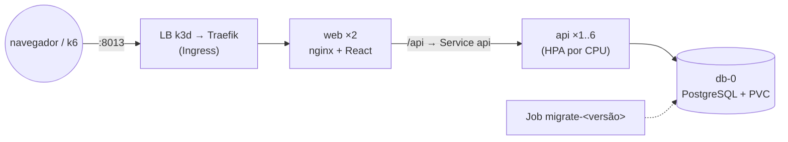

# Aula 13 — Tarefas no Kubernetes: escala horizontal com Terraform e k6

O sistema da [Aula 12](../../Aula12/tarefas/) (PostgreSQL + API Node/Express + front React servido por nginx), agora num **Kubernetes local (k3d)**, com toda a infraestrutura em **Terraform/OpenTofu** e a API escalando sozinha (**HPA**) durante um **teste de carga (k6)**.



Material da aula: [`../aula13.md`](../aula13.md) · textos-base: [Kubernetes](../kubernetes.md) e [Infra como Código](../infra-como-codigo.md).

## Pré-requisitos

| Ferramenta | Para quê | Instalação |
| ---------- | -------- | ---------- |
| Docker (Desktop, OrbStack, Colima...) | Os nós do cluster são contêineres | <https://docs.docker.com/get-docker/> |
| `kubectl` | Falar com o cluster | `brew install kubectl` · `winget install Kubernetes.kubectl` |
| `k3d` ≥ 5.8 | Criar o cluster | `brew install k3d` · `winget install k3d` · `curl -s https://raw.githubusercontent.com/k3d-io/k3d/main/install.sh \| bash` |
| OpenTofu ≥ 1.6 (ou Terraform) | Infra como código | `brew install opentofu` · `winget install OpenTofu.Tofu` · <https://opentofu.org/docs/intro/install/> |
| `k9s` (opcional) | Painel de terminal | `brew install k9s` |

Node só é necessário para rodar os testes fora do Docker. O k6 roda num contêiner (`grafana/k6`).

Recursos: o cluster ocioso usa ~1 GB de RAM; no pico da carga (6 pods de API + k6), ~3–4 núcleos.

## Do zero ao teste de carga

```bash
cd Aula13/tarefas
cp .env.example .env              # senha do banco (letras e números)

scripts/cluster-up.sh             # cria o cluster aula13 (1 server + 2 agents) e espera o metrics-server
scripts/deploy.sh v1              # build (com testes) → k3d image import → tofu apply → smoke test
open http://localhost:8013

scripts/observar.sh               # OUTRO terminal: HPA, pods, CPU, nós (ou: k9s -n tarefas)

scripts/cenario.sh sem-hpa        # 1 pod fixo
scripts/carga.sh                  # → falha: p95 ≈ 10 s, ~9 % de erros

scripts/cenario.sh hpa-agressivo  # HPA 1–6 pods, scale-down em 30 s
scripts/carga.sh                  # → passa: 1 → 5 pods, p95 ≈ 43 ms, 0 erros

scripts/cluster-down.sh           # apaga o cluster e o state do Terraform
```

## Scripts

| Script | O que faz |
| ------ | --------- |
| `cluster-up.sh` / `cluster-down.sh` | Cria/apaga o cluster k3d ([`cluster/k3d.yaml`](cluster/k3d.yaml)). O *down* apaga também o state. |
| `deploy.sh [tag]` | 1 build das imagens (os testes rodam no build) → 2 `k3d image import` → 3 `tofu apply` (migrations → API → web) → 4 smoke test → 5 registra a versão. Rollback automático se 3 ou 4 falhar. |
| `rollback.sh [tag]` | `tofu apply` com a versão anterior (segundos: as imagens já estão no cluster). |
| `cenario.sh [nome]` | Aplica um cenário de [`infra/cenarios/`](infra/cenarios/) sem rebuild. Sem argumento, mostra o ativo. |
| `tf.sh <args>` | `tofu`/`terraform` em `infra/` com a senha do `.env` carregada: `scripts/tf.sh plan`, `output`, `state list`... |
| `carga.sh` | k6 numa rede do k3d, entrando pelo LB como um usuário. Ajustes: `PICO` (req/s, padrão 60), `PLATO` (2m), `RAMPA` (30s). |
| `observar.sh` | Painel atualizado a cada 2 s (`INTERVAL=1` para mais rápido). |
| `quem-responde.sh [n]` | Conta qual pod respondeu cada uma de *n* requisições (cabeçalho `X-Instance`). |

Os scripts usam `tofu` se existir e `terraform` caso contrário (force com `TF=terraform`). No Windows, rode-os no **WSL 2** (no Git Bash, os caminhos dos `docker run -v` costumam quebrar).

## Parâmetros da infraestrutura ([`infra/variables.tf`](infra/variables.tf))

| Variável | Padrão | Para quê |
| -------- | ------ | -------- |
| `image_tag` | — | Versão das imagens (o `deploy.sh` grava em `versao.auto.tfvars`) |
| `db_password` | — | Vem de `TF_VAR_db_password` (os scripts leem `POSTGRES_PASSWORD` do `.env`) |
| `hpa_enabled` | `true` | Liga o autoscaler. Desligado, vale `api_replicas`. |
| `api_replicas` | `1` | Réplicas fixas (sem HPA) |
| `hpa_min` / `hpa_max` | `1` / `6` | Limites do autoscaler |
| `hpa_cpu_target` | `60` | % do *request* de CPU que o HPA tenta manter |
| `hpa_scale_up_window` / `hpa_scale_down_window` | `0` / `300` | Janelas de estabilização (s) |
| `api_cpu_request` / `api_cpu_limit` | `250m` / `500m` | Reserva e teto de CPU por pod |
| `api_memory_request` / `api_memory_limit` | `96Mi` / `192Mi` | Reserva e teto de memória |
| `db_pool_max` | `10` | Conexões por pod. Uma `precondition` exige réplicas máximas × pool ≤ `db_max_connections` − 5. |
| `db_max_connections` | `100` | `max_connections` do Postgres |
| `report_cpu_cost` | `200000` | Iterações do PBKDF2 em `/api/tasks/report` (≈ 19 ms de CPU) |
| `web_replicas` | `2` | Réplicas do nginx |
| `kube_context` | `k3d-aula13` | Contexto do `~/.kube/config` |

Ordem de precedência: `default` < `TF_VAR_*` < `terraform.tfvars` < `*.auto.tfvars` (cenário e versão) < `-var`/`-var-file`.

## Estrutura

```
tarefas/
├── cluster/k3d.yaml          # o cluster como código
├── infra/                    # Terraform: namespace, postgres, migrate (Job), api, hpa, web, ingress
│   ├── variables.tf          # TODOS os parâmetros, com validação
│   ├── terraform.tfvars      # base versionada (sem segredos)
│   ├── cenarios/             # sem-hpa · hpa · hpa-agressivo
│   └── .terraform.lock.hcl   # versões exatas dos providers (versionado)
├── carga/escala.js           # k6: ramping-arrival-rate, 60% relatório / 30% lista / 10% escrita
├── scripts/                  # cluster, deploy, rollback, cenário, carga, observar...
├── api/  web/  e2e/          # aplicação da Aula 12 + /api/tasks/report + X-Instance
├── docker-compose.yml        # o mesmo sistema SEM Kubernetes (dev), em http://localhost:8091
└── docker-compose.test.yml   # testes de integração com Postgres real
```

## Testes

| Camada | Como rodar |
| ------ | ---------- |
| Unitários (API) | `cd api && npm ci && npm run test:unit` |
| Componente (web) | `cd web && npm ci && npm test` |
| Integração (API + Postgres) | `docker compose -f docker-compose.test.yml up --build --abort-on-container-exit --exit-code-from api-test` |
| Smoke (pós-deploy) | automático no `deploy.sh`; à mão: `BASE_URL=http://localhost:8013 node --test e2e/smoke.test.mjs` |
| Carga | `scripts/carga.sh` (thresholds: p95 do relatório < 500 ms, da lista < 300 ms, erros < 1 %) |
| Infra | `cd infra && tofu fmt -check && tofu validate` |

## Medições (nesta máquina: Apple Silicon, Docker com 8 núcleos / 8 GB)

| | Resultado |
| - | --------- |
| `cluster-up.sh` | ~45 s (com imagens já baixadas) |
| `deploy.sh v1` (primeiro) | ~50 s · smoke 6/6 |
| Custo do relatório | ~19 ms de CPU (PBKDF2, 200 mil iterações) |
| 1 pod, pico 40 req/s | passa · p95 relatório 162 ms · CPU 450–474m (teto 500m) |
| 1 pod, pico 60 req/s | **falha** · p95 10 s (timeout) · 9,2 % de erros · 638 iterações descartadas |
| HPA, pico 60 req/s | **passa** · 1 → 2 → 4 → 5 pods em ~75 s · p95 relatório 43 ms · 0 % de erros |
| Deploy v2 durante a carga | 0 erros em 12.433 requisições |
| Scale-down 5 → 1 (janela 30 s) com 6 req/s | ~50 s · 0 erros em 637 requisições |
| `tofu plan` com 5 pods criados pelo HPA | *No changes* |

## Problemas comuns

| Sintoma | Causa provável |
| ------- | -------------- |
| `port is already allocated` no `cluster-up` | Algo já usa a 8013. Troque em `cluster/k3d.yaml` (e nos scripts). |
| HPA com `TARGETS <unknown>` | O metrics-server ainda está coletando (~1 min após subir), ou o pod não tem *request* de CPU. |
| Pod `ErrImagePull` | A imagem não foi importada no cluster: use o `deploy.sh` (ele faz `k3d image import`). |
| `Error: Kubernetes cluster unreachable` | O cluster está parado (`k3d cluster start aula13`) ou o contexto está errado. |
| `tofu plan` quer recriar tudo depois de recriar o cluster | State velho: rode `scripts/cluster-down.sh` (apaga o state) antes de recriar. |
| k6: `Insufficient VUs` | O sistema está lento demais para a taxa pedida (é o próprio resultado do teste). |
