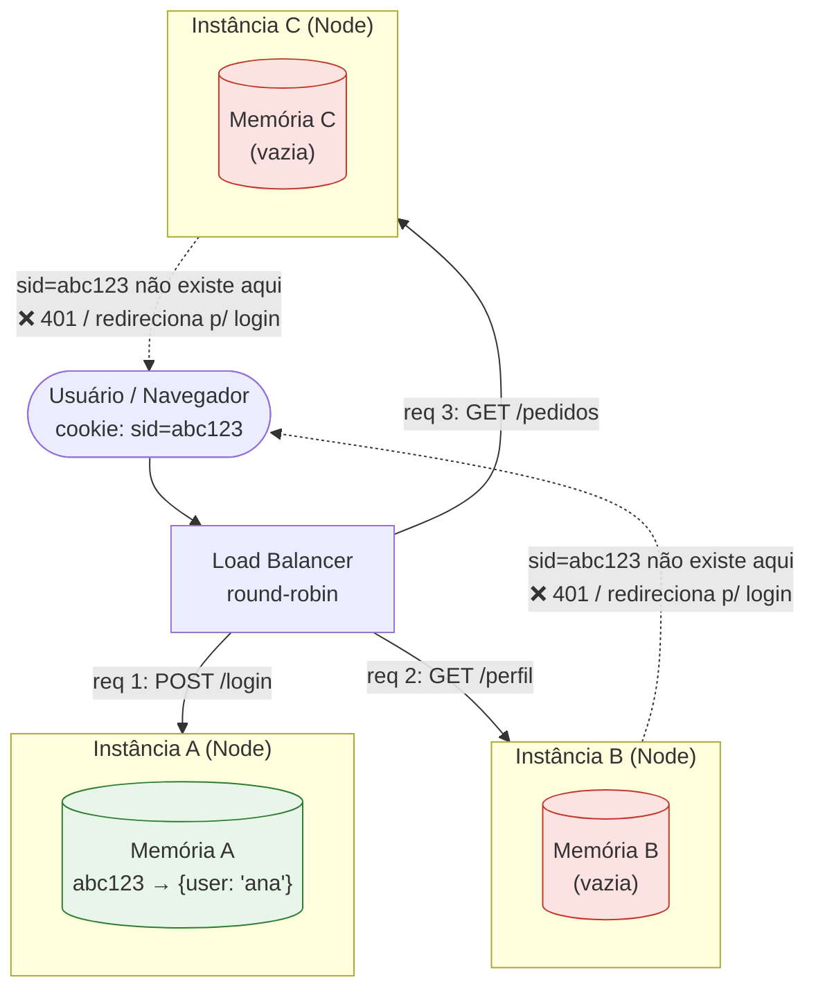
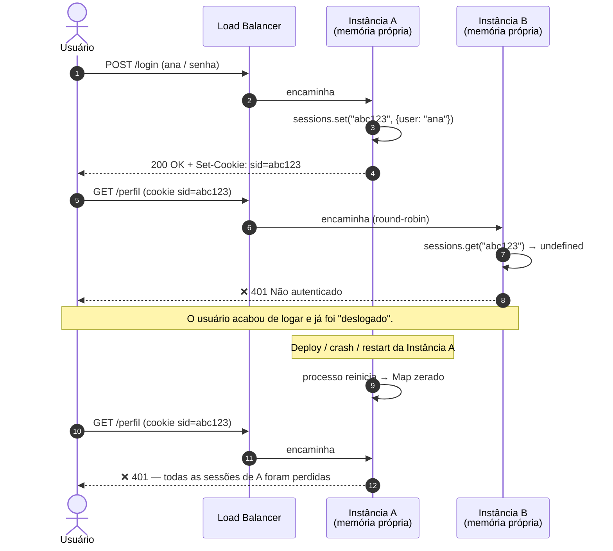
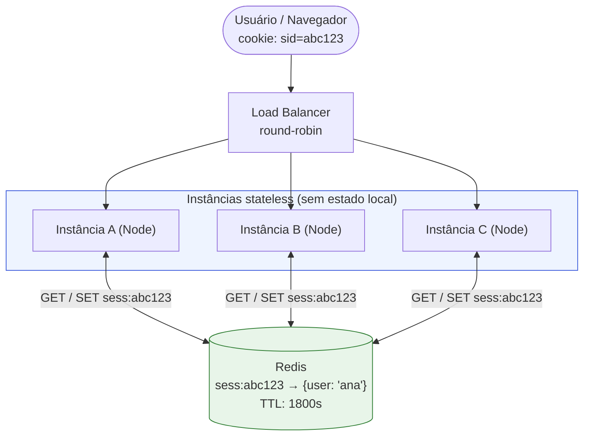
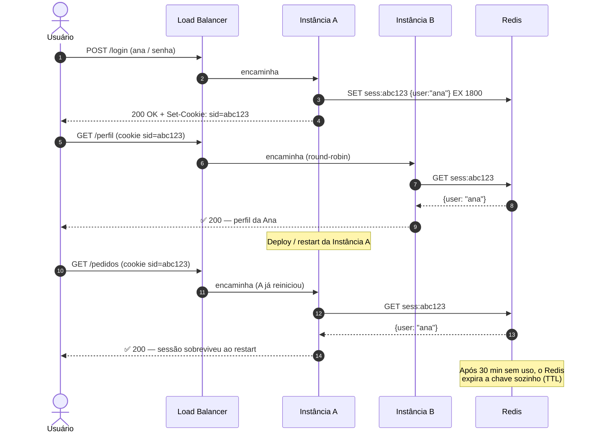

# Sessões em memória x Sessões no Redis

Quando uma aplicação web guarda a sessão do usuário (quem está logado, carrinho, permissões), ela precisa decidir **onde** esse estado fica. As duas opções mais comuns são:

1. **Em memória**: um `Map`/objeto dentro do processo Node (é o `MemoryStore` padrão do `express-session`).
2. **Em um store externo compartilhado**: o Redis, que todas as instâncias da aplicação acessam.

Com uma instância só, as duas parecem iguais. A diferença aparece quando a aplicação **escala**, **reinicia** ou **cresce**.

---

## 1. Arquitetura SEM Redis (sessão em memória)



Cada instância tem **sua própria memória**. A sessão criada na instância A só existe lá dentro. As outras instâncias não a enxergam.

### O que acontece na prática



---

## 2. Arquitetura COM Redis (sessão compartilhada)





O estado sai de dentro do processo e vai para um lugar **compartilhado**. As instâncias passam a ser **stateless**: qualquer uma atende qualquer requisição.

---

## 3. Pontos fracos de NÃO usar Redis (sessão em memória)

### 🔴 3.1 Não escala horizontalmente
Com duas ou mais instâncias atrás de um load balancer, a sessão só existe na instância que fez o login. As próximas requisições caem em outras instâncias e o usuário aparece como **não autenticado**. Subir mais réplicas (Kubernetes, PM2 cluster, Docker Swarm) **quebra o login**.

### 🔴 3.2 Sessões são perdidas a cada restart, deploy ou crash
A memória do processo é volátil. Qualquer um destes eventos **desloga todos os usuários** daquela instância:
- deploy de nova versão;
- `nodemon`/`pm2 restart`;
- crash por exceção não tratada;
- o orquestrador matando o container (OOM, health check, autoscaling para baixo).

### 🔴 3.3 Vazamento de memória e risco de OOM
Cada sessão ocupa RAM **do mesmo processo que atende as requisições**. Sem uma limpeza eficiente, sessões expiradas se acumulam:
- a memória cresce sem parar, até o processo ser morto por falta de memória (*Out Of Memory*);
- o Garbage Collector passa a trabalhar mais, e **a latência de todas as rotas aumenta**;
- um atacante pode criar milhares de sessões (ex.: requisições sem cookie) e **derrubar o servidor** (DoS por exaustão de memória).

> A própria documentação do `express-session` avisa: o `MemoryStore` *"is purposely not designed for a production environment. It will leak memory under most conditions, does not scale past a single process"*.

### 🔴 3.4 Expiração (TTL) precisa ser implementada na mão
Em memória, é você que precisa criar um `setInterval` para varrer e remover sessões vencidas. Isso consome CPU do event loop e é fácil de errar. No Redis, `EX`/`EXPIRE` faz isso de forma nativa e eficiente.

### 🔴 3.5 Sticky sessions: um remendo, não uma solução
O contorno comum é configurar o load balancer com *sticky sessions* (afinidade: o mesmo usuário sempre vai para a mesma instância). Isso traz novos problemas:
- **distribuição de carga desigual**: uma instância pode ficar sobrecarregada enquanto outras ficam ociosas;
- **se a instância cair, os usuários "grudados" nela perdem a sessão** do mesmo jeito;
- o autoscaling fica pior: remover uma instância desloga seus usuários;
- deixa o load balancer mais complexo e acoplado à aplicação.

### 🔴 3.6 Impossível invalidar sessões de forma global
Casos como "deslogar de todos os dispositivos", "bloquear usuário agora" ou "trocou a senha, encerrar sessões antigas" exigem achar a sessão **em todas as instâncias**. Com memória local, cada processo só conhece as próprias sessões. Com Redis, basta um `DEL` (ou apagar um conjunto de chaves do usuário).

### 🔴 3.7 Sem visibilidade nem operação
Não dá para responder perguntas simples como "quantos usuários estão logados agora?" ou "qual o conteúdo da sessão X?" sem criar rotas de debug em cada instância. No Redis: `KEYS sess:*` (ou `SCAN`), `TTL sess:abc123`, `GET sess:abc123`.

### 🔴 3.8 Acopla o estado ao ciclo de vida do processo
A aplicação deixa de ser **stateless** e passa a violar um dos princípios do [12-Factor App](https://12factor.net/pt_br/processes) (*"processos são stateless e não compartilham nada; dados que precisam persistir devem ficar em um serviço de apoio"*). Isso dificulta deploy *blue/green*, *rolling update* e o uso de serverless.

---

## 4. Comparativo rápido

| Critério                              | Sessão em memória                  | Sessão no Redis                          |
|---------------------------------------|------------------------------------|------------------------------------------|
| Várias instâncias / load balancer     | ❌ Quebra (ou exige sticky session) | ✅ Qualquer instância atende              |
| Sobrevive a restart/deploy            | ❌ Perde tudo                       | ✅ Mantém (Redis é externo)               |
| Uso de memória da aplicação           | ❌ Cresce com o nº de usuários      | ✅ Fica fora do processo Node             |
| Expiração automática (TTL)            | ⚠️ Manual, com `setInterval`        | ✅ Nativa (`EXPIRE`)                      |
| Logout global / revogar sessões       | ❌ Só na instância local            | ✅ `DEL` em um lugar só                   |
| Observabilidade                       | ❌ Escondida dentro do processo     | ✅ `SCAN`, `TTL`, `GET` via `redis-cli`   |
| Latência de leitura                   | ✅ Nanossegundos (local)            | ⚠️ ~sub-milissegundo (rede)               |
| Infraestrutura extra                  | ✅ Nenhuma                          | ⚠️ Precisa operar um Redis                |
| Indicado para                         | Desenvolvimento local, protótipos  | Produção                                 |

---

## 5. Na prática: trocando o store no Express

**Sem Redis** (padrão, `MemoryStore`):

```ts
import session from "express-session";

app.use(
  session({
    secret: process.env.SESSION_SECRET!,
    resave: false,
    saveUninitialized: false,
    // nenhum "store" → usa MemoryStore (só serve para desenvolvimento)
  })
);
```

**Com Redis** (`connect-redis`):

```ts
import session from "express-session";
import { RedisStore } from "connect-redis";
import { createClient } from "redis";

const redisClient = createClient({ url: process.env.REDIS_URL });
await redisClient.connect();

app.use(
  session({
    store: new RedisStore({ client: redisClient, prefix: "sess:" }),
    secret: process.env.SESSION_SECRET!,
    resave: false,
    saveUninitialized: false,
    cookie: { maxAge: 30 * 60 * 1000, httpOnly: true, secure: true },
  })
);
```

O código das rotas **não muda**: `req.session.user` continua funcionando igual. Só troca o lugar onde o estado é guardado. É o mesmo raciocínio de portas e adaptadores visto nas aulas anteriores.

---

## 6. E o Redis não tem pontos fracos?

Tem, e eles precisam ser tratados:

- **Vira dependência crítica**: se o Redis cair, ninguém consegue se autenticar. Mitigação: réplica + Sentinel ou Redis Cluster, ou um serviço gerenciado.
- **Latência de rede** em toda requisição autenticada. Na prática é baixa (sub-milissegundo na mesma rede), mas existe.
- **Persistência**: por padrão o Redis guarda tudo em memória. Configure RDB/AOF se perder sessões em um restart do Redis for inaceitável.
- **Segurança**: o Redis não deve ficar exposto na internet. Use senha/ACL, TLS e rede privada.

Mesmo com esses pontos, o problema muda de natureza: deixa de ser **"a arquitetura não escala"** e passa a ser **"preciso operar bem um serviço"**, que é um problema conhecido e bem resolvido.
